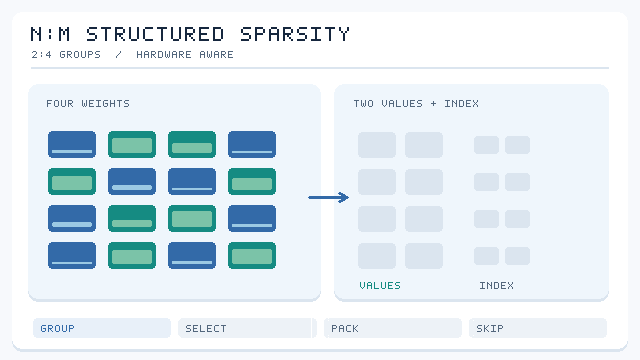

# N:M 細緻結構化稀疏

N:M 稀疏在每 \(M\) 個連續權重的區塊中，最多保留 \(N\) 個非零值。最著名的模式是 2:4，即每四個權重保留兩個。它的細緻程度足以保留非結構化[剪枝](../index.zh-TW.md)的大部分準確度，同時規律到硬體可以跳過零值，因此已成為加速器的標準模式。

## 概述

非結構化稀疏可以移除許多權重，但零值位置不規則，在稠密硬體上幾乎無法加速。結構化稀疏移除整個通道，速度快但粒度粗。N:M 模式介於兩者之間：在每個小區塊內，非零值的位置遵循固定的規則，因此硬體可以把壓縮後的值與一個小索引一起儲存，並在計算時跳過零值。

*原創概念動畫，CC BY-SA 4.0。* 此範例在**每組四個權重**中保留**絕對值最大的兩個**，其餘設為零，再將保留值及位置索引打包。支援 2:4 稀疏矩陣乘法的硬體可跳過零值運算，但**非零權重減少 50% 不代表端到端推論一定加速兩倍**。圖中數值與硬體脈衝皆為示意，不是效能實測。參見 [Mishra 等人（2021）](https://arxiv.org/abs/2104.08378)。

## 關鍵概念

- **模式**：\(N\):\(M\) 的規則。2:4 模式保留一半權重，其他模式如 1:4 或 4:8 也有研究。
- **稀疏張量核心**：近期的 NVIDIA GPU 以硬體實作 2:4 模式，以壓縮格式儲存非零值與其位置。
- **依模式訓練**：N:M 剪枝可以在訓練後進行，也可以在訓練中進行，模式甚至可以從一開始就施加。
- **區塊大小的取捨**：較大的區塊讓選擇保留哪些權重時更有彈性，但硬體支援更困難。

## 各重要方法比較

| 方法 | 何時施加模式 | 頁面 |
| --- | --- | --- |
| 從頭學習 N:M | 訓練中，從第一步開始 | [從頭學習 N:M](learning-n-m-from-scratch/index.zh-TW.md) |
| 稀疏張量核心 | 訓練後，再微調到 2:4 模式 | [稀疏張量核心](sparse-tensor-cores/index.zh-TW.md) |

第一個方法問的是：如果從一開始就施加模式，是否會損失準確度。第二個方法說明硬體與流程，讓這個模式在實務上變快。

## 取捨

- **速度與彈性**：2:4 模式提供固定的 50% 稀疏度，並有硬體支援，但在高稀疏度下不如非結構化稀疏靈活。
- **準確度**：在有支援的硬體上，細緻模式在相同速度下比通道剪枝保留更多準確度。
- **硬體綁定**：這個模式只在有支援的地方才快，因此選擇取決於可用的[加速器](../../../../engineering/hardware/index.zh-TW.md)。

## 更多變體與開放問題

- **開放問題**：未來硬體能否支援更大區塊或不同 \(N\) 與 \(M\) 的 N:M 模式，同時保留加速效果。
- **開放問題**：N:M 稀疏如何與量化結合，因為壓縮格式必須同時攜帶稀疏與降低的精度；見[量化](../../quantisation/index.zh-TW.md)。
- **變體**：[結構化剪枝](../structured-pruning/index.zh-TW.md)，移除整個通道，不需特殊硬體。

## 相關連結

N:M 稀疏是硬體設計塑造壓縮方法的最清楚例子。裝置的[記憶體層級](../../../../engineering/hardware/index.zh-TW.md)決定壓縮格式能節省多少頻寬，這也決定了該模式在實務上是否划算。

## 參考文獻

### 開創性論文

- Zhou, A., 等人 (2021). *Learning N:M Fine-grained Structured Sparse Neural Networks From Scratch*. arXiv:2102.04010. https://arxiv.org/abs/2102.04010 — 從頭以 2:4 模式訓練網路，在 A100 GPU 上報告 2 倍加速且沒有準確度損失。
- Mishra, A., 等人 (2021). *Accelerating Sparse Deep Neural Networks*. arXiv:2104.08378. https://arxiv.org/abs/2104.08378 — 說明稀疏張量核心執行的 2:4 模式，數學吞吐量為兩倍。
- Han, S., Pool, J., Tran, J., Dally, W. J. (2015). *Learning both Weights and Connections for Efficient Neural Networks*. arXiv:1506.02626. https://arxiv.org/abs/1506.02626 — 非結構化剪枝，是 N:M 稀疏所權衡的對象。

### 綜述與教科書

- Hoefler, T., 等人 (2021). *Sparsity in Deep Learning: Pruning and Growth for Efficient Inference and Training in Neural Networks*. arXiv:2102.00554. https://arxiv.org/abs/2102.00554 — 綜述稀疏模式及其硬體實作。
- Gale, T., Elsen, E., Hooker, S. (2019). *The State of Sparsity in Deep Neural Networks*. arXiv:1902.09574. https://arxiv.org/abs/1902.09574 — 比較各方法的稀疏準確度成本。

### 講座與影片

（本頁尚未查核任何項目）

### 文章與文件

（本頁尚未查核任何項目）
