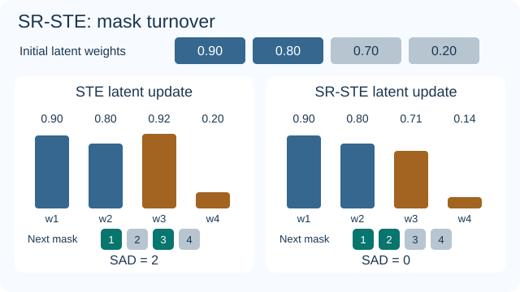

# Learning N:M Sparse Networks from Scratch

Learning N:M sparse networks from scratch trains a network with the N:M constraint from the first step, rather than pruning a dense network to the pattern afterwards. Zhou et al. showed that the pattern can be kept throughout training without losing accuracy, and reported a 2 times speed-up for a 2:4 sparse network on NVIDIA A100 GPUs. It is a method within [N:M sparsity](../index.md).

## Problem

N:M sparsity is hardware friendly, but it was unclear whether networks can be trained with the pattern from scratch without losing accuracy. Pruning to the pattern after training is one option, but it discards the weights that the pattern removes before they can adapt.

## Core idea

Enforce the N:M constraint during training, so that the weights and their selection evolve together under the pattern. The network never has to recover from a one-off cut to the pattern.

### Visual walkthrough: latent weights and mask turnover

[GitHub-readable fallback](../../../../../assets/concept-animations/nm-sr-ste-mask-turnover-still.svg) · [Full 12-second animation](../../../../../assets/concept-animations/nm-sr-ste-mask-turnover-motion.svg)

On MkDocs, use Play/Pause (Enter or Space) to inspect the changes. GitHub and reduced-motion readers see the static comparison. Original diagram, **CC BY-SA 4.0**.

The forward pass uses $\widetilde w=m\odot w$, retaining the two largest-magnitude latent weights in each group of four. The latent vector $w$ is updated using the straight-through gradient $g=\nabla_{\widetilde w}L$. Zhou et al. (2021, Sections 3.2–3.3) introduce the sparse-refined update

$
w^+=w-\eta[g+\lambda(1-m)\odot w].
$

The additional term suppresses the magnitude of weights masked in the current forward pass without permanently freezing them. In this schematic one-block example, $w=(0.9,0.8,0.7,0.2)$, $m=(1,1,0,0)$, $g=(0,0,-0.22,0)$ and $\eta=1$. The bars show the latent weights, blue for initially retained positions and amber for initially masked positions. They interpolate between the two endpoints for explanation, not to depict multiple SGD iterations. The green boxes show the next forward mask.

| Update | Next latent weights | Next mask | SAD |
| --- | --- | --- | --- |
| STE ($\lambda=0$) | (0.90, 0.80, 0.92, 0.20) | (1, 0, 1, 0) | 2 |
| SR-STE ($\lambda=0.3$) | (0.90, 0.80, 0.71, 0.14) | (1, 1, 0, 0) | 0 |

Sparse Architecture Divergence (SAD) is $\|m^+-m\|_1$: one exchanged connection changes two binary positions. Both forward masks retain exactly two positions. A sufficiently large opposing task gradient can still change the mask under SR-STE; stability is encouraged, not guaranteed. The unusually large illustrative regularisation and learning rate make a single update visible; they are **not** the paper's experimental settings or model measurements. See [Zhou et al. (2021), Eq. 4](https://arxiv.org/abs/2102.04010).

### When does the mask change?

Hold the first two latent weights fixed and replace the third gradient by $-u$, with $u\geq0$ and $0\leq\lambda\leq1$. The fourth weight remains below both initially active weights. The third becomes $0.7+u-0.7\lambda$; it enters the top two precisely when

$
u>0.1+0.7\lambda.
$

At equality the next mask depends on the tie-breaking rule. The illustrated $u=0.22$ causes turnover at $\lambda=0$ but not at $\lambda=0.3$ (threshold 0.31). At $u=0.4$ even $\lambda=0.3$ allows turnover. This is a one-step threshold for this block, not a universal stability guarantee or a recommended training coefficient.

## Equation or algorithm

Within each block of \(M\) weights, at most \(N\) may be non-zero. The method keeps this constraint throughout training, and the choice of which weights are non-zero is updated as the weights change. The exact update rule is in the paper.

## Results

The abstract states that a 2:4 sparse network could achieve a 2 times speed-up without performance drop on NVIDIA A100 GPUs.

## Limitations

The reported speed-up is for the matrix multiplications that the hardware accelerates, not for the whole model. The experiments are on the networks of the time.

## Open issues and related variants

- **Larger blocks.** Whether training from scratch works for patterns with larger blocks, such as 4:8, is less studied.
- **Related:** [sparse tensor cores](../sparse-tensor-cores/index.md) describe the hardware and the pruning workflow for the 2:4 pattern.

## Connections

The pattern is an example of a method shaped by hardware design, and its benefit depends on the [memory hierarchy](../../../../../engineering/hardware/index.md) and the matrix units of the target device.

## References

### Seminal papers

- Zhou, A., et al. (2021). *Learning N:M Fine-grained Structured Sparse Neural Networks From Scratch*. arXiv:2102.04010. https://arxiv.org/abs/2102.04010 — Trains networks with the 2:4 pattern from scratch, with a 2 times speed-up on A100 GPUs.
- Mishra, A., et al. (2021). *Accelerating Sparse Deep Neural Networks*. arXiv:2104.08378. https://arxiv.org/abs/2104.08378 — Describes the 2:4 pattern that sparse tensor cores execute.
- Han, S., Pool, J., Tran, J., Dally, W. J. (2015). *Learning both Weights and Connections for Efficient Neural Networks*. arXiv:1506.02626. https://arxiv.org/abs/1506.02626 — Unstructured pruning, the pattern that N:M sparsity trades off against.

### Surveys and textbooks

- Hoefler, T., et al. (2021). *Sparsity in Deep Learning: Pruning and Growth for Efficient Inference and Training in Neural Networks*. arXiv:2102.00554. https://arxiv.org/abs/2102.00554 — Surveys sparsity patterns and their hardware implications.

### Lectures and videos

(none checked for this page)

### Articles and documentation

- Gale, T., Elsen, E., Hooker, S. (2019). *The State of Sparsity in Deep Neural Networks*. arXiv:1902.09574. https://arxiv.org/abs/1902.09574 — Benchmarks the accuracy cost of sparsity across methods.
