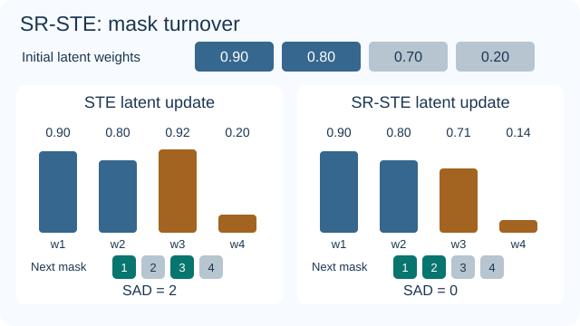

# 從頭學習 N:M 稀疏網路

從頭學習 N:M 稀疏網路，是從第一步開始就在訓練中施加 N:M 限制，而不是先訓練稠密網路、之後再剪成該模式。Zhou 等人顯示，模式可以在整個訓練過程中維持而不損失準確度，並報告 2:4 稀疏網路在 NVIDIA A100 GPU 上有 2 倍加速。它是 [N:M 稀疏](../index.zh-TW.md)中的一種方法。

## 問題

N:M 稀疏對硬體友善，但不清楚能否從頭以這個模式訓練網路而不損失準確度。訓練後再剪成模式是一種選擇，但被剪掉的權重在能調整之前就已移除。

## 核心想法

在訓練期間施加 N:M 限制，使權重與它們的選擇一起在模式下演變。網路從不需要從一次性剪到模式的衝擊中恢復。

### 動畫解讀：潛在權重與遮罩更替

[GitHub 靜態預覽](../../../../../assets/concept-animations/nm-sr-ste-mask-turnover-still.svg) · [完整 12 秒動畫](../../../../../assets/concept-animations/nm-sr-ste-mask-turnover-motion.svg)

在 MkDocs 使用播放／暫停（Enter 或空白鍵）檢視變化；GitHub 與減少動態效果模式使用靜態比較圖。原創示意圖，**CC BY-SA 4.0**。

前向傳播使用 $\widetilde w=m\odot w$，每四個潛在權重保留絕對值最大的兩個。潛在向量 $w$ 以直通估計梯度 $g=\nabla_{\widetilde w}L$ 更新。Zhou 等人（2021，第 3.2–3.3 節）提出稀疏修正更新：

$
w^+=w-\eta[g+\lambda(1-m)\odot w].
$

額外項抑制目前前向傳播中被遮罩的權重幅度，但不會永久凍結它們。本示意算例只有一個區塊，令 $w=(0.9,0.8,0.7,0.2)$、$m=(1,1,0,0)$、$g=(0,0,-0.22,0)$、$\eta=1$。長條呈現潛在權重，藍色代表起初保留的位置，琥珀色代表起初被遮罩的位置。長條在兩個端點間插值以利解讀，並非多次 SGD 更新；綠色方格表示下一次前向傳播的遮罩。

| 更新方式 | 下一組潛在權重 | 下一個遮罩 | SAD |
| --- | --- | --- | --- |
| STE ($\lambda=0$) | (0.90, 0.80, 0.92, 0.20) | (1, 0, 1, 0) | 2 |
| SR-STE ($\lambda=0.3$) | (0.90, 0.80, 0.71, 0.14) | (1, 1, 0, 0) | 0 |

稀疏架構差異（Sparse Architecture Divergence, SAD）為 $\|m^+-m\|_1$：一次連線更替會改變兩個二元位置。兩個前向遮罩都恰好保留兩個位置。若任務梯度的反向作用足夠強，SR-STE 仍可能改變遮罩；此方法鼓勵穩定，而非保證固定拓樸。刻意放大的正則化係數與學習率只是為了凸顯單次更新，**不是**原論文的實驗設定或模型實測值。參見 [Zhou 等人（2021），公式 4](https://arxiv.org/abs/2102.04010)。

### 遮罩何時會更替？

固定前兩個潛在權重，將第三個梯度改成 $-u$，其中 $u\geq0$、$0\leq\lambda\leq1$。第四個權重仍低於兩個起初保留的權重。第三個權重變成 $0.7+u-0.7\lambda$；其進入前兩名的嚴格條件為

$
u>0.1+0.7\lambda.
$

等號成立時，下一個遮罩取決於同分處理規則。動畫的 $u=0.22$ 在 $\lambda=0$ 時造成更替，在 $\lambda=0.3$ 時則不會（門檻為 0.31）。若 $u=0.4$，即使 $\lambda=0.3$ 仍會更替。這只是此區塊的單次更新門檻，並非普遍穩定性保證或訓練係數建議。

## 公式或演算法

在每 \(M\) 個權重的區塊中，最多 \(N\) 個可以是非零。非零的選擇會隨權重改變而更新。確切的更新規則見論文。

## 結果

摘要表示，2:4 稀疏網路在 NVIDIA A100 GPU 上可以達到 2 倍加速，且沒有效能下降。

## 限制

報告的加速只適用於硬體加速的矩陣乘法，不是整個模型。實驗使用當時的網路。

## 開放問題與相關變體

- **較大的區塊。** 從頭訓練在較大區塊的模式（例如 4:8）上是否可行，研究較少。
- **相關**：[稀疏張量核心](../sparse-tensor-cores/index.zh-TW.md)說明硬體與 2:4 模式的剪枝流程。

## 相關連結

這個模式是硬體設計塑造方法的例子，其效益取決於目標裝置的[記憶體層級](../../../../../engineering/hardware/index.zh-TW.md)與矩陣單元。

## 參考文獻

### 開創性論文

- Zhou, A., 等人 (2021). *Learning N:M Fine-grained Structured Sparse Neural Networks From Scratch*. arXiv:2102.04010. https://arxiv.org/abs/2102.04010 — 從頭以 2:4 模式訓練網路，在 A100 GPU 上有 2 倍加速。
- Mishra, A., 等人 (2021). *Accelerating Sparse Deep Neural Networks*. arXiv:2104.08378. https://arxiv.org/abs/2104.08378 — 說明稀疏張量核心執行的 2:4 模式。
- Han, S., Pool, J., Tran, J., Dally, W. J. (2015). *Learning both Weights and Connections for Efficient Neural Networks*. arXiv:1506.02626. https://arxiv.org/abs/1506.02626 — 非結構化剪枝，是 N:M 稀疏所權衡的對象。

### 綜述與教科書

- Hoefler, T., 等人 (2021). *Sparsity in Deep Learning: Pruning and Growth for Efficient Inference and Training in Neural Networks*. arXiv:2102.00554. https://arxiv.org/abs/2102.00554 — 綜述稀疏模式與其硬體實作。

### 講座與影片

（本頁尚未查核任何項目）

### 文章與文件

- Gale, T., Elsen, E., Hooker, S. (2019). *The State of Sparsity in Deep Neural Networks*. arXiv:1902.09574. https://arxiv.org/abs/1902.09574 — 比較稀疏性的準確度成本，這是 2:4 模式必須維持低成本的標準。
