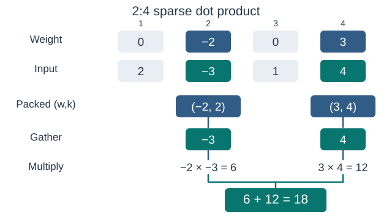

# Sparse Tensor Cores and the 2:4 Pattern

Sparse tensor cores are matrix units in recent NVIDIA GPUs that execute the 2:4 pattern of [N:M sparsity](../index.md) directly. Mishra et al. describe the pattern, the workflow for pruning a trained network to it, and the retraining that recovers accuracy. The hardware stores only the two non-zero values in each group of four, together with their positions, and skips the zeros during the multiplication.

## Problem

Sparse tensor cores need a documented pattern and a software path that makes the sparse format usable in training and inference. Without that, the hardware support is of little use to practitioners.

## Core idea

Keep the two largest-magnitude values in each group of four weights, then fine-tune the network to recover accuracy. The compressed representation is handled by the hardware, so the matrix multiplication runs on half the values.

### Visual walkthrough: metadata-guided multiplication

[GitHub-readable fallback](../../../../../assets/concept-animations/sparse-metadata-gather-still.svg) · [Full 12-second animation](../../../../../assets/concept-animations/sparse-metadata-gather-motion.svg)

The toy reduction uses $w=(0,-2,0,3)$ and $x=(2,-3,1,4)$. After imposing 2:4 sparsity, the schematic packed pairs are $(w,k)=(-2,2),(3,4)$, with **one-based positions**, not the actual hardware metadata bit encoding. The indices select $x_2=-3$ and $x_4=4$, giving two products and their sum:

$
w^\top x=(-2)(-3)+3(4)=18.
$

The dense dot product with the same already-pruned weights also gives 18. It need not agree with the output of the original unpruned model. The visual preserves the original column alignment for clarity; only the two packed pairs are stored in this schematic sparse representation, not the blank lanes. The compressed operand also needs metadata, so halving the stored weight values does not halve total storage exactly. Mishra et al. (2021) describe the hardware's 2:4 constraint and peak math throughput; this example is not an instruction layout, timing measurement or an end-to-end speedup claim.

**Storage accounting.** In a schematic format with two 2-bit positions (zero-based for encoding) per group, the dense payload is $4b$ bits and the compressed payload is $2b+4$ bits for $b$-bit weights. At $b=16$ this is 36 rather than 64 bits (56.25% of the dense payload, or 43.75% saved); at $b=8$ it is 20 rather than 32 bits (62.5% of the dense payload). This arithmetic excludes padding, alignment and auxiliary buffers, and does not claim the exact instruction encoding or physical storage layout. Metadata therefore matters more as weight precision decreases.

On MkDocs use Play/Pause (Enter or Space); GitHub and reduced-motion readers can inspect the complete static result. Original diagram, **CC BY-SA 4.0**.

## Equation or algorithm

Pruning to 2:4 keeps the two largest-magnitude values in each group of four, followed by fine-tuning. The compressed form stores the non-zero values and a small index for their positions, and the matrix unit uses the index to select the matching inputs.

## Results

The abstract states that sparse tensor cores exploit the 2:4 (50%) sparsity pattern, giving twice the math throughput of dense matrix units.

## Limitations

The gain depends on the hardware pattern and on the operations the hardware accelerates. Patterns other than 2:4 do not get the same hardware support.

## Open issues and related variants

- **Other patterns.** Support for patterns beyond 2:4 on future hardware is an open engineering question.
- **Related:** [learning N:M from scratch](../learning-n-m-from-scratch/index.md) shows how to train with the pattern, rather than pruning to it afterwards.

## Connections

The 2:4 pattern is an example of the link between [pruning](../../index.md) and [AI hardware](../../../../../engineering/hardware/index.md). Its benefit also depends on how the compressed format interacts with quantisation; see [quantisation](../../../quantisation/index.md).

## References

### Seminal papers

- Mishra, A., et al. (2021). *Accelerating Sparse Deep Neural Networks*. arXiv:2104.08378. https://arxiv.org/abs/2104.08378 — Describes the 2:4 pattern that sparse tensor cores execute, with twice the math throughput.
- Zhou, A., et al. (2021). *Learning N:M Fine-grained Structured Sparse Neural Networks From Scratch*. arXiv:2102.04010. https://arxiv.org/abs/2102.04010 — Trains with the 2:4 pattern from the start, with a 2 times speed-up on A100 GPUs.
- Han, S., Pool, J., Tran, J., Dally, W. J. (2015). *Learning both Weights and Connections for Efficient Neural Networks*. arXiv:1506.02626. https://arxiv.org/abs/1506.02626 — Unstructured pruning, the pattern that the hardware pattern trades off against.

### Surveys and textbooks

- Hoefler, T., et al. (2021). *Sparsity in Deep Learning: Pruning and Growth for Efficient Inference and Training in Neural Networks*. arXiv:2102.00554. https://arxiv.org/abs/2102.00554 — Surveys hardware-supported sparsity patterns and their deployment costs.

### Lectures and videos

(none checked for this page)

### Articles and documentation

- Gale, T., Elsen, E., Hooker, S. (2019). *The State of Sparsity in Deep Neural Networks*. arXiv:1902.09574. https://arxiv.org/abs/1902.09574 — Benchmarks the accuracy cost of sparsity that the 2:4 pattern must keep low.
