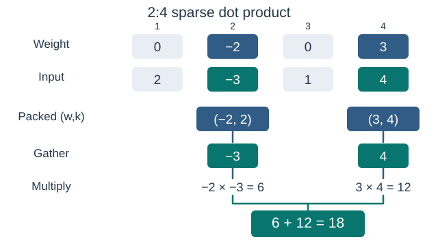

# 稀疏張量核心與 2:4 模式

稀疏張量核心是近期 NVIDIA GPU 中的矩陣單元，能直接執行 [N:M 稀疏](../index.zh-TW.md)的 2:4 模式。Mishra 等人說明了這個模式、把訓練後網路剪成該模式的流程，以及用來恢復準確度的重新訓練。硬體只儲存每四個權重中的兩個非零值，以及它們的位置，並在乘法時跳過零值。

## 問題

稀疏張量核心需要一個有文件說明的模式，以及讓稀疏格式能用於訓練與推論的軟體路徑。沒有這些，硬體支援對實務者就沒有用處。

## 核心想法

在每四個權重中保留兩個最大量值的值，然後微調網路以恢復準確度。壓縮的表示由硬體處理，因此矩陣乘法只使用一半的值。

### 動畫解讀：中繼資料引導的乘法

[GitHub 靜態預覽](../../../../../assets/concept-animations/sparse-metadata-gather-still.svg) · [完整 12 秒動畫](../../../../../assets/concept-animations/sparse-metadata-gather-motion.svg)

本算例使用 $w=(0,-2,0,3)$、$x=(2,-3,1,4)$。套用 2:4 稀疏結構後，示意壓縮配對為 $(w,k)=(-2,2),(3,4)$，採用**從 1 開始的位置索引**，並非硬體實際使用的中繼資料位元編碼。依索引選出 $x_2=-3$ 與 $x_4=4$，得到兩項乘積與總和：

$
w^\top x=(-2)(-3)+3(4)=18.
$

使用相同剪枝後權重的稠密內積也會得到 18，但不一定等於原始未剪枝模型的輸出。圖中為方便追蹤而保留原始欄位對齊；此示意稀疏表示只儲存兩組壓縮配對，而非空白欄位。壓縮運算元也需要中繼資料，因此儲存的權重值減半並不代表總儲存量恰好減半。Mishra 等人（2021）說明硬體的 2:4 限制及峰值數學吞吐量；此人工算例不是指令格式、延遲實測或端到端加速宣稱。

MkDocs 網站使用播放／暫停（Enter 或 Space）；GitHub 與減少動態效果偏好的讀者可檢視完整靜態結果。原創圖示，**CC BY-SA 4.0**。

## 公式或演算法

剪成 2:4 時，每四個值保留兩個絕對值最大的，之後微調。壓縮格式儲存非零值與一個小索引，記錄它們的位置；矩陣單元使用索引選取對應的輸入。

## 結果

摘要表示，稀疏張量核心利用 2:4（50%）稀疏模式，使數學吞吐量為稠密矩陣單元的兩倍。

## 限制

加速取決於硬體的模式，以及硬體加速的運算。2:4 以外的模式沒有相同的硬體支援。

## 開放問題與相關變體

- **其他模式。** 未來硬體對 2:4 以外模式的支援，是開放的工程問題。
- **相關**：[從頭學習 N:M](../learning-n-m-from-scratch/index.zh-TW.md)說明如何從一開始就以模式訓練，而不是事後剪成模式。

## 相關連結

2:4 模式是[剪枝](../../index.zh-TW.md)與 [AI 硬體](../../../../../engineering/hardware/index.zh-TW.md)之間連結的例子。它的效益也取決於壓縮格式與量化的互動，見[量化](../../../quantisation/index.zh-TW.md)。

## 參考文獻

### 開創性論文

- Mishra, A., 等人 (2021). *Accelerating Sparse Deep Neural Networks*. arXiv:2104.08378. https://arxiv.org/abs/2104.08378 — 說明稀疏張量核心執行的 2:4 模式，數學吞吐量為兩倍。
- Zhou, A., 等人 (2021). *Learning N:M Fine-grained Structured Sparse Neural Networks From Scratch*. arXiv:2102.04010. https://arxiv.org/abs/2102.04010 — 從一開始就以 2:4 模式訓練，在 A100 GPU 上有 2 倍加速。
- Han, S., Pool, J., Tran, J., Dally, W. J. (2015). *Learning both Weights and Connections for Efficient Neural Networks*. arXiv:1506.02626. https://arxiv.org/abs/1506.02626 — 非結構化剪枝，是硬體模式所權衡的對象。

### 綜述與教科書

- Hoefler, T., 等人 (2021). *Sparsity in Deep Learning: Pruning and Growth for Efficient Inference and Training in Neural Networks*. arXiv:2102.00554. https://arxiv.org/abs/2102.00554 — 綜述硬體支援的稀疏模式。

### 講座與影片

（本頁尚未查核任何項目）

### 文章與文件

- Gale, T., Elsen, E., Hooker, S. (2019). *The State of Sparsity in Deep Neural Networks*. arXiv:1902.09574. https://arxiv.org/abs/1902.09574 — 比較稀疏性的準確度成本，2:4 模式必須將其維持在低水準。
