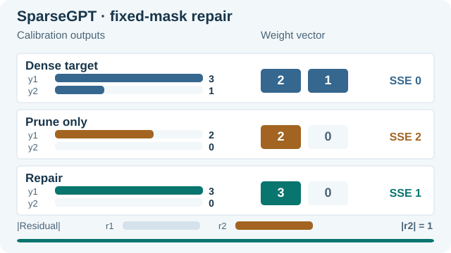

# SparseGPT

SparseGPT is a one-shot pruning method for large GPT-family models. It removes weights layer by layer and updates the remaining weights to compensate, using approximate second-order information about the layer's reconstruction error. It reaches high unstructured sparsity without retraining. It is the pruning counterpart of [GPTQ](../../../quantisation/post-training/gptq/index.md), which uses the same framework for rounding.

## Problem

Iterative pruning and retraining are too expensive for models with billions of parameters. Simple magnitude pruning fails at high sparsity in these models, because removing a weight without correcting the others loses too much of the layer's output.

## Core idea

Prune each layer in one shot, choosing which weights to remove and updating the remaining weights so that the layer's output stays close to the original. The choice and the update both come from the reconstruction error, approximated with second-order information from a small calibration set.

## Equation or algorithm

For a layer with weights \(W\) and calibration inputs \(X\), the method seeks a sparse \(\hat{W}\) that keeps the layer output close to the original, approximately minimising

\[
\lVert WX - \hat{W}X \rVert_2^2
\]

over the mask and the updated weights. The solver uses an approximate inverse Hessian of the reconstruction error, computed from the calibration inputs, and the remaining weights are updated to compensate for the removed ones.

## Instructional animation: repair after fixing a pruning mask

[GitHub-readable fallback](../../../../../assets/concept-animations/sparsegpt-fixed-mask-repair-still.svg) · [Full animation](../../../../../assets/concept-animations/sparsegpt-fixed-mask-repair-motion.svg)

Original 12-second instructional animation (CC BY-SA 4.0). Use the MkDocs keyboard-operable Play/Pause control; reduced motion starts with the still, and the focusable figure can be scrolled horizontally on mobile.

Use the row weight vector $w=(2,1)$ and two calibration inputs $x^{(1)}=(1,1)$ and $x^{(2)}=(0,1)$. The dense outputs are $(3,1)$. Fix a mask that removes the second weight. Without repair, $w'=(2,0)$ yields $(2,0)$ and summed squared error (SSE) 2.

Write the surviving weight as $a$. The reconstruction objective is $L(a)=(a-3)^2+1$, with minimum at $a=3$. Repair yields $(3,0)$ and SSE 1. The second sample cannot be recovered with this mask. The calibration Gram matrix has a nonzero off-diagonal entry: both features contribute to the first sample, so changing the surviving weight can compensate for part of the removed contribution.

This fixed-mask analytic example illustrates the local second-order repair motivation of Frantar and Alistarh (2023), Section 3; it does not simulate SparseGPT's blockwise mask selection, damping, or full inverse-Hessian updates. The growing bar interpolates the output change for explanation, not an iterative training trajectory. All numbers are constructed teaching values, not model measurements.

### Why the first residual disappears but the second cannot

Write the calibration matrix with samples as rows, $X=\begin{bmatrix}1&1\\0&1\end{bmatrix}$. With $r=Xw-X\hat w$, the animation's residual bars represent $|r_1|$ and $|r_2|$, not squared errors. During the illustrative repair, $a$ moves from 2 to 3: $r=(3-a,1)$, so the first bar shrinks while the second remains at one. At the optimum the residual is orthogonal to the retained feature.

More generally, let $K$ be the retained coordinates and $P$ the pruned coordinates. With column-oriented weights, the residual is $X_Pw_P-X_K\Delta_K$, where $\hat w_K=w_K+\Delta_K$. The normal equation for the undamped fixed-mask least-squares optimum is

$
G_{KK}\Delta_K=G_{KP}w_P,
\qquad G=X^TX.
$

If $G_{KK}$ is nonsingular, this determines the unique compensation. In the example $G_{KK}=G_{KP}=1$ and $w_P=1$, giving $\Delta_K=1$. If instead the retained and removed calibration features are orthogonal, $G_{KP}=0$ and no such compensation improves the objective. This is an exact local reconstruction calculation under a fixed mask, not the full SparseGPT solver; singular or damped systems need separate treatment.

## Results

The paper reports that the method can prune large GPT-family models in one shot, without retraining, to at least 50% sparsity. The abstract states that it reaches 60% unstructured sparsity with negligible increase in perplexity. The largest open models it is evaluated on are OPT-175B and BLOOM-176B.

## Limitations

Unstructured sparsity needs sparse kernels to give speed-ups on common hardware. The method needs calibration data and an approximate second-order solver, which adds engineering complexity, and the paper's results are for the GPT family, not for every architecture.

## Open issues and related variants

- **Structured variants.** Extending the reconstruction framework to whole heads or channels is not covered by the original method.
- **Related:** [Wanda](../wanda/index.md) uses a simpler score with no weight update, and reports results competitive with SparseGPT on LLaMA models.

## Connections

SparseGPT and [GPTQ](../../../quantisation/post-training/gptq/index.md) share the same curvature-based framework, one for removal and one for rounding. The unstructured result needs the sparse formats discussed in [AI hardware](../../../../../engineering/hardware/index.md) to run faster.

## References

### Seminal papers

- Frantar, E., Alistarh, D. (2023). *SparseGPT: Massive Language Models Can Be Accurately Pruned in One-Shot*. arXiv:2301.00774. https://arxiv.org/abs/2301.00774 — One-shot pruning with weight reconstruction, reaching 60% unstructured sparsity with negligible perplexity increase on OPT-175B and BLOOM-176B.
- Frantar, E., Ashkboos, S., Hoefler, T., Alistarh, D. (2022). *GPTQ: Accurate Post-Training Quantization for Generative Pre-trained Transformers*. arXiv:2210.17323. https://arxiv.org/abs/2210.17323 — The rounding counterpart that uses the same approximate second-order framework.
- Sun, M., Liu, Z., Bair, A., Kolter, J. Z. (2023). *A Simple and Effective Pruning Approach for Large Language Models*. arXiv:2306.11695. https://arxiv.org/abs/2306.11695 — A simpler one-shot score, without weight correction, for comparison.

### Surveys and textbooks

- Hoefler, T., Alistarh, D., Ben-Nun, T., Dryden, N., Peste, A. (2021). *Sparsity in Deep Learning: Pruning and Growth for Efficient Inference and Training in Neural Networks*. arXiv:2102.00554. https://arxiv.org/abs/2102.00554 — Surveys reconstruction-based and other sparsity methods.

### Lectures and videos

(none checked for this page)

### Articles and documentation

- Gale, T., Elsen, E., Hooker, S. (2019). *The State of Sparsity in Deep Neural Networks*. arXiv:1902.09574. https://arxiv.org/abs/1902.09574 — Benchmarks the magnitude baseline that SparseGPT is measured against.
