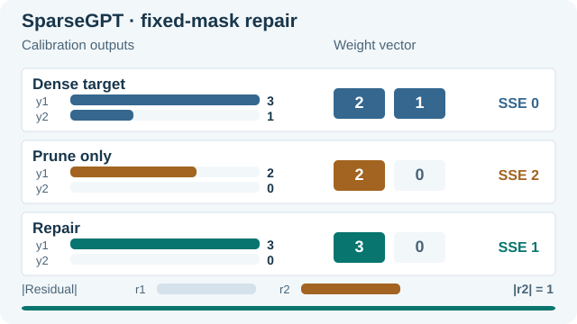

# SparseGPT

SparseGPT 是一種針對大型 GPT 系列模型的一次性剪枝方法。它逐層移除權重，並更新剩餘的權重以作補償，所用的是該層重建誤差的近似二階資訊。它不需重新訓練即可達到很高的非結構化稀疏度。它是 [GPTQ](../../../quantisation/post-training/gptq/index.zh-TW.md) 的剪枝對應方法，後者在取整時使用同一框架。

## 問題

對於數十億參數的模型，迭代式剪枝加再訓練成本太高。在這些模型中，簡單的幅度剪枝在高稀疏度時會失效，因為在不修正其他權重的情況下移除一個權重，會使該層的輸出損失太多。

## 核心想法

對每一層一次性剪枝：選擇要移除的權重，並更新剩餘的權重，使該層的輸出仍接近原來的輸出。選擇與更新都來自重建誤差，並以校準資料集上的近似二階資訊來計算。

## 公式或演算法

對於權重為 \(W\)、校準輸入為 \(X\) 的一層，此方法尋找一個稀疏的 \(\hat{W}\)，使該層輸出保持接近原始輸出，近似地最小化

\[
\lVert WX - \hat{W}X \rVert_2^2
\]

此最小化是針對遮罩與更新後的權重。求解器使用由校準輸入計算出的重建誤差近似逆 Hessian 矩陣，並更新剩餘的權重，以補償被移除的權重。

## 教學動畫：固定剪枝遮罩後的權重補償

[GitHub 靜態預覽](../../../../../assets/concept-animations/sparsegpt-fixed-mask-repair-still.svg) · [完整動畫](../../../../../assets/concept-animations/sparsegpt-fixed-mask-repair-motion.svg)

原創 12 秒教學動畫（CC BY-SA 4.0）。網站支援鍵盤操作的播放／暫停；減少動態效果模式預設顯示靜態圖。手機可聚焦圖形區域後水平捲動。

令權重列向量為 $w=(2,1)$，兩筆校準輸入為 $x^{(1)}=(1,1)$ 與 $x^{(2)}=(0,1)$。稠密輸出為 $(3,1)$。固定遮罩，移除第二個權重；若不補償，$w'=(2,0)$ 的輸出為 $(2,0)$，平方誤差總和（SSE）為 2。

將保留的權重記為 $a$。重建目標為 $L(a)=(a-3)^2+1$，最小值出現在 $a=3$。補償後輸出為 $(3,0)$，SSE 降至 1；此遮罩無法恢復第二筆樣本的輸出。校準資料的 Gram 矩陣存在非零的非對角項：兩個特徵都對第一筆樣本有貢獻，因此調整保留權重可以補償部分被移除的貢獻。

此固定遮罩的解析算例呈現 Frantar 與 Alistarh（2023）第 3 節所述的局部二階補償動機，並未模擬 SparseGPT 的區塊遮罩選擇、阻尼或完整逆 Hessian 更新。長條增長是為了解釋輸出變化的插值，不是迭代訓練軌跡。所有數值皆為人工教學算例，並非模型實測。

## 結果

論文報告，此方法可在不重新訓練的情況下，把大型 GPT 系列模型一次性剪到至少 50% 稀疏度。摘要指出，它能達到 60% 的非結構化稀疏度，困惑度的增加可忽略不計。它評估所用最大的開源模型為 OPT-175B 與 BLOOM-176B。

## 限制

非結構化稀疏要在常見硬體上提速，需要稀疏核心的支援。此方法需要校準資料與近似二階求解器，增加工程複雜度；而且論文的結果是針對 GPT 系列，不代表所有架構。

## 未解問題與相關變體

- **結構化變體。** 把重建框架延伸到整個注意力頭或通道，原始方法未涵蓋。
- **相關。** [Wanda](../wanda/index.zh-TW.md) 使用較簡單的分數且不更新權重，在 LLaMA 模型上報告的結果與 SparseGPT 相當。

## 與其他主題的連結

SparseGPT 與 [GPTQ](../../../quantisation/post-training/gptq/index.zh-TW.md) 共用基於曲率的框架，一個用於移除，一個用於取整。非結構化的結果需要 [AI 硬體](../../../../../engineering/hardware/index.zh-TW.md)中討論的稀疏格式才能加速。

## 參考文獻

### 奠基性論文

- Frantar, E., Alistarh, D. (2023). *SparseGPT: Massive Language Models Can Be Accurately Pruned in One-Shot*. arXiv:2301.00774. https://arxiv.org/abs/2301.00774 — 以權重重建進行一次性剪枝，在 OPT-175B 與 BLOOM-176B 上達到 60% 非結構化稀疏度，困惑度增加可忽略不計。
- Frantar, E., Ashkboos, S., Hoefler, T., Alistarh, D. (2022). *GPTQ: Accurate Post-Training Quantization for Generative Pre-trained Transformers*. arXiv:2210.17323. https://arxiv.org/abs/2210.17323 — 取整的對應方法，使用同樣的近似二階框架。
- Sun, M., Liu, Z., Bair, A., Kolter, J. Z. (2023). *A Simple and Effective Pruning Approach for Large Language Models*. arXiv:2306.11695. https://arxiv.org/abs/2306.11695 — 較簡單的一次性分數，不做權重修正，用於比較。

### 綜述與教科書

- Hoefler, T., Alistarh, D., Ben-Nun, T., Dryden, N., Peste, A. (2021). *Sparsity in Deep Learning: Pruning and Growth for Efficient Inference and Training in Neural Networks*. arXiv:2102.00554. https://arxiv.org/abs/2102.00554 — 綜述基於重建的方法與其他稀疏化方法。

### 講座與影片

（本頁未檢核任何項目）

### 文章與文件

- Gale, T., Elsen, E., Hooker, S. (2019). *The State of Sparsity in Deep Neural Networks*. arXiv:1902.09574. https://arxiv.org/abs/1902.09574 — SparseGPT 所對照的幅度剪枝基準。
