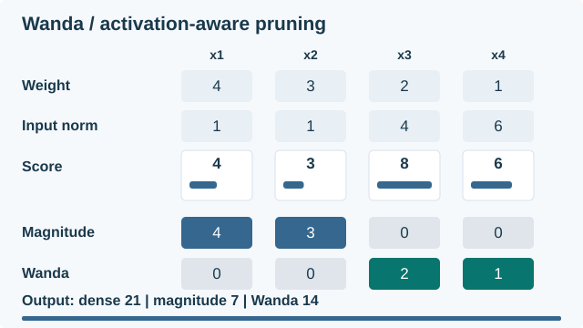

# Wanda

Wanda (Pruning by Weights and Activations) is a one-shot pruning method for large language models. It scores each weight by its magnitude multiplied by the norm of the corresponding input activation, and removes the lowest-scoring weights within each output. It needs no retraining and no weight update, which makes it much cheaper than [SparseGPT](../sparsegpt/index.md).

## Problem

SparseGPT is accurate, but it needs a second-order calculation for each layer. A simpler method that scales to large models would be easier to adopt, particularly where calibration time is limited.

## Core idea

A weight matters when it is large and when the input it multiplies is large. Score each weight by the product of these two, and prune the lowest-scoring weights in each output. No other weight is changed.

### Visual walkthrough

[GitHub static preview](../../../../../assets/concept-animations/wanda-activation-pruning-still.svg) · Use the keyboard-accessible **Play/Pause** control on MkDocs; reduced-motion preferences initially show the still.

Consider one output row with weights (4, 3, 2, 1) and a single calibration input (1, 1, 4, 6), so the four input-feature L2 norms are (1, 1, 4, 6). The animation builds the Wanda scores (4, 3, 8, 6) one channel at a time, then compares two masks with 50% sparsity. Magnitude pruning within this row keeps the first two weights; Wanda keeps the last two. The dense dot product is 21. On the same toy input, magnitude pruning produces 7 and Wanda produces 14. The retained weights are unchanged in both cases.

The difference illustrates why a small weight can have a large contribution when its input activation is large. These are constructed values, not model measurements; this one positive input is deliberately simple. Across multiple calibration tokens the feature norm is computed over all observations, and correlated or signed contributions can cancel. The score is a heuristic, not a guarantee of minimum output error for every input. See Sun et al. (2023), especially the pruning metric and per-output comparison in the existing References.

*Original instructional animation, CC BY-SA 4.0.*

### Why the score can fail: signed contributions

For a calibration matrix $X$ (tokens × features) and a fixed output weight vector $w$, let $r$ contain the removed weights and zeros elsewhere. Without updating the retained weights, the reconstruction residual is $Xr$, and its squared norm is

$
L(r)=r^T G r,\qquad G=X^T X.
$

The diagonal contribution is $\sum_j r_j^2 G_{jj}$. Wanda's squared score for a removed weight equals that diagonal term. If the feature columns are orthogonal on the calibration set, the off-diagonal terms vanish, so removing the smallest scores minimises this fixed-cardinality reconstruction loss without weight updates. In general, the cross terms can reinforce or cancel one another; Wanda does not optimise them.

Change only the sign of the fourth input in the animation, from 6 to −6. Its activation norm and both masks remain unchanged, but the signed contributions change from (4, 3, 8, 6) to (4, 3, 8, −6).

| Input | Dense | Magnitude | Wanda |
|---|---:|---:|---:|
| (1, 1, 4, 6) | 21 | 7 | 14 |
| (1, 1, 4, −6) | 9 | 7 | 2 |
| Absolute error, signed case | 0 | 2 | 7 |

In the signed case, the two contributions removed by magnitude pruning cancel substantially (8 − 6 = 2). Wanda removes contributions 4 and 3, which reinforce each other. Thus the ranking by output error reverses even though the importance scores are identical. This constructed counterexample concerns one row and a local reconstruction objective, not language-model perplexity or the empirical results of Sun et al. (2023).

## Equation or algorithm

The score of weight \(W_{ij}\) is

\[
S_{ij} = |W_{ij}| \cdot \lVert X_j \rVert_2
\]

where \(X_j\) is the input feature multiplied by weight \(j\), computed on a small calibration set. The lowest-scoring weights are removed within each output, so every output keeps the same sparsity. The pruned model is used directly, with no retraining and no weight update.

## Results

The abstract reports that Wanda significantly outperforms the established baseline of magnitude pruning on large language models. The authors also report that it is competitive with SparseGPT, which uses intensive weight updates. These results are on the LLaMA and LLaMA-2 model families.

## Limitations

The method removes weights without correcting the remaining ones. Its advantage over SparseGPT is cost and simplicity, not a uniform gain in accuracy, and the paper's results are for the LLaMA families.

## Open issues and related variants

- **High sparsity.** How to combine a cheap score with a light correction step, to close the remaining gap to SparseGPT at high sparsity, is open.
- **Related:** [SparseGPT](../sparsegpt/index.md) adds the weight update that this method leaves out.

## Connections

Wanda's score is a magnitude-times-activation rule, which extends the simple [magnitude pruning](../../magnitude-pruning/index.md) baseline to use the inputs. The unstructured result needs the sparse kernels discussed in [AI hardware](../../../../../engineering/hardware/index.md) to speed up inference.

## References

### Seminal papers

- Sun, M., Liu, Z., Bair, A., Kolter, J. Z. (2023). *A Simple and Effective Pruning Approach for Large Language Models*. arXiv:2306.11695. https://arxiv.org/abs/2306.11695 — Wanda, a magnitude-times-activation score that prunes per output without retraining; it significantly outperforms magnitude pruning.
- Frantar, E., Alistarh, D. (2023). *SparseGPT: Massive Language Models Can Be Accurately Pruned in One-Shot*. arXiv:2301.00774. https://arxiv.org/abs/2301.00774 — The weight-updating one-shot method that Wanda is compared against.
- Han, S., Pool, J., Tran, J., Dally, W. J. (2015). *Learning both Weights and Connections for Efficient Neural Networks*. arXiv:1506.02626. https://arxiv.org/abs/1506.02626 — Magnitude pruning with retraining, the baseline that Wanda improves on.

### Surveys and textbooks

- Hoefler, T., Alistarh, D., Ben-Nun, T., Dryden, N., Peste, A. (2021). *Sparsity in Deep Learning: Pruning and Growth for Efficient Inference and Training in Neural Networks*. arXiv:2102.00554. https://arxiv.org/abs/2102.00554 — Surveys sparsity scores and their trade-offs.

### Lectures and videos

(none checked for this page)

### Articles and documentation

- Gale, T., Elsen, E., Hooker, S. (2019). *The State of Sparsity in Deep Neural Networks*. arXiv:1902.09574. https://arxiv.org/abs/1902.09574 — Benchmarks the magnitude baseline that Wanda extends.
