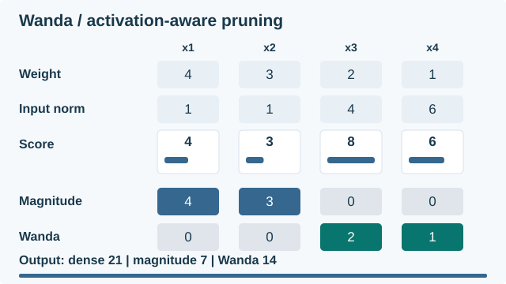

# Wanda

Wanda（Pruning by Weights and Activations，依權重與激活剪枝）是一種針對大型語言模型的一次性剪枝方法。它以權重幅度乘上對應輸入激活的範數來為每個權重評分，並在每個輸出內移除分數最低的權重。它不需要重新訓練，也不更新權重，因此比 [SparseGPT](../sparsegpt/index.zh-TW.md) 便宜得多。

## 問題

SparseGPT 很準確，但每一層都需要二階計算。若有一種更簡單、能擴展到大型模型的方法，會更容易被採用，特別是在校準時間有限的情況下。

## 核心想法

當權重大、且它所乘的輸入也大時，該權重才重要。以這兩者的乘積為每個權重評分，並在每個輸出中剪除分數最低的權重。其他權重一律不變。

### 動畫解讀

[GitHub 靜態預覽](../../../../../assets/concept-animations/wanda-activation-pruning-still.svg) · MkDocs 網站可使用鍵盤操作的 **播放／暫停（Play/Pause）** 控制；偏好減少動態效果時顯示靜態圖。

考慮單一輸出列，權重為 (4, 3, 2, 1)，校準資料只有一筆輸入 (1, 1, 4, 6)，所以四個輸入特徵的 L2 範數為 (1, 1, 4, 6)。動畫逐通道建立 Wanda 分數 (4, 3, 8, 6)，再比較兩種稀疏度皆為 50% 的遮罩。此輸出列內的幅度剪枝保留前兩個權重，Wanda 則保留後兩個。稠密內積為 21；對相同示意輸入，幅度剪枝的輸出為 7，Wanda 為 14。兩種方法都不修改保留權重的數值。

這說明小幅度權重乘上大幅度激活值時，仍可能對輸出有顯著貢獻。所有數值皆為人工示意，並非模型實測；此處刻意只使用一筆正值輸入。實際有多筆校準詞元時，特徵範數需跨觀測值計算，而且相關或帶正負號的貢獻可能互相抵消。此分數是啟發式指標，不保證對所有輸入都能使輸出誤差最小。參見既有參考文獻 Sun 等人（2023）的剪枝指標與逐輸出比較。

*原創教學動畫，CC BY-SA 4.0。*

### 分數為何可能失效：帶正負號的貢獻

令校準矩陣 $X$ 的形狀為詞元數 × 特徵數，$w$ 為固定的輸出權重向量，$r$ 在被剪除的位置保留原權重，其餘位置為零。不更新保留權重時，重建殘差為 $Xr$，其平方範數為

$
L(r)=r^T G r,\qquad G=X^T X.
$

對角項的貢獻為 $\sum_j r_j^2 G_{jj}$。Wanda 對被剪除權重的分數平方恰為對應的對角項。若校準資料的各特徵欄彼此正交，非對角項皆為零，因此剪除最低分數的權重可在固定剪枝數量、不更新權重的條件下最小化此重建損失。一般情況下，交叉項可能互相增強或抵消，而 Wanda 並未對交叉項進行最佳化。

僅將原動畫的第四個輸入由 6 改為 −6。其激活範數與兩種遮罩均不變，但帶正負號的貢獻由 (4, 3, 8, 6) 改為 (4, 3, 8, −6)。

| 輸入 | 稠密 | 幅度剪枝 | Wanda |
|---|---:|---:|---:|
| (1, 1, 4, 6) | 21 | 7 | 14 |
| (1, 1, 4, −6) | 9 | 7 | 2 |
| 帶符號算例的絕對誤差 | 0 | 2 | 7 |

帶符號算例中，幅度剪枝移除的兩項貢獻大幅抵消（8 − 6 = 2）；Wanda 移除的兩項貢獻 4 與 3 則互相增強。因此重要性分數完全相同，輸出誤差的排序卻反轉。此人工反例僅涉及單一輸出列及局部重建目標，並非語言模型困惑度或 Sun 等人（2023）的實驗結果。

## 公式或演算法

權重 \(W_{ij}\) 的分數為

\[
S_{ij} = |W_{ij}| \cdot \lVert X_j \rVert_2
\]

其中 \(X_j\) 是權重 \(j\) 所乘的輸入特徵，在一小組校準資料上計算。分數最低的權重在每個輸出內被移除，因此每個輸出保持相同的稀疏度。剪枝後的模型直接使用，不需重新訓練，也不更新權重。

## 結果

摘要報告，Wanda 在大型語言模型上明顯優於幅度剪枝這個既有基準。作者也報告，它與需要大量權重更新的 SparseGPT 相比具有競爭力。這些結果是在 LLaMA 與 LLaMA-2 模型系列上取得的。

## 限制

此方法移除權重後不修正剩餘的權重。它相對於 SparseGPT 的優勢在於成本與簡單性，而不是準確率全面領先；且論文的結果是針對 LLaMA 系列。

## 未解問題與相關變體

- **高稀疏度。** 如何把廉價的分數與輕量的修正步驟結合，以縮小與 SparseGPT 在高稀疏度下的剩餘差距，仍是未解問題。
- **相關。** [SparseGPT](../sparsegpt/index.zh-TW.md) 加入了本方法所省略的權重更新。

## 與其他主題的連結

Wanda 的分數是「幅度乘激活」的規則，把簡單的[幅度剪枝](../../magnitude-pruning/index.zh-TW.md)基準擴展為同時使用輸入。非結構化的結果需要 [AI 硬體](../../../../../engineering/hardware/index.zh-TW.md)中討論的稀疏核心，才能加速推論。

## 參考文獻

### 奠基性論文

- Sun, M., Liu, Z., Bair, A., Kolter, J. Z. (2023). *A Simple and Effective Pruning Approach for Large Language Models*. arXiv:2306.11695. https://arxiv.org/abs/2306.11695 — Wanda，以「幅度乘激活」的分數按輸出剪枝且不重新訓練；明顯優於幅度剪枝。
- Frantar, E., Alistarh, D. (2023). *SparseGPT: Massive Language Models Can Be Accurately Pruned in One-Shot*. arXiv:2301.00774. https://arxiv.org/abs/2301.00774 — Wanda 所對照的、會更新權重的一次性方法。
- Han, S., Pool, J., Tran, J., Dally, W. J. (2015). *Learning both Weights and Connections for Efficient Neural Networks*. arXiv:1506.02626. https://arxiv.org/abs/1506.02626 — 含再訓練的幅度剪枝，是 Wanda 所改良的基準。

### 綜述與教科書

- Hoefler, T., Alistarh, D., Ben-Nun, T., Dryden, N., Peste, A. (2021). *Sparsity in Deep Learning: Pruning and Growth for Efficient Inference and Training in Neural Networks*. arXiv:2102.00554. https://arxiv.org/abs/2102.00554 — 綜述稀疏分數及其取捨。

### 講座與影片

（本頁未檢核任何項目）

### 文章與文件

- Gale, T., Elsen, E., Hooker, S. (2019). *The State of Sparsity in Deep Neural Networks*. arXiv:1902.09574. https://arxiv.org/abs/1902.09574 — Wanda 所擴展的幅度剪枝基準。
