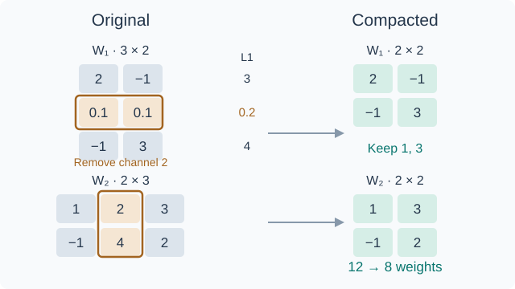

# Filter Pruning

Filter pruning removes whole convolution filters, and with them the matching input channels of the next layer, so that the network becomes a smaller dense network. Li et al. proposed ranking filters by the \(\ell_1\) norm of their weights and pruning the smallest. It is a reference method for [structured pruning](../index.md) of convolutional networks.

## Problem

Pruning individual weights gives sparse layers that standard convolution libraries cannot accelerate. A pruning scheme that gives smaller dense layers was needed.

## Core idea

Rank the filters of each convolution by the size of their weights, remove the least important, and retrain. The paper is explicit that its criterion needs no data: the score uses only the filter weights, so pruning requires no sample inputs. The paper also analyses which layers are sensitive to pruning, and prunes those less.

## Equation or algorithm

For filter \(j\) in a layer with \(n_i\) input channels and kernels \(K_l\), the score is

\[
s_j = \sum_{l=1}^{n_i} \lVert K_l \rVert_1
\]

Filters with the lowest scores are pruned first. Removing filter \(j\) also removes the feature map it produces and input channel \(j\) of the following layer. The main method prunes across several layers at once and retrains once afterwards, with per-layer pruning ratios chosen by sensitivity analysis. The paper also describes an iterative variant that retrains after each layer is pruned. The authors report that it may give better results but needs many more epochs, especially for very deep networks.

### Worked animation

*Original 12-second teaching animation (CC BY-SA 4.0).* All values are schematic, not model measurements. MkDocs provides Play/Pause; focus the scroll region to navigate horizontally by keyboard. GitHub shows the [static fallback](../../../../../assets/concept-animations/filter-pruning-channel-compaction-still.svg).

For two consecutive bias-free $1\times1$ convolutions with no cross-channel operation between them, write the channel matrices as $W_1\in\mathbb R^{3\times2}$ and $W_2\in\mathbb R^{2\times3}$. The three filter scores are $(3,0.2,4)$. The amber row and column show the **same hidden channel**, not two independently chosen pruning decisions. The teal signal then reveals the surviving rows of $W_1$ and columns of $W_2$ in compact storage. With $S=\{1,3\}$, the compact matrices are $W_1'=W_1[S,:]$ and $W_2'=W_2[:,S]$. For a pointwise activation $f$, $W_2'f(W_1'x)$ equals the output of the original network with its second hidden activation explicitly masked to zero. It does not generally equal the unpruned output; fine-tuning may be necessary. Nominal weights and MACs per spatial position decrease from $3\cdot2+2\cdot3=12$ to $2\cdot2+2\cdot2=8$ (one third fewer). Biases, spatial sizes, memory traffic and runtime are not included. For general CNNs, the downstream channel slice extends across all spatial kernel coefficients, and normalisation, residual additions and grouped convolutions can impose further dependency constraints.

[Full SVG animation](../../../../../assets/concept-animations/filter-pruning-channel-compaction-motion.svg).

## Results

The abstract reports that inference cost is reduced by up to 34% for VGG-16 and by up to 38% for ResNet-110 on CIFAR-10. The authors also report that the \(\ell_2\) norm gives nearly the same result as the \(\ell_1\) norm.

## Limitations

The abstract's savings are in inference cost (computation) on CIFAR-10 networks. Filter norms are a proxy for how much a filter contributes to the output, and they ignore how a removed filter changes later layers until retraining recovers it.

## Open issues and related variants

- **Better scores.** Scores that measure the loss effect of a removal are more accurate than norms, but they cost more to compute.
- **Related:** [network slimming](../network-slimming/index.md) uses the scaling factors of batch normalisation as the score instead.

## Connections

Filter pruning gives the dense matrices that [AI accelerators](../../../../../engineering/hardware/index.md) run well, which is why it is common in deployment. The contrast with unstructured pruning is set out in [learning both weights and connections](../../learning-weights-and-connections/index.md).

## References

### Seminal papers

- Li, H., Kadav, A., Durdanovic, I., Samet, H., Graf, H. P. (2016). *Pruning Filters for Efficient ConvNets*. arXiv:1608.08710. https://arxiv.org/abs/1608.08710 — Filter pruning by \(\ell_1\) norm, reducing VGG-16 inference cost by up to 34% and ResNet-110 by up to 38% on CIFAR-10.
- Liu, Z., Li, J., Shen, Z., Huang, G., Yan, S., Zhang, C. (2017). *Learning Efficient Convolutional Networks through Network Slimming*. arXiv:1708.06519. https://arxiv.org/abs/1708.06519 — Channel selection with an \(\ell_1\) penalty on batch-normalisation scales.
- Han, S., Pool, J., Tran, J., Dally, W. J. (2015). *Learning both Weights and Connections for Efficient Neural Networks*. arXiv:1506.02626. https://arxiv.org/abs/1506.02626 — Unstructured pruning, the contrast that structured methods are measured against.

### Surveys and textbooks

- Hoefler, T., Alistarh, D., Ben-Nun, T., Dryden, N., Peste, A. (2021). *Sparsity in Deep Learning: Pruning and Growth for Efficient Inference and Training in Neural Networks*. arXiv:2102.00554. https://arxiv.org/abs/2102.00554 — Compares structured and unstructured sparsity across training and inference.

### Lectures and videos

(none checked for this page)

### Articles and documentation

- Gale, T., Elsen, E., Hooker, S. (2019). *The State of Sparsity in Deep Neural Networks*. arXiv:1902.09574. https://arxiv.org/abs/1902.09574 — Benchmarks sparsity methods, including structured ones.
