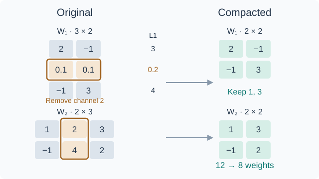

# 濾波器剪枝

濾波器剪枝移除整個卷積濾波器，以及下一層中與之對應的輸入通道，使網路變成較小的稠密網路。Li 等人提出依濾波器權重的 \(\ell_1\) 範數排序，並剪除最小的濾波器。它是卷積網路[結構化剪枝](../index.zh-TW.md)的參考方法。

## 問題

剪除個別權重會得到稀疏層，而標準的卷積函式庫無法加速這些稀疏層。因此需要一種能產生較小稠密層的剪枝方案。

## 核心想法

依每個卷積的濾波器權重大小排序，移除最不重要的，然後重新訓練。論文明確指出，它的準則不需要資料：分數只使用濾波器權重，因此剪枝不需要樣本輸入。論文也分析哪些層對剪枝敏感，並對這些層少剪。

## 公式或演算法

對於輸入通道數為 \(n_i\)、核為 \(K_l\) 的層中第 \(j\) 個濾波器，分數為

\[
s_j = \sum_{l=1}^{n_i} \lVert K_l \rVert_1
\]

分數最低的濾波器先被剪除。移除濾波器 \(j\) 也會移除它產生的特徵圖，以及下一層中的輸入通道 \(j\)。主要方法一次跨多層剪枝，然後只重新訓練一次，各層的剪枝比例由敏感度分析決定。論文也描述一種迭代變體，每剪完一層就重新訓練。作者報告，它可能得到更好的結果，但需要多得多的 epoch，對很深的網路尤其如此。

### 動態算例

*原創 12 秒教學動畫（CC BY-SA 4.0）。* 所有數值均為人工示意，非模型實測值。MkDocs 提供播放／暫停控制；可使用鍵盤聚焦圖框並水平捲動。GitHub 顯示 [靜態回退圖](../../../../../assets/concept-animations/filter-pruning-channel-compaction-still.svg).

考慮兩個連續、不含偏置的 $1\times1$ 卷積，且中間沒有跨通道運算，通道權重矩陣分別為 $W_1\in\mathbb R^{3\times2}$ 及 $W_2\in\mathbb R^{2\times3}$。三個濾波器的分數為 $(3,0.2,4)$。琥珀色的列與欄標示的是**同一個隱藏通道**，不是兩次獨立的剪枝決策。接著綠色訊號依序揭露 $W_1$ 保留的列及 $W_2$ 保留的欄，形成緊湊的儲存排列。令 $S=\{1,3\}$，則 $W_1'=W_1[S,:]$、$W_2'=W_2[:,S]$。對逐元素激活函數 $f$，$W_2'f(W_1'x)$ 等於原網路將第二個隱藏激活值明確遮罩為零後的輸出，但通常不等於未剪枝的輸出，因此可能需要微調。每個空間位置的名目權重數及 MACs 由 $3\cdot2+2\cdot3=12$ 降為 $2\cdot2+2\cdot2=8$（減少三分之一）。未計入偏置、空間尺寸、記憶體存取及實際執行時間。一般 CNN 的下游通道切片包含所有空間卷積核係數；正規化、殘差相加與群組卷積也可能帶來額外的相依性限制。

[完整 SVG 動畫](../../../../../assets/concept-animations/filter-pruning-channel-compaction-motion.svg).

## 結果

摘要報告，在 CIFAR-10 上，VGG-16 的推論成本最多降低 34%，ResNet-110 最多降低 38%。作者也報告，\(\ell_2\) 範數得到的結果與 \(\ell_1\) 範數幾乎相同。

## 限制

摘要所報告的節省在於推論運算量（計算量），且針對的是 CIFAR-10 上的網路。濾波器範數只是某濾波器對輸出貢獻的代理指標，在重新訓練恢復之前，它也忽略了移除某濾波器對後續層的影響。

## 未解問題與相關變體

- **更好的分數。** 能衡量移除所造成損失效應的分數比範數更準確，但計算成本較高。
- **相關。** [網路瘦身](../network-slimming/index.zh-TW.md)改以批次正規化的縮放係數作為分數。

## 與其他主題的連結

濾波器剪枝產生的是 [AI 加速器](../../../../../engineering/hardware/index.zh-TW.md)能有效執行的稠密矩陣，這也是它在部署中常見的原因。與非結構化剪枝的對比，見[同時學習權重與連接](../../learning-weights-and-connections/index.zh-TW.md)。

## 參考文獻

### 奠基性論文

- Li, H., Kadav, A., Durdanovic, I., Samet, H., Graf, H. P. (2016). *Pruning Filters for Efficient ConvNets*. arXiv:1608.08710. https://arxiv.org/abs/1608.08710 — 依 \(\ell_1\) 範數的濾波器剪枝，在 CIFAR-10 上使 VGG-16 的推論成本最多降低 34%、ResNet-110 最多降低 38%。
- Liu, Z., Li, J., Shen, Z., Huang, G., Yan, S., Zhang, C. (2017). *Learning Efficient Convolutional Networks through Network Slimming*. arXiv:1708.06519. https://arxiv.org/abs/1708.06519 — 以批次正規化縮放係數的 \(\ell_1\) 懲罰來選擇通道。
- Han, S., Pool, J., Tran, J., Dally, W. J. (2015). *Learning both Weights and Connections for Efficient Neural Networks*. arXiv:1506.02626. https://arxiv.org/abs/1506.02626 — 非結構化剪枝，是結構化方法所比較的對象。

### 綜述與教科書

- Hoefler, T., Alistarh, D., Ben-Nun, T., Dryden, N., Peste, A. (2021). *Sparsity in Deep Learning: Pruning and Growth for Efficient Inference and Training in Neural Networks*. arXiv:2102.00554. https://arxiv.org/abs/2102.00554 — 比較訓練與推論中的結構化與非結構化稀疏。

### 講座與影片

（本頁未檢核任何項目）

### 文章與文件

- Gale, T., Elsen, E., Hooker, S. (2019). *The State of Sparsity in Deep Neural Networks*. arXiv:1902.09574. https://arxiv.org/abs/1902.09574 — 在同一套流程下比較各種稀疏化方法，包括結構化方法。
