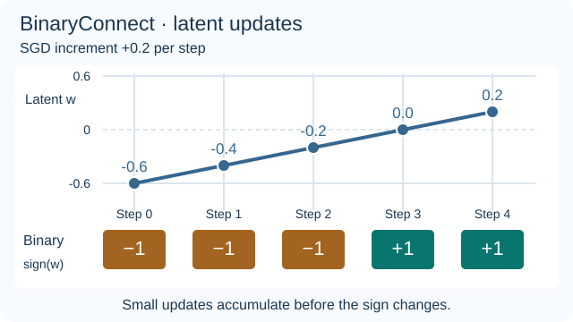

# BinaryConnect

BinaryConnect trains a neural network whose weights are binary, \(\pm 1\), during the forward and backward passes, while keeping real-valued weights for the parameter updates. It is an early demonstration that deep networks can be trained with binary weights, and it is a starting point for much of the later work in the [binary and ternary](../index.md) family.

## Problem

Gradient descent needs small real-valued updates to the weights. A network whose weights are only \(\pm 1\) cannot take such updates directly, so training with binary weights seemed impossible without a different learning rule.

## Core idea

Keep a real-valued copy of the weights for the updates. For each mini-batch, binarise the copy, run the forward and backward passes with the binary weights, and apply the resulting gradient to the real-valued copy. The paper binarises the weights only during the forward and backward passes, never during the parameter update. The real-valued weights are then clipped to \([-1, 1]\), because binarisation does not respond to changes beyond that range, and without clipping the real-valued weights would grow without effect on the binary ones.

## Equation or algorithm

The deterministic binarisation is

\[
w_b = \begin{cases} +1 & \text{if } w \ge 0 \\ -1 & \text{otherwise} \end{cases}
\]

The stochastic variant sets \(w_b = +1\) with probability \(\sigma(w)\), where \(\sigma(x) = \max(0, \min(1, (x+1)/2))\) is a hard sigmoid. The gradient is computed with respect to the binary weights \(w_b\) and applied to the real-valued weights \(w\), with \(w\) clipped to \([-1, 1]\) after each update. The paper does not use the term straight-through estimator, but it describes this same update, which later work names that way. Because the sign function has zero gradient almost everywhere, this step is needed for the update to have any effect.

### Visual walkthrough: latent weight accumulation

[GitHub-readable fallback](../../../../../assets/concept-animations/binaryconnect-latent-accumulation-still.svg) · [Full 12-second animation](../../../../../assets/concept-animations/binaryconnect-latent-accumulation-motion.svg)

Starting from $w_0=-0.6$, apply four illustrative SGD updates with $\eta=0.2$ and an externally fixed gradient $g=-1$: $w_{k+1}=\operatorname{clip}(w_k-\eta g,-1,1)$. The stored weight evolves through $(-0.6,-0.4,-0.2,0,0.2)$, while the deterministic binary copy is $(-1,-1,-1,+1,+1)$ using the sign-at-zero convention above. The blue segments interpolate between discrete updates solely for readability; the sign is sampled at each completed step, not continuously during an SGD update. The first two updates are invisible to the binary copy but accumulate in the stored weight. This isolates the mechanism in Courbariaux et al. (2015); it does not simulate a network, stochastic binarisation or gradient recomputation. All values are schematic, not model measurements.

On MkDocs use Play/Pause (Enter or Space) to inspect the changes. GitHub and reduced-motion readers see the complete static result. Original diagram, **CC BY-SA 4.0**.

## Results

The abstract reports near state-of-the-art results on permutation-invariant MNIST, CIFAR-10 and SVHN. It also reports that BinaryConnect acts as a regulariser, comparable to dropout.

## Limitations

The experiments are on small networks and datasets of their time. The method has no per-filter scale factor, which [XNOR-Net](../xnor-net/index.md) adds. Its arithmetic gain depends on hardware that can exploit binary weights.

## Open issues and related variants

- **Scale factors.** Adding a real scale per filter, as in XNOR-Net, is one way to address what the bare sign function loses.
- **Ternary weights.** Allowing a zero value, as in [ternary weight networks](../ternary-weight-networks/index.md), keeps a sparse code at a small cost in storage.
- **Stochastic binarisation.** Whether the stochastic form is better than deterministic binarisation is not settled across tasks.

## Connections

The gradient-through-binarisation device used here is the same idea used throughout [quantisation-aware training](../../quantisation-aware-training/index.md). The arithmetic of binary weights links to the bit-level operations discussed in [AI hardware](../../../../../engineering/hardware/index.md).

## References

### Seminal papers

- Courbariaux, M., Bengio, Y., David, J.-P. (2015). *BinaryConnect: Training Deep Neural Networks with Binary Weights during Propagations*. arXiv:1511.00363. https://arxiv.org/abs/1511.00363 — Binary weights in the forward and backward passes, real-valued weights for updates, and near state-of-the-art results on MNIST, CIFAR-10 and SVHN.
- Rastegari, M., Ordonez, V., Redmon, J., Farhadi, A. (2016). *XNOR-Net: ImageNet Classification Using Binary Convolutional Neural Networks*. arXiv:1603.05279. https://arxiv.org/abs/1603.05279 — Adds per-filter real-valued scale factors to binary weights.
- Li, F., Liu, B., Wang, X., Zhang, B., Yan, J. (2016). *Ternary Weight Networks*. arXiv:1605.04711. https://arxiv.org/abs/1605.04711 — Restricts each weight to +1, 0 or −1, with up to 16 times compression on MNIST and CIFAR-10.

### Surveys and textbooks

- Gholami, A., Kim, S., Dong, Z., Yao, Z., Mahoney, M. W., Keutzer, K. (2021). *A Survey of Quantization Methods for Efficient Neural Network Inference*. arXiv:2103.13630. https://arxiv.org/abs/2103.13630 — Reviews low-bit representations of neural networks, weighing the strengths and weaknesses of current approaches.

### Lectures and videos

(none checked for this page)

### Articles and documentation

- Jacob, B., Kligys, S., Chen, B., Zhu, M., Tang, M., Howard, A., Adam, H., Kalenichenko, D. (2017). *Quantization and Training of Neural Networks for Efficient Integer-Arithmetic-Only Inference*. arXiv:1712.05877. https://arxiv.org/abs/1712.05877 — The 8-bit integer counterpart to binary weights, for comparison of accuracy costs.
