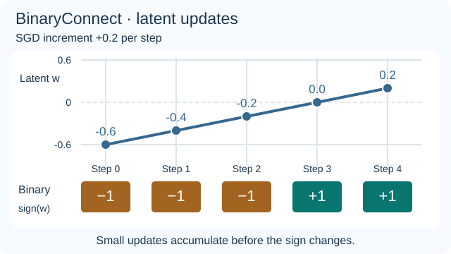

# BinaryConnect

BinaryConnect 訓練權重為二值（\(\pm 1\)）的神經網路：前向與反向傳播時使用二值權重，而參數更新時保留實數權重。它是深度網路可以使用二值權重訓練的早期示範，也是[二值與三值](../index.zh-TW.md)系列中許多後續工作的起點。

## 問題

梯度下降需要對權重做微小的實數更新。權重只有 \(\pm 1\) 的網路無法直接接受這樣的更新，因此若沒有不同的學習規則，以二值權重訓練似乎不可能。

## 核心想法

保留一份實數權重副本以供更新。每個 mini-batch 都將該副本二值化，以二值權重進行前向與反向傳播，再把得到的梯度套用到實數副本上。論文只在前向與反向傳播時二值化權重，參數更新時從不二值化。實數權重之後被裁剪到 \([-1, 1]\)，因為二值化對超出該範圍的變化沒有反應；若不裁剪，實數權重會不斷增長，卻對二值權重沒有影響。

## 公式或演算法

確定性的二值化為

\[
w_b = \begin{cases} +1 & \text{若 } w \ge 0 \\ -1 & \text{否則} \end{cases}
\]

隨機變體以機率 \(\sigma(w)\) 令 \(w_b = +1\)，其中 \(\sigma(x) = \max(0, \min(1, (x+1)/2))\) 是 hard sigmoid。梯度對二值權重 \(w_b\) 計算，然後套用到實數權重 \(w\) 上，並在每次更新後把 \(w\) 裁剪到 \([-1, 1]\)。論文未使用直通估計器（straight-through estimator）這個名稱，但它描述的正是這個更新，後續工作以此名稱稱呼它。由於符號函式幾乎處處梯度為零，這一步是讓更新產生作用所必需的。

### 視覺解說：實數權重的梯度累積

[GitHub 靜態預覽](../../../../../assets/concept-animations/binaryconnect-latent-accumulation-still.svg) · [完整 12 秒動畫](../../../../../assets/concept-animations/binaryconnect-latent-accumulation-motion.svg)

從 $w_0=-0.6$ 出發，固定示意梯度 $g=-1$ 與學習率 $\eta=0.2$，執行四次 SGD 更新：$w_{k+1}=\operatorname{clip}(w_k-\eta g,-1,1)$。儲存的實數權重依序為 $(-0.6,-0.4,-0.2,0,0.2)$；依上方零值取正號的定義，確定性二值副本依序為 $(-1,-1,-1,+1,+1)$。藍色線段只是離散更新之間的視覺插值，二值符號在每次更新完成後重新計算，而不是在單次 SGD 更新中連續取樣。前兩次更新雖未改變二值副本，仍累積於實數權重。本例隔離 Courbariaux 等人（2015）的核心機制，未模擬完整網路、隨機二值化或梯度重新計算。所有數值皆為示意，並非模型實測值。

在 MkDocs 使用播放／暫停（Enter 或 Space）觀察變化，GitHub 與減少動態效果模式提供完整靜態結果。原創圖示，**CC BY-SA 4.0**。

### 確定性與隨機二值副本

對裁剪後的儲存權重 $w\in[-1,1]$，上述隨機規則滿足 $\Pr(w_b=+1)=(w+1)/2$，因此 $\mathbb{E}[w_b\mid w]=w$ 且 $\operatorname{Var}(w_b\mid w)=1-w^2$。沿用動畫中的五個儲存權重，取正號的機率依序為 $0.2,0.3,0.4,0.5,0.6$。不同於確定性副本，隨機取樣可能在儲存權重抵達零之前便取正號；在零時兩個符號等機率。裁剪限制的是儲存權重，而非二值副本的幅度。此處的不偏性僅指單一取樣權重，並不保證非線性網路的梯度或損失不偏。這些是解析機率，並非訓練實測頻率。

## 結果

摘要報告，在排列不變的 MNIST、CIFAR-10 與 SVHN 上取得接近最先進的結果。它也報告，BinaryConnect 可作為正則化器，效果類似 dropout。

## 限制

實驗的網路與資料集以當時的標準來看規模很小。此方法沒有每個濾波器的縮放係數，而 [XNOR-Net](../xnor-net/index.zh-TW.md) 加入了這一項。它的算術增益取決於能利用二值權重的硬體。

## 未解問題與相關變體

- **縮放係數。** 像 XNOR-Net 那樣為每個濾波器加上實數縮放，是處理純符號函式所損失部分的一種方式。
- **三值權重。** 允許零值，如[三值權重網路](../ternary-weight-networks/index.zh-TW.md)，能以少量儲存成本保持稀疏編碼。
- **隨機二值化。** 隨機形式是否優於確定性二值化，在不同任務上尚無定論。

## 與其他主題的連結

此處使用的「透過二值化的梯度」技巧，與整個[量化感知訓練](../../quantisation-aware-training/index.zh-TW.md)所用的想法相同。二值權重的算術則與 [AI 硬體](../../../../../engineering/hardware/index.zh-TW.md)所討論的位元層級運算相關。

## 參考文獻

### 奠基性論文

- Courbariaux, M., Bengio, Y., David, J.-P. (2015). *BinaryConnect: Training Deep Neural Networks with Binary Weights during Propagations*. arXiv:1511.00363. https://arxiv.org/abs/1511.00363 — 前向與反向傳播使用二值權重、更新使用實數權重；在 MNIST、CIFAR-10 與 SVHN 上取得接近最先進的結果。
- Rastegari, M., Ordonez, V., Redmon, J., Farhadi, A. (2016). *XNOR-Net: ImageNet Classification Using Binary Convolutional Neural Networks*. arXiv:1603.05279. https://arxiv.org/abs/1603.05279 — 為二值權重加入每個濾波器的實數縮放係數。
- Li, F., Liu, B., Wang, X., Zhang, B., Yan, J. (2016). *Ternary Weight Networks*. arXiv:1605.04711. https://arxiv.org/abs/1605.04711 — 將每個權重限制為 +1、0 或 −1，在 MNIST 與 CIFAR-10 上最多達到 16 倍壓縮。

### 綜述與教科書

- Gholami, A., Kim, S., Dong, Z., Yao, Z., Mahoney, M. W., Keutzer, K. (2021). *A Survey of Quantization Methods for Efficient Neural Network Inference*. arXiv:2103.13630. https://arxiv.org/abs/2103.13630 — 綜述神經網路的低位元表示，並權衡現有方法的優缺點。

### 講座與影片

（本頁未檢核任何項目）

### 文章與文件

- Jacob, B., Kligys, S., Chen, B., Zhu, M., Tang, M., Howard, A., Adam, H., Kalenichenko, D. (2017). *Quantization and Training of Neural Networks for Efficient Integer-Arithmetic-Only Inference*. arXiv:1712.05877. https://arxiv.org/abs/1712.05877 — 與二值權重相對的 8 位元整數版本，用於比較精度成本。
