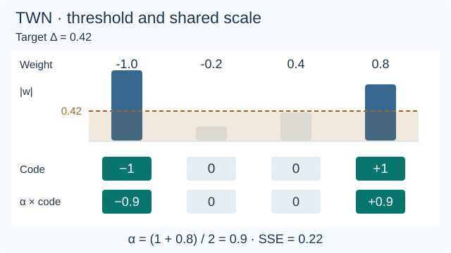

# Ternary Weight Networks

Ternary Weight Networks (TWN) restrict each weight to one of three values, \(\{-\alpha, 0, +\alpha\}\). The zero value lets the network drop small weights as it quantises them, which keeps more information than a binary code at a modest storage cost. It sits between [BinaryConnect](../binaryconnect/index.md) and [pruning](../../../pruning/index.md) in the [binary and ternary](../index.md) family.

## Problem

Binary weights remove too much information, because every weight must be \(\pm 1\) even when its true value is close to zero. A three-value code can represent near-zero weights exactly, at the cost of a little more storage and some extra arithmetic.

## Core idea

Quantise each weight to zero when its magnitude is below a threshold, and to \(\pm \alpha\) otherwise. The threshold and the scale are chosen per filter, so that the ternary weights approximate the full-precision weights closely. The threshold is a fixed fraction of the mean magnitude, and the scale is the mean magnitude of the weights that survive it.

## Equation or algorithm

The ternary approximation is \(W_t = \alpha \cdot t\), where \(t_i \in \{-1, 0, +1\}\) and \(t_i\) is zero when \(|W_i|\) is below the threshold \(\Delta\). The paper's rule of thumb is

\[
\Delta^\ast \approx 0.7 \cdot \mathbb{E}(|W|) \approx \frac{0.7}{n} \sum_{i=1}^{n} |W_i|
\]

where \(n\) is the number of weights in the filter. The scale is the mean magnitude of the weights above the threshold, \(\alpha^\ast = \frac{1}{|I_\Delta|} \sum_{i \in I_\Delta} |W_i|\) with \(I_\Delta = \{i : |W_i| > \Delta\}\). The paper derives the 0.7 factor from assumed weight distributions, so it is an approximation rather than an exact optimum. Zero entries contribute nothing to the product, so the arithmetic reduces to sums and subtractions.

The paper uses the ternary weights in the forward and backward propagations but not in the parameter update, which keeps real-valued weights, as in [BinaryConnect](../binaryconnect/index.md).

### Visual walkthrough: threshold and shared scale

[GitHub-readable fallback](../../../../../assets/concept-animations/twn-threshold-scale-still.svg) · [Full 12-second animation](../../../../../assets/concept-animations/twn-threshold-scale-motion.svg)

For $w=(-1,-0.2,0.4,0.8)$, the mean magnitude is $0.6$, so the heuristic threshold is $\Delta=0.42$. The rising shaded band illustrates the threshold selection, not a training trajectory. With strict survival $|w_i|>\Delta$, the ternary code is $t=(-1,0,0,1)$. Holding this nonempty code fixed, minimising $\|w-\alpha t\|_2^2$ gives $\alpha=(w^\top t)/(t^\top t)=(1+0.8)/2=0.9$. The reconstruction is $(-0.9,0,0,0.9)$ with squared error $0.01+0.04+0.16+0.01=0.22$. If no entries survive, the reconstruction is zero and the scale is immaterial; do not divide by zero. The example isolates the threshold and scale rule of Li et al. (2016), not a globally optimised threshold or an empirical accuracy result. All values are schematic, not model measurements.

On MkDocs use Play/Pause (Enter or Space) to inspect the changes. GitHub and reduced-motion readers see the complete static result. Original diagram, **CC BY-SA 4.0**.

## Results

The abstract reports up to 16 times model compression. The accuracy gap to full precision is given in the paper's tables, and should be read there rather than compared across papers that use different networks.

## Limitations

Ternary arithmetic needs hardware or kernels that skip the zero entries to gain speed. The compression ratio assumes that the ternary code is stored efficiently, and the choice of threshold rule affects the final accuracy.

## Open issues and related variants

- **Learned thresholds.** Setting the threshold from the mean magnitude is a heuristic; learning the quantiser per layer is a natural extension that later work explores, for example [learned step size quantisation](../../quantisation-aware-training/lsq/index.md).
- **Related:** [XNOR-Net](../xnor-net/index.md) uses binary weights with scales, and [structured pruning](../../../pruning/structured-pruning/index.md) removes whole channels, which gives a zero-heavy code with a different structure.

## Connections

A ternary code with many zeros is a sparse representation, so the arithmetic links to [pruning](../../../pruning/index.md). The sums and subtractions that replace multiplications are suited to the bit-level units discussed in [AI hardware](../../../../../engineering/hardware/index.md).

## References

### Seminal papers

- Li, F., Liu, B., Wang, X., Zhang, B., Yan, J. (2016). *Ternary Weight Networks*. arXiv:1605.04711. https://arxiv.org/abs/1605.04711 — Three-value weights with a threshold of about 0.7 times the mean magnitude and a scale over the surviving weights; up to 16 times compression.
- Rastegari, M., Ordonez, V., Redmon, J., Farhadi, A. (2016). *XNOR-Net: ImageNet Classification Using Binary Convolutional Neural Networks*. arXiv:1603.05279. https://arxiv.org/abs/1603.05279 — The binary-with-scale alternative that TWN extends with a zero value.
- Courbariaux, M., Bengio, Y., David, J.-P. (2015). *BinaryConnect: Training Deep Neural Networks with Binary Weights during Propagations*. arXiv:1511.00363. https://arxiv.org/abs/1511.00363 — The two-value method that ternary networks relax.

### Surveys and textbooks

- Gholami, A., Kim, S., Dong, Z., Yao, Z., Mahoney, M. W., Keutzer, K. (2021). *A Survey of Quantization Methods for Efficient Neural Network Inference*. arXiv:2103.13630. https://arxiv.org/abs/2103.13630 — Reviews ternary and binary weights among low-bit methods.

### Lectures and videos

(none checked for this page)

### Articles and documentation

- Esser, S. K., McKinstry, J. L., Bablani, D., Appuswamy, R., Modha, D. S. (2019). *Learned Step Size Quantization*. arXiv:1902.08153. https://arxiv.org/abs/1902.08153 — Learns the quantiser step size during training, a trained alternative to the threshold heuristic used here.
