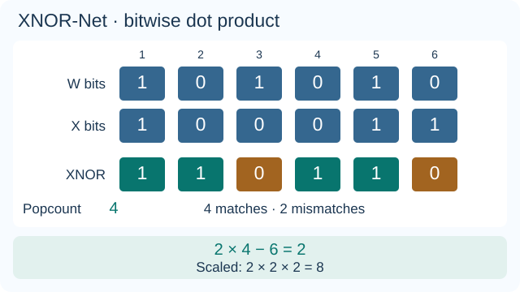

# XNOR-Net

XNOR-Net approximates each real-valued convolution filter by a binary filter multiplied by a real scale factor, and can also binarise the input activations. With both binary, the convolution reduces to XNOR operations and bit counting, which is much faster than floating-point multiplication. It is a method in the [binary and ternary](../index.md) family, and it adds scale factors to [BinaryConnect](../binaryconnect/index.md).

## Problem

Binary networks without scale factors lose much accuracy on ImageNet, because the sign function discards the magnitudes of the weights and activations. The output of each layer then has the wrong scale.

## Core idea

Approximate each filter \(W\) by a binary filter \(B\) times a scale \(\alpha\) computed from the filter itself, so that the approximation keeps the magnitude of the original. The inputs to each convolution are binarised in the same way. The convolution then runs on binary values, with the scale applied once per output.

## Equation or algorithm

The weight approximation is \(W \approx \alpha B\), with \(B = \operatorname{sign}(W)\) and

\[
\alpha^\ast = \frac{\lVert W \rVert_{\ell_1}}{n}
\]

where \(n\) is the number of weights in the filter. The scale is therefore the mean absolute value of the filter's weights. The convolution is approximated as \(I \ast W \approx (I \oplus B)\,\alpha\), where \(\oplus\) uses only additions and subtractions. In the full XNOR-Net variant the inputs \(I\) are binarised in the same way, and the dot product of two binary vectors becomes an XNOR followed by a popcount.

### Visual walkthrough: signed dot product and population count

[GitHub-readable fallback](../../../../../assets/concept-animations/xnor-popcount-dot-still.svg) · [Full 12-second animation](../../../../../assets/concept-animations/xnor-popcount-dot-motion.svg)

Map positive signs to bit 1 and negative signs to bit 0. For one flattened six-element convolution patch, take $w=(2,-1,3,-2,1,-3)$ and $x=(2,-1,-1,-2,4,2)$. The weight and input scales are both 2 (mean absolute magnitude). Their bit vectors are $(1,0,1,0,1,0)$ and $(1,0,0,0,1,1)$. XNOR marks equal signs as 1 and unequal signs as 0, so the result is $(1,1,0,1,1,0)$ and its population count is 4.

For $n$ valid bits and $c$ matches, the signed binary dot product is $c-(n-c)=2c-n$, not just $c$. Here it is 2; applying the two real scales gives $2\times2\times2=8$. The original real-valued dot product is 4, so scaling is an approximation, not an identity. Padding bits in a packed word must be excluded from the count. The sequential comparisons are a teaching visualisation, not a claim that a real packed kernel processes one bit at a time. All numbers are schematic, not model measurements. See Rastegari et al. (2016) in References.[^xnor-motion]

On MkDocs use Play/Pause (Enter or Space) to inspect the changes. GitHub and reduced-motion readers see the complete static result. Original artwork, **CC BY-SA 4.0**.

[^xnor-motion]: Rastegari et al. (2016). https://arxiv.org/abs/1603.05279 — Original method.

### Packed-word boundary example

If the six valid bits above occupy the low six positions of an eight-bit word, let both high padding bits be zero. XNOR also marks the two padding pairs as matches, so the unmasked population count becomes 6 instead of 4. With a valid-bit mask $M=00111111_2$ and $n=6$, the correct operation is

$
c=\operatorname{popcount}(\operatorname{XNOR}(b_w,b_x)\mathbin{\&}M),\qquad d=2c-n.
$

The correct signed result is 2; counting all eight positions gives $2(6)-8=4$, while counting padding but subtracting only six gives 6. Mask each partial word before counting, and subtract the total valid dimension, not the storage width. This is an illustrative packing example, not a measured kernel result.

## Results

The abstract reports that the binary-weight version of AlexNet matches the classification accuracy of the full-precision AlexNet on ImageNet. The fully binary XNOR-Net is less accurate. The paper's Table 1 gives 44.2% top-1 accuracy for XNOR-Net against 56.6% for full-precision AlexNet, a gap of 12.4 points, and the abstract reports that it is more than 16% more accurate than BinaryConnect and BinaryNet.

## Limitations

The fully binary variant loses accuracy that the binary-weight variant does not, so the speed gain comes with a larger accuracy cost on this task. The speed-up depends on hardware that implements bitwise operations efficiently, and a GPU gains little from it in practice.

## Open issues and related variants

- **Accuracy of fully binary networks.** The gap between binary-weight and fully binary networks remains large on hard tasks, and later methods try to close it with better training.
- **Related:** [ternary weight networks](../ternary-weight-networks/index.md) keep a zero value, and [mixed precision](../../mixed-precision/index.md) keeps sensitive layers at more bits.

## Connections

The XNOR and popcount arithmetic is a bit-level operation that [hardware](../../../../../engineering/hardware/index.md) with bit-serial or in-memory compute can exploit. A single scale per filter is similar in spirit to the per-channel scaling in [AWQ](../../post-training/awq/index.md), though the two methods scale different things.

## References

### Seminal papers

- Rastegari, M., Ordonez, V., Redmon, J., Farhadi, A. (2016). *XNOR-Net: ImageNet Classification Using Binary Convolutional Neural Networks*. arXiv:1603.05279. https://arxiv.org/abs/1603.05279 — Binary filters with a per-filter scale; binary-weight AlexNet matches full precision, and fully binary XNOR-Net reaches 44.2% top-1 against 56.6%.
- Courbariaux, M., Bengio, Y., David, J.-P. (2015). *BinaryConnect: Training Deep Neural Networks with Binary Weights during Propagations*. arXiv:1511.00363. https://arxiv.org/abs/1511.00363 — The binary-weight training method that XNOR-Net extends with scales.
- Li, F., Liu, B., Wang, X., Zhang, B., Yan, J. (2016). *Ternary Weight Networks*. arXiv:1605.04711. https://arxiv.org/abs/1605.04711 — The three-value alternative, with a zero that keeps some weights.

### Surveys and textbooks

- Gholami, A., Kim, S., Dong, Z., Yao, Z., Mahoney, M. W., Keutzer, K. (2021). *A Survey of Quantization Methods for Efficient Neural Network Inference*. arXiv:2103.13630. https://arxiv.org/abs/2103.13630 — Places binary convolutions among low-bit methods.

### Lectures and videos

(none checked for this page)

### Articles and documentation

- Jacob, B., Kligys, S., Chen, B., Zhu, M., Tang, M., Howard, A., Adam, H., Kalenichenko, D. (2017). *Quantization and Training of Neural Networks for Efficient Integer-Arithmetic-Only Inference*. arXiv:1712.05877. https://arxiv.org/abs/1712.05877 — The 8-bit integer baseline against which binary convolutions are compared.
