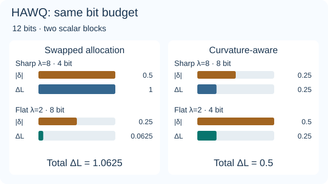

# HAWQ

HAWQ (Hessian AWare Quantization) chooses a bit-width for each layer of a network from the curvature of the loss in that layer. Layers whose loss is sensitive to perturbation keep more bits, and layers that are insensitive receive fewer. It is a method in the [mixed-precision](../index.md) family of [quantisation](../../index.md).

## Problem

Choosing bit-widths by hand or by exhaustive search is slow, and simple size-based rules do not reflect how sensitive each layer is to rounding. Two layers of the same size can respond very differently to the same rounding error.

## Core idea

Use the Hessian of the loss with respect to each layer's weights as a measure of sensitivity. The paper bases each layer's relative precision on the Hessian spectrum of that layer, so layers with high curvature are quantised more carefully. The bit budget is then spent on the most sensitive layers first.

### Visual walkthrough: curvature and an equal bit budget

[GitHub-readable fallback](../../../../../assets/concept-animations/hawq-curvature-budget-still.svg) · [Full 12-second animation](../../../../../assets/concept-animations/hawq-curvature-budget-motion.svg)

On MkDocs, use Play/Pause (Enter or Space) to inspect the changes. GitHub and reduced-motion readers see the static comparison. Original diagram, **CC BY-SA 4.0**.

Near a stationary point, ignoring cross-block interactions and higher-order terms, a scalar quadratic block with curvature $h$ has loss increase $\Delta L=\frac12 h\delta^2$ for perturbation $\delta$. Consider two equally sized scalar blocks with curvatures 8 and 2, and a total budget of 12 weight bits. Assign schematic absolute perturbations 0.5 to 4 bits and 0.25 to 8 bits; these are constructed examples, not quantizer specifications. Amber bars grow linearly with the schematic perturbation magnitude (full scale 0.5); blue and teal loss bars grow quadratically (full scale 1). At each sampled animation knot the loss is computed from the corresponding perturbation; interpolation between knots approximates the quadratic curve. The reset is a presentation transition, not an optimisation trajectory.

| Bit allocation (sharp, flat) | Sharp loss | Flat loss | Total |
| --- | ---: | ---: | ---: |
| (4, 8) | 1 | 0.0625 | 1.0625 |
| (8, 4) | 0.25 | 0.25 | 0.5 |

Both allocations cost the same number of bits, but protecting the sharper block reduces the quadratic loss. For the original HAWQ, Dong et al. (2019, Section III-B) rank blocks by the top Hessian eigenvalue divided by the block parameter count, $S_i=\lambda_i/n_i$, to obtain a **relative** precision ordering; their fine-tuning order uses $\Omega_i=\lambda_i\|Q(W_i)-W_i\|_2^2$. The original score does not determine exact bit widths. The two-block example is an analytic illustration with equal sizes, not the full HAWQ search, a real quantization grid, or measured model accuracy. See [Dong et al. (2019), Eqs. 5–6](https://arxiv.org/abs/1905.03696).

### Why the allocation wins (and when it may not)

For equal-size independent scalar blocks, let $e_4>e_8\geq0$ be the same candidate error magnitudes for both blocks. Subtracting the losses for allocations (4, 8) and (8, 4) gives

$
L_{4,8}-L_{8,4}=\tfrac12(h_A-h_B)(e_4^2-e_8^2).
$

For the illustrated curvatures and errors this is 0.5625. If the curvatures are equal there is no advantage in swapping. With layer-dependent quantization errors, unequal parameter counts or cross-block Hessian terms, this simplified ordering need not hold. A real bit budget counts bits per parameter (and may include metadata), not just the sum of layer bit-widths.

## Equation or algorithm

The paper's abstract describes choosing each layer's relative quantisation precision from the layer's Hessian spectrum. The full Hessian of a large network is too big to form, so the method works with Hessian-based quantities that can be estimated from the loss and its gradients. The original HAWQ sensitivity ranking determines relative precision only; exact bit widths must still be selected separately. The exact estimator and the search procedure are in the paper's method section, which should be read for the details.

## Results

The abstract states that HAWQ allows automatic selection of the relative quantisation precision of each layer, based on the Hessian spectrum. The paper's tables give the accuracy results for specific networks, and should be read there.

## Limitations

Hessian estimates are noisy and cost extra computation on every calibration pass. The sensitivity measure summarises each layer by a single number, which may hide rare but important directions in the loss. How well it extends to very large transformers needs more study.

## Open issues and related variants

- **Predicting behaviour.** Whether Hessian sensitivity predicts the effect of rounding on reasoning and long-context behaviour, rather than on average loss, is not known.
- **Related:** [GPTQ](../../post-training/gptq/index.md) uses the same second-order information to compensate rounding errors within a layer, rather than to choose widths between layers.

## Connections

HAWQ extends the uniform-precision idea of [quantisation](../../index.md). Its budgets are set by the memory and latency limits of the target [hardware](../../../../../engineering/hardware/index.md), and curvature-based sensitivity is also used in [pruning](../../../pruning/index.md) to decide which weights to remove.

## References

### Seminal papers

- Dong, Z., Yao, Z., Gholami, A., Mahoney, M., Keutzer, K. (2019). *HAWQ: Hessian AWare Quantization of Neural Networks with Mixed-Precision*. arXiv:1905.03696. https://arxiv.org/abs/1905.03696 — Assigns per-layer relative precision from each layer's Hessian spectrum.
- Frantar, E., Ashkboos, S., Hoefler, T., Alistarh, D. (2022). *GPTQ: Accurate Post-Training Quantization for Generative Pre-trained Transformers*. arXiv:2210.17323. https://arxiv.org/abs/2210.17323 — Uses second-order information to compensate rounding within a layer, the uniform-precision counterpart.
- Jacob, B., Kligys, S., Chen, B., Zhu, M., Tang, M., Howard, A., Adam, H., Kalenichenko, D. (2017). *Quantization and Training of Neural Networks for Efficient Integer-Arithmetic-Only Inference*. arXiv:1712.05877. https://arxiv.org/abs/1712.05877 — Uniform 8-bit integer inference, the baseline that mixed precision improves on.

### Surveys and textbooks

- Gholami, A., Kim, S., Dong, Z., Yao, Z., Mahoney, M. W., Keutzer, K. (2021). *A Survey of Quantization Methods for Efficient Neural Network Inference*. arXiv:2103.13630. https://arxiv.org/abs/2103.13630 — Reviews mixed-precision schemes and the sensitivity measures they use.

### Lectures and videos

(none checked for this page)

### Articles and documentation

- Dettmers, T., Lewis, M., Belkada, Y., Zettlemoyer, L. (2022). *LLM.int8(): 8-bit Matrix Multiplication for Transformers at Scale*. arXiv:2208.07339. https://arxiv.org/abs/2208.07339 — Keeps the few outlier dimensions of large transformers in 16 bits and the rest in 8 bits, a different allocation within a matrix.
