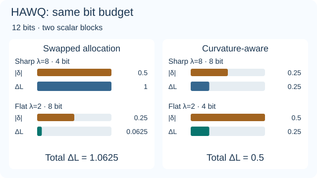

# HAWQ

HAWQ（Hessian AWare Quantization，海森感知量化）依每一層損失函數的曲率，為該層選擇位元寬度。對擾動的損失敏感的層保留較多位元，對擾動不敏感的層則分配較少位元。它是[量化](../../index.zh-TW.md)中[混合精度](../index.zh-TW.md)系列的一種方法。

## 問題

以手動或窮舉搜尋選擇位元寬度既慢又費力，而以大小為基礎的簡單規則無法反映每一層對捨入的敏感程度。兩個大小相同的層，面對相同的捨入誤差，反應可能截然不同。

## 核心想法

以損失函數對每一層權重的海森矩陣作為敏感度的度量。論文依據每一層的海森譜（Hessian spectrum）來決定該層的相對精度，因此曲率高的層會被更謹慎地量化。位元預算則優先分配給最敏感的層。

### 動畫解讀：曲率與相同位元預算

[GitHub 靜態預覽](../../../../../assets/concept-animations/hawq-curvature-budget-still.svg) · [完整 12 秒動畫](../../../../../assets/concept-animations/hawq-curvature-budget-motion.svg)

在 MkDocs 使用播放／暫停（Enter 或空白鍵）檢視變化；GitHub 與減少動態效果模式使用靜態比較圖。原創示意圖，**CC BY-SA 4.0**。

在駐點附近，忽略跨區塊交互作用與高階項，曲率為 $h$ 的純量二次區塊受到擾動 $\delta$ 時，損失增量為 $\Delta L=\frac12 h\delta^2$。考慮兩個大小相同、曲率分別為 8 與 2 的純量區塊，權重位元總預算為 12。假設 4 位元與 8 位元的示意絕對擾動分別為 0.5 與 0.25，這是人工算例，而非量化器的規格。長條增長至各區塊的損失貢獻；中間長度是呈現進度，而非最佳化實測狀態。

| 位元配置（尖銳、平坦） | 尖銳區塊損失 | 平坦區塊損失 | 總和 |
| --- | ---: | ---: | ---: |
| (4, 8) | 1 | 0.0625 | 1.0625 |
| (8, 4) | 0.25 | 0.25 | 0.5 |

兩種配置耗用相同位元數，但保護曲率較高的區塊可降低二次損失。原始 HAWQ 中，Dong 等人（2019，第 III-B 節）以海森矩陣最大特徵值除以區塊參數數量 $S_i=\lambda_i/n_i$ 來取得**相對**精度排序；微調順序則使用 $\Omega_i=\lambda_i\|Q(W_i)-W_i\|_2^2$。原始分數無法直接決定確切位元寬度。本雙區塊算例僅為等大小的解析示意，並非完整 HAWQ 搜尋、實際量化網格或模型準確率實測。參見 [Dong 等人（2019），公式 5–6](https://arxiv.org/abs/1905.03696)。

## 公式或演算法

論文的摘要描述了依每一層的海森譜來選擇其相對量化精度。大型網路的完整海森矩陣太大，無法直接形成，因此方法使用可由損失與梯度估計的、基於海森的量。原始 HAWQ 的敏感度排序只決定區塊的相對精度，確切位元寬度仍需另行選定。確切的估計器與搜尋程序，見論文的方法章節，應以原文為準。

## 結果

摘要指出，HAWQ 能依據海森譜自動選擇每一層的相對量化精度。特定網路的準確率結果見論文的表格，應以原文為準。

## 限制

海森估計有雜訊，且每次校準都需要額外的運算。敏感度量把每一層總結為單一數值，可能掩蓋損失中罕見但重要的方向。它如何延伸到非常大的 transformer，仍需進一步研究。

## 未解問題與相關變體

- **行為預測。** 海森敏感度能否預測捨入對推理與長脈絡行為的影響（而不只是平均損失），目前並不清楚。
- **相關。** [GPTQ](../../post-training/gptq/index.zh-TW.md) 使用同樣的二階資訊來補償層內的捨入誤差，而不是在各層之間選擇寬度。

## 與其他主題的連結

HAWQ 擴展了[量化](../../index.zh-TW.md)的均勻精度想法。它的預算由目標 [硬體](../../../../../engineering/hardware/index.zh-TW.md)的記憶體與延遲限制決定；以曲率為基礎的敏感度也用於[剪枝](../../../pruning/index.zh-TW.md)，以決定移除哪些權重。

## 參考文獻

### 奠基性論文

- Dong, Z., Yao, Z., Gholami, A., Mahoney, M., Keutzer, K. (2019). *HAWQ: Hessian AWare Quantization of Neural Networks with Mixed-Precision*. arXiv:1905.03696. https://arxiv.org/abs/1905.03696 — 依每一層的海森譜分配該層的相對精度。
- Frantar, E., Ashkboos, S., Hoefler, T., Alistarh, D. (2022). *GPTQ: Accurate Post-Training Quantization for Generative Pre-trained Transformers*. arXiv:2210.17323. https://arxiv.org/abs/2210.17323 — 使用二階資訊補償層內的捨入誤差，是均勻精度的對應方法。
- Jacob, B., Kligys, S., Chen, B., Zhu, M., Tang, M., Howard, A., Adam, H., Kalenichenko, D. (2017). *Quantization and Training of Neural Networks for Efficient Integer-Arithmetic-Only Inference*. arXiv:1712.05877. https://arxiv.org/abs/1712.05877 — 均勻的 8 位元整數推理，是混合精度所改進的基準。

### 綜述與教科書

- Gholami, A., Kim, S., Dong, Z., Yao, Z., Mahoney, M. W., Keutzer, K. (2021). *A Survey of Quantization Methods for Efficient Neural Network Inference*. arXiv:2103.13630. https://arxiv.org/abs/2103.13630 — 綜述混合精度方案及其使用的敏感度量。

### 講座與影片

（本頁未檢核任何項目）

### 文章與文件

- Dettmers, T., Lewis, M., Belkada, Y., Zettlemoyer, L. (2022). *LLM.int8(): 8-bit Matrix Multiplication for Transformers at Scale*. arXiv:2208.07339. https://arxiv.org/abs/2208.07339 — 把大型 transformer 中少數的離群維度保留為 16 位元、其餘為 8 位元，是矩陣內另一種位元配置方式。
