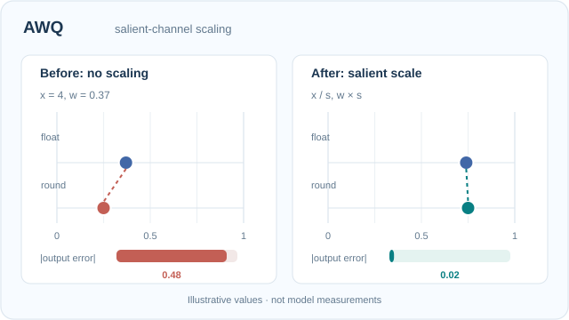

# AWQ

AWQ（激活感知權重量化）是大型語言模型僅權重量化的訓練後方法。它依據激活統計量，而非權重量值，決定哪些權重需要保護；量化之前先縮放這些通道，使它們的相對捨入誤差下降。

## 問題

最重要的權重並不是量值最大的權重。統一量化所有權重，會在攜帶大激活值的少數通道上損失準確度。

## 核心想法

依激活統計量找出顯著通道。量化前先放大這些通道的尺度，使它們的相對捨入誤差下降。反向的尺度會併入前一個運算，因此在完整精度下網路在數學上不變。

### 教學動畫：顯著通道縮放與捨入誤差

[GitHub 可閱讀靜態預覽](../../../../../assets/concept-animations/awq-salient-scaling-still.svg) · [完整 12 秒動畫](../../../../../assets/concept-animations/awq-salient-scaling-motion.svg)

此**單一通道的解析示例**假設激活值 $x=4$、權重 $w=0.37$，量化格點間距固定為**示意值** $\Delta=0.25$。未縮放時，$Q(0.37)=0.25$，輸出誤差 $|4(0.25-0.37)|=0.48$。若 $s=2$，全精度運算仍滿足 $(x/s)(sw)=xw$，而相同示意格點上的 $Q(0.74)=0.75$，使誤差成為 $|(4/2)(0.75-0.74)|=0.02$。動畫讓 $s$ 從 1 連續增至 2 再返回，且捨入會在格點邊界**跳變**，誤差並**不保證單調下降**。此圖只隔離 Lin 等人（2023）激活感知保護的動機，**不是**實際 AWQ 的群組量化器或校準搜尋，數值亦**非模型量測**。

MkDocs 可用**播放／暫停**（Enter／Space）觀察浮點與捨入位置、誤差長條的變化；GitHub 與偏好減少動態效果的讀者看到最終靜態比較。原創圖像授權 **CC BY-SA 4.0**。

## 公式或演算法

對尺度為 \(s\) 的通道，層的計算為 \((W\,\mathrm{diag}(s)) \cdot (\mathrm{diag}(s)^{-1}X)\)。尺度透過網格搜尋選定，目標是在校準資料上使輸出誤差最小。

## 結果

作者報告，只保護約 1% 的顯著權重，就能大幅降低量化誤差。此論文獲得 MLSys 2024 最佳論文獎。

## 限制

搜尋尺度需要校準時間。此方法以僅權重量化為目標，激活值仍維持較高精度。

## 開放問題與相關變體

- **激活分布偏移**：在校準資料上選定的尺度，可能不適用於與校準分布相差很遠的輸入。
- **相關**：[GPTQ](../gptq/index.zh-TW.md) 補償捨入誤差，而不是重新縮放通道；[SmoothQuant](../smoothquant/index.zh-TW.md) 也為激活值量化做縮放。

## 相關連結

AWQ 是讓大型模型[服務](../../../../../engineering/mlops/index.zh-TW.md)更便宜的主要方法之一，其格式取決於目標[硬體](../../../../../engineering/hardware/index.zh-TW.md)支援的核心程式。

## 參考文獻

### 開創性論文

- Lin, J., 等人 (2023). *AWQ: Activation-aware Weight Quantization for LLM Compression and Acceleration*. MLSys 2024. https://arxiv.org/abs/2306.00978 — 依激活統計量縮放顯著通道，並觀察到保護約 1% 權重即可大幅降低誤差。
- Frantar, E., 等人 (2022). *GPTQ: Accurate Post-Training Quantization for Generative Pre-trained Transformers*. arXiv:2210.17323. https://arxiv.org/abs/2210.17323 — 以捨入補償為主的替代方法。
- Xiao, G., Lin, J., Seznec, M., Wu, H., Demouth, J., Han, S. (2023). *SmoothQuant: Accurate and Efficient Post-Training Quantization for Large Language Models*. ICML 2023. arXiv:2211.10438. https://arxiv.org/abs/2211.10438 — 面向 8 位元推論的激活端縮放。

### 綜述與教科書

- Gholami, A., 等人 (2021). *A Survey of Quantization Methods for Efficient Neural Network Inference*. arXiv:2103.13630. https://arxiv.org/abs/2103.13630 — 把激活感知縮放放在精度降低方法之中。

### 講座與影片

（本頁尚未查核任何項目）

### 文章與文件

- Dettmers, T., 等人 (2022). *LLM.int8(): 8-bit Matrix Multiplication for Transformers at Scale*. arXiv:2208.07339. https://arxiv.org/abs/2208.07339 — 作為比較基準的混合精度 8 位元方法。
