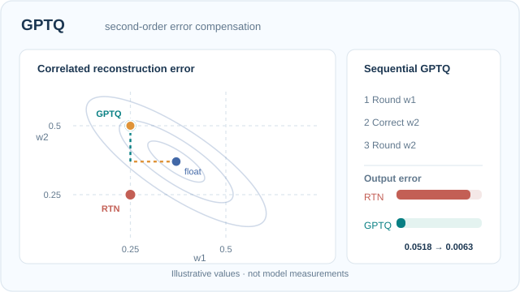

# GPTQ

GPTQ is a post-training method that quantises the weights of large language models to 3 or 4 bits. It rounds one column of a layer at a time and compensates each rounding error by adjusting the columns that have not been quantised yet, using second-order information from a small calibration set.

## Problem

Rounding each weight to the nearest grid value, as in round-to-nearest quantisation, ignores the effect of the rounding on the other weights. At 3 or 4 bits the error accumulates and quality drops.

## Core idea

Quantise the weights of one layer one column at a time. After each column is rounded, the rounding error is compensated by updating the not-yet-quantised columns, using approximate second-order information from the calibration inputs.

### Visual walkthrough: second-order error compensation

[GitHub-readable fallback](../../../../../assets/concept-animations/gptq-error-compensation-still.svg) · [Full 12-second animation](../../../../../assets/concept-animations/gptq-error-compensation-motion.svg)

A **two-weight analytic example** uses $w=(0.37,0.37)$ and $H=\begin{bmatrix}1&0.8\\0.8&1\end{bmatrix}$ (positive definite). The illustrated contours are level sets of $(\hat w-w)^\top H(\hat w-w)$, a **toy quadratic reconstruction loss**, not a measured LLM Hessian. First round $w_1$ to $0.25$ (error $e_1=-0.12$). Minimising this quadratic with that first coordinate fixed gives $w_2'=0.37-(H_{21}/H_{22})e_1=0.466$, which then rounds to $0.50$. The compensated final point $(0.25,0.50)$ has squared error **0.00634**, compared with **0.05184** for independent rounding to $(0.25,0.25)$. This isolates the coupling that motivates Frantar et al. (2022); it omits GPTQ's blockwise updates and Cholesky implementation. **No values are model measurements.**

On MkDocs use **Play/Pause** (Enter/Space); the path traverses rounding, compensation and the second rounding. GitHub/reduced-motion fallback shows the completed path. Original diagram, **CC BY-SA 4.0**.

## Equation or algorithm

The method follows the optimal brain quantisation framework, which uses the inverse Hessian \(H^{-1}\) of the layer's squared error \(\lVert WX - \hat{W}X \rVert^2\) to decide which weight to round and how to update the rest. GPTQ makes this efficient for billions of parameters by processing columns in blocks and using a Cholesky decomposition.

## Results

The abstract reports that GPTQ can quantise GPT models with 175 billion parameters in about four GPU hours, reducing the weights to 3 or 4 bits.

## Limitations

Calibration uses a small dataset, so the result depends on how well it matches the target domain. Speed-ups during inference need kernels that support the packed format.

## Open issues and related variants

- **Calibration sensitivity.** Results vary with the calibration data, and the effect on reasoning and long-context tasks is less studied.
- **Related:** [AWQ](../awq/index.md) reaches similar bit-widths by scaling salient channels rather than compensating rounding errors.

## Connections

GPTQ uses the same curvature idea as pruning with second-order reconstruction, on the [pruning](../../../pruning/index.md) page, and it is a common baseline in [mixed-precision](../../mixed-precision/index.md) comparisons.

## References

### Seminal papers

- Frantar, E., et al. (2022). *GPTQ: Accurate Post-Training Quantization for Generative Pre-trained Transformers*. ICLR 2023. https://arxiv.org/abs/2210.17323 — Layer-wise second-order rounding with error compensation for 3 and 4 bit weights.
- Frantar, E., Alistarh, D. (2023). *SparseGPT: Massive Language Models Can Be Accurately Pruned in One-Shot*. arXiv:2301.00774. https://arxiv.org/abs/2301.00774 — The pruning counterpart, using the same reconstruction framework.
- Dettmers, T., et al. (2022). *LLM.int8(): 8-bit Matrix Multiplication for Transformers at Scale*. arXiv:2208.07339. https://arxiv.org/abs/2208.07339 — An 8-bit alternative that keeps outliers in 16 bits.

### Surveys and textbooks

- Gholami, A., et al. (2021). *A Survey of Quantization Methods for Efficient Neural Network Inference*. arXiv:2103.13630. https://arxiv.org/abs/2103.13630 — Reviews the precision reduction methods GPTQ belongs to.

### Lectures and videos

(none checked for this page)

### Articles and documentation

- Lin, J., et al. (2023). *AWQ: Activation-aware Weight Quantization for LLM Compression and Acceleration*. arXiv:2306.00978. https://arxiv.org/abs/2306.00978 — The activation-aware alternative for 4-bit weights.
