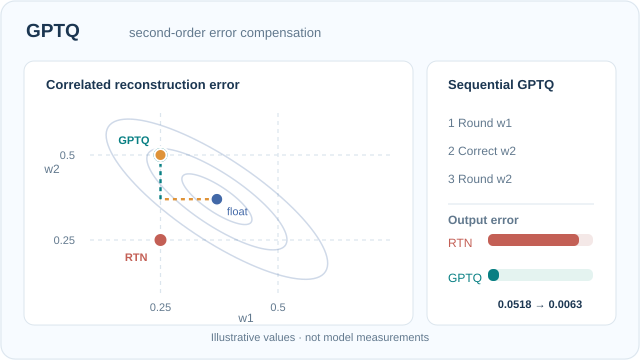

# GPTQ

GPTQ 是一種訓練後方法，把大型語言模型的權重量化為 3 或 4 位元。它每次處理一層中的一欄，捨入後再用校準資料的近似二階資訊，調整尚未量化的欄，以補償捨入誤差。

## 問題

像最近捨入這樣把每個權重都四捨五入到最近的網格值，忽略了捨入對其他權重的影響。在 3 或 4 位元時，誤差會累積，品質下降。

## 核心想法

逐行量化單一層的權重。每一欄捨入後，用校準輸入的近似二階資訊，更新尚未量化的欄，以補償捨入誤差。

### 教學動畫：二階捨入補償

[GitHub 可閱讀靜態預覽](../../../../../assets/concept-animations/gptq-error-compensation-still.svg) · [完整 12 秒動畫](../../../../../assets/concept-animations/gptq-error-compensation-motion.svg)

使用**兩權重的解析示例**：$w=(0.37,0.37)$，$H=\begin{bmatrix}1&0.8\\0.8&1\end{bmatrix}$（正定）。等值線對應 $(\hat w-w)^\top H(\hat w-w)$，是**人工二次重建損失**，非實測 LLM Hessian。先將 $w_1$ 捨入至 $0.25$，誤差 $e_1=-0.12$。固定第一個座標後，最小化二次式得到 $w_2'=0.37-(H_{21}/H_{22})e_1=0.466$，再捨入至 $0.50$。補償後的 $(0.25,0.50)$ 平方誤差為 **0.00634**，兩座標直接捨入為 $(0.25,0.25)$ 則為 **0.05184**。此圖只展示 Frantar 等人（2022）方法所利用的誤差關聯，未呈現 GPTQ 真實的區塊更新或 Cholesky 實作。**數值不是模型實測值。**

MkDocs 可用**播放／暫停**（Enter／Space）檢視第一個座標捨入、第二個座標補償及再次捨入；GitHub／減少動態效果模式顯示完整靜態路徑。原創圖像授權 **CC BY-SA 4.0**。

## 公式或演算法

此方法遵循最佳腦部量化（optimal brain quantisation）的框架，利用該層平方誤差 \(\lVert WX - \hat{W}X \rVert^2\) 的反 Hessian \(H^{-1}\)，決定先捨入哪個權重，以及如何更新其餘權重。GPTQ 以分塊處理與 Cholesky 分解，使數十億參數的模型也能有效率地完成。

## 結果

摘要報告，GPTQ 能在約四個 GPU 小時內量化 1750 億參數的 GPT 模型，把權重降到 3 或 4 位元。

## 限制

校準使用一小批資料，因此結果取決於它與目標領域的吻合程度。推論時要獲得加速，需要支援該打包格式的核心程式。

## 開放問題與相關變體

- **校準敏感度**：結果隨校準資料而變，對推理與長脈絡任務的影響較少被研究。
- **相關**：[AWQ](../awq/index.zh-TW.md) 透過縮放顯著通道達到相近的位元寬度，而不是補償捨入誤差。

## 相關連結

GPTQ 與[二階重建剪枝](../../../pruning/index.zh-TW.md)使用相同的曲率概念，也是[混合精度](../../mixed-precision/index.zh-TW.md)比較中常見的基準。

## 參考文獻

### 開創性論文

- Frantar, E., 等人 (2022). *GPTQ: Accurate Post-Training Quantization for Generative Pre-trained Transformers*. ICLR 2023. https://arxiv.org/abs/2210.17323 — 逐層二階捨入，為 3 與 4 位元權重做誤差補償。
- Frantar, E., Alistarh, D. (2023). *SparseGPT: Massive Language Models Can Be Accurately Pruned in One-Shot*. arXiv:2301.00774. https://arxiv.org/abs/2301.00774 — 剪枝的對應方法，使用相同的重建框架。
- Dettmers, T., 等人 (2022). *LLM.int8(): 8-bit Matrix Multiplication for Transformers at Scale*. arXiv:2208.07339. https://arxiv.org/abs/2208.07339 — 8 位元替代方案，把離群值保留在 16 位元。

### 綜述與教科書

- Gholami, A., 等人 (2021). *A Survey of Quantization Methods for Efficient Neural Network Inference*. arXiv:2103.13630. https://arxiv.org/abs/2103.13630 — 回顧 GPTQ 所屬的精度降低方法。

### 講座與影片

（本頁尚未查核任何項目）

### 文章與文件

- Lin, J., 等人 (2023). *AWQ: Activation-aware Weight Quantization for LLM Compression and Acceleration*. arXiv:2306.00978. https://arxiv.org/abs/2306.00978 — 4 位元權重的激活感知替代方法。
