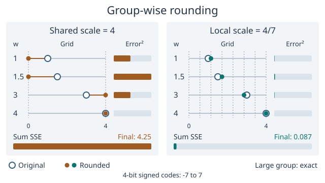

# 訓練後量化

訓練後量化（PTQ）在不重新訓練模型的情況下，把已訓練好的模型轉成較低精度。它用一小批校準資料決定尺度，並逐層固定或調整捨入。對大型語言模型來說，PTQ 是最常見的做法，因為完整的量化感知訓練成本過高。

## 概述

最簡單的 PTQ 是最近捨入：為每個張量或每組計算尺度，並把每個值捨入到最近的網格點。它很快，但在 4 位元及以下時會損失準確度，因為捨入一個權重時，忽略了它對輸出的影響。本頁的方法以不同方式改進基準：以二階資訊選擇捨入方式（GPTQ）、保護最重要的權重（AWQ）、把激活離群值移到權重上（SmoothQuant），或把離群維度保留在較高精度（LLM.int8()）。

## 關鍵概念

- **校準集**：數百到數千筆輸入，用來量測激活統計量，並選擇尺度或計算重建誤差。
- **分組尺度**：把權重分成 32 到 128 個值一組，每組有自己的尺度，可以減輕離群值造成的損害。
- **逐層目標**：大多數 PTQ 方法最小化單一層的輸出誤差 \(\lVert WX - \hat{W}X \rVert^2\)，而不是權重誤差。
- **僅權重與權重加激活**：僅權重方法節省記憶體，但運算仍以浮點數進行；權重加激活的方法則可使用整數運算。

### 為什麼分組尺度會改變捨入結果

考慮兩組各四個權重的人工算例：$(1,1.5,3,4)$ 與 $(8,16,24,28)$。採用對稱式有號 4 位元量化，整數碼範圍為 $-7$ 至 $7$（不使用 $-8$），最大絕對值尺度 $s=\max|w|/7$，以及最近捨入：

$$
q_i=\operatorname{clip}(\operatorname{round}(w_i/s),-7,7),\qquad \hat w_i=sq_i.
$$

共用尺度 $4$ 時，小權重組重建為 $(0,0,4,4)$；獨立尺度 $4/7$ 則重建為 $(8/7,12/7,20/7,4)$。大權重組在兩種設定下的尺度皆為 $4$，且都能精確重建。動畫將小權重由原始位置移至最近的量化網格點；中間移動只是教學插值，並非反覆迭代的量化演算法。

| 尺度選擇 | 小權重組平方誤差 | 大權重組平方誤差 |
| --- | ---: | ---: |
| 共用 | $17/4=4.25$ | 0 |
| 分組 | $17/196\approx0.086735$ | 0 |

本算例的權重平方誤差降為原來的 1/49。這是沒有捨入平手的人工數值，不是實測準確率或延遲。額外尺度也需要中繼資料空間：若權重以 4 位元打包、每個尺度占 $b$ 位元，忽略對齊與標頭時，八個權重的成本分別為 $32+b$ 與 $32+2b$ 位元。較小的分組不一定能改善端到端延遲或任務損失。

*原創 12 秒教學動畫（CC BY-SA 4.0）。* 網站可使用播放／暫停按鈕，小螢幕可水平捲動。GitHub 可直接開啟[靜態預覽](../../../../assets/concept-animations/ptq-group-scale-grid-still.svg)或[完整 SVG 動畫](../../../../assets/concept-animations/ptq-group-scale-grid-motion.svg)。

新版動畫依序將四個小權重捨入。每當圓點抵達量化網格，就揭露該權重的平方殘差，並加入累計平方誤差。左右兩欄的逐權重長條共用 $9/4$ 的尺度上限，累計長條共用 $17/4$ 的尺度上限。圖內較小的最終數值四捨五入至小數第三位。

| 已捨入的權重 | 共用尺度累計平方誤差 | 分組尺度累計平方誤差 |
| ---: | ---: | ---: |
| 1 | 1 | $4/196$ |
| 1.5 | $13/4$ | $13/196$ |
| 3 | $17/4$ | $17/196$ |
| 4 | $17/4$ | $17/196$ |

這個順序只是為了拆解彼此獨立的最近捨入運算；實際量化核心可以平行捨入四個權重。長條只計入已完成捨入的項目，循環重設並不是量化步驟。

### 權重誤差與校準輸出誤差

前述權重平方誤差通常不是線性層選擇尺度時的實際目標。對權重向量 $w$，令 $d=w-\hat w$，並以 $M=\mathbb E[xx^\top]$ 表示未中心化的校準二階動差矩陣，預期平方輸出誤差為

$
\mathbb E[(d^\top x)^2]=d^\top M d.
$

另考慮人工算例 $w=(1.1,0.85)$，採有號 4 位元最近捨入，比較兩個候選尺度（不必為最大絕對值尺度）。兩者皆無截斷或捨入平手。

| 尺度 | 重建權重 | 權重平方誤差 | $x=(5,2)$ 的平方輸出誤差 | $x=(3,2)$ 的平方輸出誤差 |
| ---: | --- | ---: | ---: | ---: |
| 1 | $(1,1)$ | 0.0325 | 0.04 | 0 |
| 0.6 | $(1.2,0.6)$ | 0.0725 | 0 | 0.04 |

若校準輸入以機率 $p$ 取 $x=(5,2)$，否則取 $x=(3,2)$，兩種尺度的預期輸出誤差分別為 $0.04p$ 與 $0.04(1-p)$。因此，以輸出誤差為目標時，較佳尺度在 $p=1/2$ 切換，但權重平方誤差始終偏好尺度 1。帶符號的殘差貢獻彼此抵消，因此某個輸入方向上的輸出誤差可以為零。兩個尺度只是人工候選值，不代表全域最佳解或特定 PTQ 方法的實測結果。

## 方法

每個方法都有自己的頁面：

- [LLM.int8()](llm-int8/index.zh-TW.md)：混合精度分解，把離群維度保留在 16 位元。
- [GPTQ](gptq/index.zh-TW.md)：以二階資訊進行捨入，並補償誤差，適用 3 與 4 位元。
- [AWQ](awq/index.zh-TW.md)：依激活統計量縮放顯著通道，加以保護。
- [SmoothQuant](smoothquant/index.zh-TW.md)：把激活離群值移到權重上，使權重與激活值都能是 8 位元。

## 取捨

- **成本與準確度**：PTQ 需要數分鐘到數小時的校準。解決逐層問題的方法成本較高，但在低位元時能保留更多準確度。
- **位元寬度**：多數方法在 8 位元時可靠，但在 4 位元及以下時變得敏感。
- **核心支援**：只有推論函式庫能快速執行某種格式，該方法才有實用價值。

## 相關連結

PTQ 是 LLM 服務的預設做法，見[MLOps 與部署](../../../../engineering/mlops/index.zh-TW.md)。PTQ 所針對的數字格式由 [AI 硬體](../../../../engineering/hardware/index.zh-TW.md)決定。若要使用訓練期的替代做法，見[量化感知訓練](../quantisation-aware-training/index.zh-TW.md)。

## 開放問題

- **4 位元以下**：單靠 PTQ，2 與 3 位元的品質（尤其是推理任務）仍未解決。
- **校準偏差**：校準集可能偏向某些領域，對其他領域的影響尚未充分量測。
- **方法組合**：GPTQ 式的捨入與 AWQ 式的縮放能否同時使用而不互相干擾，是待解的工程問題。

## 參考文獻

### 開創性論文

- Frantar, E., 等人 (2022). *GPTQ: Accurate Post-Training Quantization for Generative Pre-trained Transformers*. arXiv:2210.17323. https://arxiv.org/abs/2210.17323 — 逐層二階捨入，用於 3 與 4 位元權重。
- Dettmers, T., Lewis, M., Belkada, Y., Zettlemoyer, L. (2022). *LLM.int8(): 8-bit Matrix Multiplication for Transformers at Scale*. arXiv:2208.07339. https://arxiv.org/abs/2208.07339 — 混合精度 8 位元推論，把離群維度保留在 16 位元。
- Lin, J., 等人 (2023). *AWQ: Activation-aware Weight Quantization for LLM Compression and Acceleration*. arXiv:2306.00978. https://arxiv.org/abs/2306.00978 — 依激活統計量選擇逐通道尺度，以保護顯著權重。

### 綜述與教科書

- Gholami, A., 等人 (2021). *A Survey of Quantization Methods for Efficient Neural Network Inference*. arXiv:2103.13630. https://arxiv.org/abs/2103.13630 — 回顧精度降低方法及其取捨。

### 講座與影片

（本頁尚未查核任何項目）

### 文章與文件

- Xiao, G., 等人 (2022). *SmoothQuant: Accurate and Efficient Post-Training Quantization for Large Language Models*. arXiv:2211.10438. https://arxiv.org/abs/2211.10438 — 把激活離群值移到權重上，使兩者都能是 8 位元。
