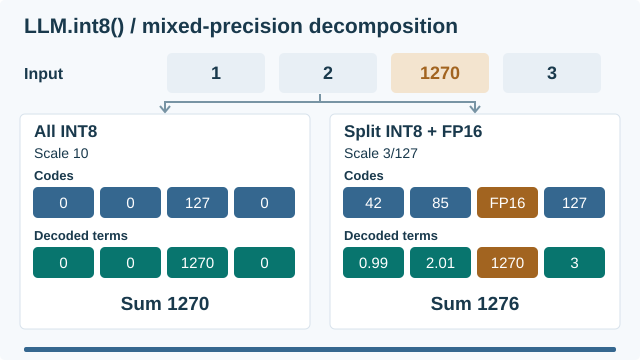

# LLM.int8()

LLM.int8() is a post-training method for 8-bit inference in large transformers. It keeps a few outlier hidden dimensions in 16-bit precision and computes the rest in 8 bits, so that models which would lose quality under plain 8-bit quantisation keep full-precision performance at about half the memory.

## Problem

Large transformers develop a few hidden-state dimensions with very large magnitudes. Quantising everything to 8 bits degrades quality sharply once a model is large enough, so the model does not fit in memory at full quality.

## Core idea

Split each matrix multiplication. The few outlier dimensions are computed in 16-bit precision, and the rest in 8-bit integers with vector-wise scales. The method is called mixed-precision decomposition.

### Visual walkthrough

[GitHub static preview](../../../../../assets/concept-animations/llm-int8-outlier-split-still.svg) · Use the keyboard-accessible **Play/Pause** control on MkDocs; reduced-motion preferences initially show the still.

For one dot product, take input (1, 2, 1270, 3) and unit weights (1, 1, 1, 1). Use symmetric INT8 codes from -127 to 127, with scale equal to the largest absolute value divided by 127. The weights are exactly representable (weight scale 1/127). The all-INT8 path uses input scale 10, rounding the three small input values to zero. Its decoded contributions sum to 1270 instead of the original 1276.

In the split path, route the third feature and its matching weight to FP16. The remaining input scale is 3/127, so the normal-feature codes are 42, 85, 127. Their decoded terms are approximately 0.99, 2.01 and 3; the FP16 contribution is 1270. Adding both partial products gives 1276 in the idealised arithmetic of this example. The two normal rounding errors happen to cancel; this is not a guarantee of exact reconstruction. The figure progressively reveals codes, decoded terms and then the sum. These are schematic numbers, not model measurements or a hardware trace. Real LLM.int8() partitions feature dimensions across the matrix operands, uses vector-wise scales and incurs rounding and implementation overhead. See Dettmers et al. (2022), Section 3 and Figure 2, in References.

*Original instructional animation, CC BY-SA 4.0.*

### Multiple tokens: split feature dimensions, not individual cells

For a matrix multiplication with $X$ of shape $m$ × $d$ and $W$ of shape $d$ × $n$, define a toy threshold rule: a feature belongs to the FP16 set if any token has absolute activation at least $\tau$ in that feature. The same feature indices select columns of $X$ and rows of $W$. The original paper's mixed-precision decomposition uses this feature-level partition (Dettmers et al., 2022, Section 3.2); Section 4.1 additionally defines prevalence criteria for its statistical analysis, not for this toy partition.

Keep the first input row from the animation and append a second row (3, 1, 2, −8). The absolute column maxima are (3, 2, 1270, 8).

| Threshold | FP16 features (1-based) | INT8 features | FP16 MAC fraction |
|---|---|---|---:|
| 6 | 3, 4 | 1, 2 | 50% |
| 10 | 3 | 1, 2, 4 | 25% |
| 2000 | none | 1, 2, 3, 4 | 0% |

At threshold 6, feature 4 is routed to FP16 for both tokens, including the first row's value 3. A cell-level mask would miss this shared feature partition. With $k$ selected features, the FP16 branch performs $mnk$ multiply-accumulates and the INT8 branch performs $mn(d-k)$, so the idealised arithmetic fraction is $k/d$. This is not a latency or memory fraction: vector-wise scales, gathering, kernel overhead, reuse and the output accumulation also matter. All values are constructed examples, not measured model statistics.

## Equation or algorithm

The product of the input \(X\) and weights \(W\) is written as a sum over normal dimensions, quantised to int8, plus a sum over outlier dimensions computed in fp16. Each row of \(X\) and column of \(W\) has its own scale.

## Results

The abstract reports that the method cuts the memory needed for inference by half while keeping full-precision performance.

## Limitations

The outlier path adds overhead, and the method targets 8-bit precision. Lower-bit inference needs other methods such as [GPTQ](../gptq/index.md) or [AWQ](../awq/index.md).

## Open issues and related variants

- **Outlier detection.** The threshold that marks a dimension as an outlier is set by hand; automatic selection is an open practical question.
- **Related:** [SmoothQuant](../smoothquant/index.md) removes outliers from the activations instead of computing them separately.

## Connections

The outlier problem is the same one that [mixed precision](../../mixed-precision/index.md) addresses by giving sensitive parts more bits. The memory savings matter most for [serving](../../../../../engineering/mlops/index.md).

## References

### Seminal papers

- Dettmers, T., Lewis, M., Belkada, Y., Zettlemoyer, L. (2022). *LLM.int8(): 8-bit Matrix Multiplication for Transformers at Scale*. NeurIPS. https://arxiv.org/abs/2208.07339 — Mixed-precision 8-bit matrix multiplication that keeps outlier dimensions in 16 bits.
- Xiao, G., Lin, J., Seznec, M., Wu, H., Demouth, J., Han, S. (2023). *SmoothQuant: Accurate and Efficient Post-Training Quantization for Large Language Models*. ICML 2023. arXiv:2211.10438. https://arxiv.org/abs/2211.10438 — The alternative that moves outliers into the weights.
- Frantar, E., et al. (2022). *GPTQ: Accurate Post-Training Quantization for Generative Pre-trained Transformers*. arXiv:2210.17323. https://arxiv.org/abs/2210.17323 — Compresses weights to 3 and 4 bits after training.

### Surveys and textbooks

- Gholami, A., et al. (2021). *A Survey of Quantization Methods for Efficient Neural Network Inference*. arXiv:2103.13630. https://arxiv.org/abs/2103.13630 — Places LLM.int8() among precision reduction methods.

### Lectures and videos

(none checked for this page)

### Articles and documentation

- Jacob, B., et al. (2017). *Quantization and Training of Neural Networks for Efficient Integer-Arithmetic-Only Inference*. arXiv:1712.05877. https://arxiv.org/abs/1712.05877 — Earlier integer-only inference for convolutional networks.
