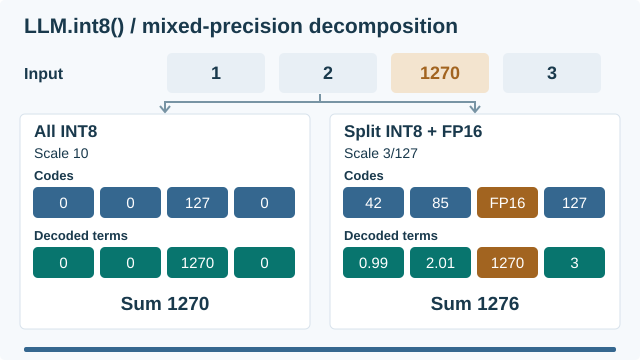

# LLM.int8()

LLM.int8() 是大型 Transformer 的訓練後 8 位元推論方法。它把少數離群隱藏維度保留在 16 位元，其餘以 8 位元計算，使原本在純 8 位元量化下會損失品質的模型，能以約一半的記憶體維持完整精度的表現。

## 問題

大型 Transformer 會出現少數隱藏狀態維度，數值非常大。模型一旦夠大，全部量化為 8 位元就會使品質急遽下降，因此模型無法在保有完整品質的情況下放進記憶體。

## 核心想法

把每次矩陣乘法拆開。少數離群維度以 16 位元精度計算，其餘以 8 位元整數與向量尺度計算。這種方法稱為混合精度分解。

### 動畫解讀

[GitHub 靜態預覽](../../../../../assets/concept-animations/llm-int8-outlier-split-still.svg) · MkDocs 網站可使用鍵盤操作的 **播放／暫停（Play/Pause）** 控制；偏好減少動態效果時顯示靜態圖。

以單一內積為例，輸入為 (1, 2, 1270, 3)，權重為 (1, 1, 1, 1)。使用 -127 至 127 的對稱 INT8 量化碼，尺度為最大絕對值除以 127。權重可精確表示（權重尺度為 1/127）。全 INT8 路徑的輸入尺度為 10，使三個小幅度輸入皆捨入為零。解量化後的貢獻總和為 1270，而原始內積為 1276。

在分解路徑中，第三個特徵及其對應權重走 FP16 路徑。其餘輸入的尺度為 3/127，一般特徵的量化碼為 42、85、127。解量化後的貢獻約為 0.99、2.01、3；FP16 貢獻為 1270。在此理想化算術中，兩個部分內積相加得到 1276。前兩個一般特徵的捨入誤差恰好抵消，並不保證能精確重建。動畫依序揭露量化碼、解量化貢獻及總和。所有數值均為示意，並非模型實測或硬體執行紀錄。實際 LLM.int8() 會沿矩陣乘法的特徵維度分割兩個運算元，採用逐向量尺度，仍有捨入誤差及實作開銷。參見既有參考文獻 Dettmers 等人（2022）第 3 節與圖 2。

*原創教學動畫，CC BY-SA 4.0。*

### 多個詞元：分割特徵維度，而非個別儲存格

考慮矩陣乘法，$X$ 的形狀為 $m$ × $d$，$W$ 的形狀為 $d$ × $n$。定義示意門檻規則：只要任一詞元在某特徵的激活絕對值至少為 $\tau$，該特徵即屬於 FP16 集合。相同的特徵索引選取 $X$ 的欄與 $W$ 的列。原論文的混合精度分解採用這類特徵層級的分割（Dettmers 等人，2022，第 3.2 節）；第 4.1 節另訂的出現頻率條件用於統計分析，而非此示意分割。

保留原動畫的第一個輸入列，再加入第二列 (3, 1, 2, −8)。各特徵欄的最大絕對值為 (3, 2, 1270, 8)。

| 門檻 | FP16 特徵（從 1 編號） | INT8 特徵 | FP16 MAC 比例 |
|---|---|---|---:|
| 6 | 3、4 | 1、2 | 50% |
| 10 | 3 | 1、2、4 | 25% |
| 2000 | 無 | 1、2、3、4 | 0% |

門檻為 6 時，兩個詞元的特徵 4 都走 FP16 路徑，包括第一列的數值 3。逐儲存格遮罩無法表達這種共用特徵分割。若選取 $k$ 個特徵，FP16 路徑執行 $mnk$ 次乘加運算，INT8 路徑執行 $mn(d-k)$ 次，因此理想化的運算量比例為 $k/d$。這不是延遲或記憶體的比例：逐向量尺度、資料收集、核心開銷、重用及輸出累加都會影響實際成本。所有數值皆為人工算例，並非模型實測統計。

## 公式或演算法

輸入 \(X\) 與權重 \(W\) 的乘積寫成兩部分之和：正常維度的部分量化為 int8；離群維度的部分以 fp16 計算。\(X\) 的每一列與 \(W\) 的每一行各有自己的尺度。

## 結果

摘要報告，此方法能把推論所需記憶體減半，同時保持與完整精度相當的效能。

## 限制

離群路徑會增加負擔，而且此方法針對 8 位元。更低位元的推論需要其他方法，例如 [GPTQ](../gptq/index.zh-TW.md) 或 [AWQ](../awq/index.zh-TW.md)。

## 開放問題與相關變體

- **離群值偵測**：把一個維度標記為離群值的門檻是人工設定的；自動選擇仍是實務上的開放問題。
- **相關**：[SmoothQuant](../smoothquant/index.zh-TW.md) 從激活值中移除離群值，而不是另外計算它們。

## 相關連結

離群值問題也是[混合精度](../../mixed-precision/index.zh-TW.md)設法解決的問題，它的做法是給敏感部分更多位元。記憶體節省在[服務](../../../../../engineering/mlops/index.zh-TW.md)時最有價值。

## 參考文獻

### 開創性論文

- Dettmers, T., Lewis, M., Belkada, Y., Zettlemoyer, L. (2022). *LLM.int8(): 8-bit Matrix Multiplication for Transformers at Scale*. NeurIPS. https://arxiv.org/abs/2208.07339 — 混合精度 8 位元矩陣乘法，把離群維度保留在 16 位元。
- Xiao, G., Lin, J., Seznec, M., Wu, H., Demouth, J., Han, S. (2023). *SmoothQuant: Accurate and Efficient Post-Training Quantization for Large Language Models*. ICML 2023. arXiv:2211.10438. https://arxiv.org/abs/2211.10438 — 把離群值移到權重上的替代方法。
- Frantar, E., 等人 (2022). *GPTQ: Accurate Post-Training Quantization for Generative Pre-trained Transformers*. arXiv:2210.17323. https://arxiv.org/abs/2210.17323 — 較低位元的訓練後替代方法。

### 綜述與教科書

- Gholami, A., 等人 (2021). *A Survey of Quantization Methods for Efficient Neural Network Inference*. arXiv:2103.13630. https://arxiv.org/abs/2103.13630 — 把 LLM.int8() 放在精度降低方法之中。

### 講座與影片

（本頁尚未查核任何項目）

### 文章與文件

- Jacob, B., 等人 (2017). *Quantization and Training of Neural Networks for Efficient Integer-Arithmetic-Only Inference*. arXiv:1712.05877. https://arxiv.org/abs/1712.05877 — 卷積網路的早期純整數推論方法。
