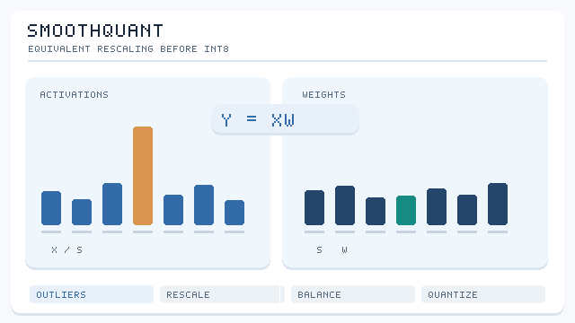

# SmoothQuant

SmoothQuant 是一種訓練後方法，讓大型語言模型的權重與激活值都能量化為 8 位元。它透過逐通道縮放，把激活離群值的困難移到權重上，而這種縮放不會改變該層的數學輸出。

## 問題

大型語言模型的激活值含有離群通道，其數值遠大於其他通道。把它們量化為 8 位元會損失準確度，而權重則較容易量化。僅權重方法讓激活值維持浮點數，因此避開了這個問題，但也無法得到整數運算的加速。

## 核心想法

對每個輸入通道，把激活值縮小，對應的權重放大，使兩者都更容易量化。縮放係數逐通道選定，用來平衡兩者之間的困難程度。

*原創概念動畫，CC BY-SA 4.0。* 以**逐輸入通道**的正縮放係數 \(s\) 重新分配動態範圍：\(X'=X\operatorname{diag}(s)^{-1}\)、\(W'=\operatorname{diag}(s)W\)，因此在**量化前**有 \(X'W'=XW\)。動畫中的激活離群通道縮小、對應權重通道放大；長條高度只是示意，**不是校準值、量化誤差或實際模型激活值**。後續 INT8 捨入仍可能引入誤差，並非完全無損。參見 [Xiao 等人（2022／2023）](https://arxiv.org/abs/2211.10438)。

## 公式或演算法

對線性層 \(Y = XW\)，方法計算 \(Y = (X\,\mathrm{diag}(s)^{-1})(\mathrm{diag}(s)\,W)\)，其中縮放 \(s\) 由激活與權重的統計量選定。縮放後的激活值與權重再量化為 8 位元。

## 結果

摘要報告，對大型語言模型可達 1.56 倍加速與 2 倍記憶體縮減，準確度損失可忽略。

## 限制

縮放係數由校準資料選定，選得不好時，離群值問題會被移到權重上。此方法針對 8 位元整數運算設計，更低的位元寬度需要其他方法。

## 開放問題與相關變體

- **困難的平衡**：決定激活與權重之間如何分擔困難的規則是啟發式的；適用於不同層的更好規則仍是開放問題。
- **相關**：[LLM.int8()](../llm-int8/index.zh-TW.md) 把離群值保留在 16 位元，而不是移動它們。

## 相關連結

SmoothQuant 是 [AWQ](../awq/index.zh-TW.md) 在激活端的對應方法。它讓整數矩陣乘法變得實用，而這正是具有 8 位元張量單元的[硬體](../../../../../engineering/hardware/index.zh-TW.md)執行最快的運算。

## 參考文獻

### 開創性論文

- Xiao, G., Lin, J., Seznec, M., Wu, H., Demouth, J., Han, S. (2022). *SmoothQuant: Accurate and Efficient Post-Training Quantization for Large Language Models*. arXiv:2211.10438. https://arxiv.org/abs/2211.10438 — 把激活離群值移到權重上以進行 8 位元推論，速度最高提升 1.56 倍。
- Dettmers, T., 等人 (2022). *LLM.int8(): 8-bit Matrix Multiplication for Transformers at Scale*. arXiv:2208.07339. https://arxiv.org/abs/2208.07339 — 把離群值保留在 16 位元，而不是移動它們。
- Lin, J., 等人 (2023). *AWQ: Activation-aware Weight Quantization for LLM Compression and Acceleration*. arXiv:2306.00978. https://arxiv.org/abs/2306.00978 — 面向僅權重量化的激活感知縮放。

### 綜述與教科書

- Gholami, A., 等人 (2021). *A Survey of Quantization Methods for Efficient Neural Network Inference*. arXiv:2103.13630. https://arxiv.org/abs/2103.13630 — 回顧精度降低方法。

### 講座與影片

（本頁尚未查核任何項目）

### 文章與文件

- Frantar, E., 等人 (2022). *GPTQ: Accurate Post-Training Quantization for Generative Pre-trained Transformers*. arXiv:2210.17323. https://arxiv.org/abs/2210.17323 — 以二階補償為主的僅權重替代方法。
