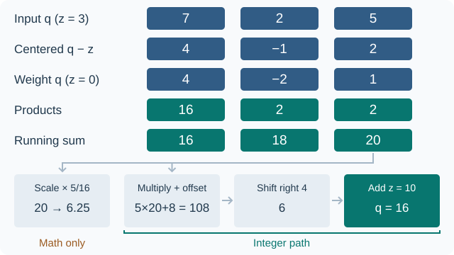

# Integer-Only Inference

Integer-only inference is a quantisation-aware training method that simulates, during training, a network whose every operation runs on integers. Weights, activations, the residual additions and the non-linearities all use quantised values, so the trained network can be deployed on integer-only hardware without losing the accuracy that a conversion from floating point would cost. It is part of the [quantisation-aware training](../index.md) family.

## Problem

Mobile processors run integer arithmetic far more efficiently than floating point, and some accelerators support nothing else. A network trained in floating point and then converted to integers often loses accuracy, because the conversion introduces rounding that the training never saw.

## Core idea

Train with the same integer arithmetic that the deployed model will use. Every tensor is stored as an 8-bit integer with a scale and a zero point. Each layer computes an integer matrix multiplication with a wide accumulator, and then rescales the result to the next layer's grid. The rescaling is itself done with integer operations.

### Visual walkthrough

[GitHub-readable fallback](../../../../../assets/concept-animations/integer-requantization-accumulator-still.svg) · [Full 12-second animation](../../../../../assets/concept-animations/integer-requantization-accumulator-motion.svg)

For this illustrative dot product without bias, let input codes be $q_x=(7,2,5)$ with $z_x=3$, $s_x=1/4$, and signed weight codes $q_w=(4,-2,1)$ with $z_w=0$, $s_w=1/2$. The centered integer products are $(16,2,2)$ and the running accumulator is $(16,18,20)$. A real-valued dot product of the represented operands is therefore $s_xs_w A=2.5$.

Choose the output scale $s_y=2/5$ and zero point $z_y=10$. The multiplier is exactly $M=s_xs_w/s_y=5/16$. With an unsigned 8-bit output and round-to-nearest (no tie here), the output code is

$q_y=\operatorname{clip}_{[0,255]}(\operatorname{round}(MA)+z_y)=16.$

The displayed $6.25$ is a mathematical intermediate, not a floating-point instruction: the same rounded nonnegative result is obtained by $(5A+8)\gg 4=6$. The reconstructed output is $s_y(q_y-z_y)=2.4$, not 2.5. Production kernels need appropriate wide accumulators, signed rounding conventions, saturation, and fixed-point multiplier approximations; an actual quantization-aware training graph typically uses floating-point fake quantization rather than integer gradients. See [Jacob et al.](https://arxiv.org/abs/1712.05877). The codes and scales are schematic, not measurements.

The animation now branches from the same accumulator into the mathematical scale (reference only) and the actual integer path: multiply by 5, add the rounding offset 8 to obtain 108, shift right four bits to obtain 6, and add the output zero point. The fractional branch is not an operand of the integer branch.

For a signed accumulator, the illustrative rule $r=\lfloor(5A+8)/16\rfloor$ rounds to nearest with ties toward positive infinity: $A=8$ gives 3 but $A=-8$ gives -2. This requires floor division (or a sign-extending arithmetic right shift) and sufficient intermediate width; other kernels may specify different tie rules. Clipping is separate from rounding: for $A=1000$ the unbounded code is 323 and saturates to 255; for $A=-100$ it is -21 and saturates to 0. All values are constructed examples, not kernel measurements.

On MkDocs, use Play/Pause (Enter/Space) to inspect the operations. GitHub and reduced-motion readers use the static fallback. Original visual, **CC BY-SA 4.0**.

## Equation or algorithm

A real value \(r\) is represented as \(r = s\,(q - z)\), where \(q\) is an 8-bit integer, \(s\) a real scale and \(z\) an integer zero point. For a layer with quantised inputs and weights, the product is computed as an integer accumulation, and the output is mapped to the next grid by multiplying with a fixed-point approximation of the ratio of scales. The training graph inserts fake quantisation at these points, so the gradient passes through with the straight-through estimator.

## Results

The abstract states that the scheme improves the trade-off between accuracy and on-device latency, and that the improvements are significant even on MobileNets, a model family known for run-time efficiency. It does not give a single headline figure, so the tables in the paper should be used for specific numbers.

## Limitations

The scheme was designed for convolutional networks, and the paper does not cover large transformers. The residual additions and the batch normalisation folding need careful handling, and a mismatch between training and deployment kernels can still cost accuracy.

## Open issues and related variants

- **Transformers.** Integer-only pipelines for attention, softmax and layer normalisation are harder to build than for convolutions, and the methods for large language models, such as [SmoothQuant](../../post-training/smoothquant/index.md), keep these parts in floating point or use other designs.
- **Related:** [LSQ](../lsq/index.md) learns the scales instead of computing them from statistics, and [binary and ternary](../../binary-and-ternary/index.md) methods go further by removing multiplications altogether.

## Connections

The integer formats used here are the ones that mobile and edge [hardware](../../../../../engineering/hardware/index.md) implements in its matrix units, and the training pipeline sits under [training](../../../../../engineering/training/index.md). The same idea underlies many mobile deployment toolchains.

## References

### Seminal papers

- Jacob, B., et al. (2017). *Quantization and Training of Neural Networks for Efficient Integer-Arithmetic-Only Inference*. arXiv:1712.05877. https://arxiv.org/abs/1712.05877 — Simulates integer-only inference during training so that the deployed model matches the training graph.
- Esser, S. K., et al. (2019). *Learned Step Size Quantization*. arXiv:1902.08153. https://arxiv.org/abs/1902.08153 — Learns the scale rather than fixing it from statistics, a later step in the same family.
- Dong, Z., et al. (2019). *HAWQ: Hessian AWare Quantization of Neural Networks with Mixed-Precision*. arXiv:1905.03696. https://arxiv.org/abs/1905.03696 — Assigns different bit-widths to layers, the mixed-precision alternative to uniform integer inference.

### Surveys and textbooks

- Gholami, A., et al. (2021). *A Survey of Quantization Methods for Efficient Neural Network Inference*. arXiv:2103.13630. https://arxiv.org/abs/2103.13630 — Reviews integer-only inference alongside other precision reduction methods.

### Lectures and videos

(none checked for this page)

### Articles and documentation

- Dettmers, T., et al. (2022). *LLM.int8(): 8-bit Matrix Multiplication for Transformers at Scale*. arXiv:2208.07339. https://arxiv.org/abs/2208.07339 — Shows an 8-bit integer path for transformers that keeps outlier dimensions in 16 bits.
