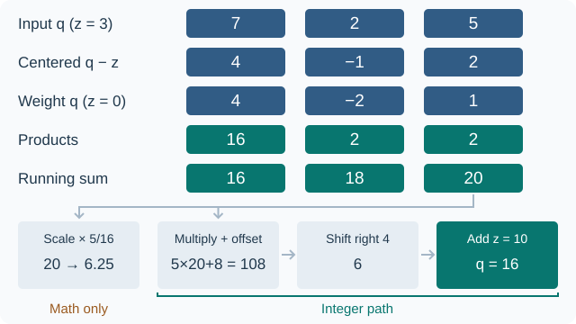

# 純整數推論

純整數推論是一種量化感知訓練方法，在訓練時模擬一個每個運算都使用整數的網路。權重、激活值、殘差相加與非線性函數都使用量化後的數值，因此訓練好的網路可以部署在純整數硬體上，而不會因為從浮點數轉換而損失準確度。它是[量化感知訓練](../index.zh-TW.md)家族的一部分。

## 問題

行動處理器執行整數運算的效率遠高於浮點數，有些加速器也只支援整數。以浮點數訓練的網路，轉換成整數後常會損失準確度，因為轉換引入的捨入，是訓練時從未見過的。

## 核心想法

訓練時使用部署模型將使用的同一種整數運算。每個張量都以 8 位元整數加上尺度與零點儲存。每一層以較寬的累加器做整數矩陣乘法，再把結果重新縮放到下一層的網格。重新縮放本身也以整數運算完成。

### 動畫解讀

[GitHub 靜態預覽](../../../../../assets/concept-animations/integer-requantization-accumulator-still.svg) · [完整 12 秒動畫](../../../../../assets/concept-animations/integer-requantization-accumulator-motion.svg)

此人工算例為不含偏差的內積。令輸入整數碼 $q_x=(7,2,5)$，零點 $z_x=3$、尺度 $s_x=1/4$；有號權重整數碼 $q_w=(4,-2,1)$，零點 $z_w=0$、尺度 $s_w=1/2$。扣除零點後的整數乘積為 $(16,2,2)$，逐步累加值為 $(16,18,20)$。因此兩個量化張量所代表的實數內積為 $s_xs_w A=2.5$。

取輸出尺度 $s_y=2/5$、零點 $z_y=10$，尺度倍率恰為 $M=s_xs_w/s_y=5/16$。使用無號 8 位元輸出及最接近值捨入（此處沒有平手），輸出整數碼為

$q_y=\operatorname{clip}_{[0,255]}(\operatorname{round}(MA)+z_y)=16.$

圖中的 $6.25$ 是數學中間值，不代表執行浮點指令；本例非負數的捨入可直接以 $(5A+8)\gg 4=6$ 完成。反量化後的輸出為 $s_y(q_y-z_y)=2.4$，並非 2.5。實際核心須處理足夠寬的累加器、有號捨入規則、飽和裁切及定點倍率近似；量化感知訓練通常使用浮點假量化，而非整數梯度。見 [Jacob 等人](https://arxiv.org/abs/1712.05877)。本例整數碼及尺度均為示意，並非模型實測值。

新版動畫由相同累加值分出數學尺度（僅供對照）與實際整數路徑：乘以 5、加上捨入偏移量 8 得 108、右移四位元得 6，最後加上輸出零點。分數支線並非整數支線的運算元。

若累加器為有號整數，示意規則 $r=\lfloor(5A+8)/16\rfloor$ 是最接近值捨入，平手時朝正無窮大：$A=8$ 得 3，但 $A=-8$ 得 -2。這需要向下取整除法（或保留符號的算術右移）及足夠的中間值位元寬度；其他核心可能使用不同的平手規則。裁切與捨入是不同操作：$A=1000$ 時未裁切整數碼為 323，飽和至 255；$A=-100$ 時為 -21，飽和至 0。數值均為人工算例，非核心實測結果。

在 MkDocs 網站可使用播放／暫停（Enter／Space）觀察各步驟；GitHub 與減少動態效果模式採用靜態回退圖。原創視覺，**CC BY-SA 4.0**。

## 公式或演算法

實數 \(r\) 表示為 \(r = s\,(q - z)\)，其中 \(q\) 是 8 位元整數，\(s\) 是實數尺度，\(z\) 是整數零點。對於輸入與權重都已量化的層，乘積以整數累加計算，輸出再以尺度比值的定點近似映射到下一個網格。訓練圖在這些位置插入假量化，因此梯度以直通估計器穿過。

## 結果

摘要指出，此方案改善了準確度與裝置端延遲之間的權衡，而且即使在以執行效率著稱的 MobileNet 上，改善仍然顯著。摘要沒有給出單一的主要數字，具體數值應查閱論文中的表格。

## 限制

此方案針對卷積網路設計，論文沒有涵蓋大型 Transformer。殘差相加與批次正規化摺疊需要謹慎處理，而訓練與部署核心之間的不一致，仍可能造成準確度損失。

## 開放問題與相關變體

- **Transformer**：注意力、softmax 與層正規化的純整數流程，比卷積更難建構；大型語言模型的方法（例如 [SmoothQuant](../../post-training/smoothquant/index.zh-TW.md)）會把這些部分保留為浮點數，或採用其他設計。
- **相關**：[LSQ](../lsq/index.zh-TW.md) 學習尺度，而不是從統計量計算；[二值與三值](../../binary-and-ternary/index.zh-TW.md)方法則更進一步，完全移除乘法。

## 相關連結

此處使用的整數格式，是行動與邊緣[硬體](../../../../../engineering/hardware/index.zh-TW.md)在矩陣單元中實作的格式，而訓練流程則位於[訓練](../../../../../engineering/training/index.zh-TW.md)之下。許多行動部署工具鏈都以相同的想法為基礎。

## 參考文獻

### 開創性論文

- Jacob, B., 等人 (2017). *Quantization and Training of Neural Networks for Efficient Integer-Arithmetic-Only Inference*. arXiv:1712.05877. https://arxiv.org/abs/1712.05877 — 在訓練時模擬純整數推論，使部署模型與訓練圖一致。
- Esser, S. K., 等人 (2019). *Learned Step Size Quantization*. arXiv:1902.08153. https://arxiv.org/abs/1902.08153 — 學習尺度而非從統計量固定，是同一家族中的後續步驟。
- Dong, Z., 等人 (2019). *HAWQ: Hessian AWare Quantization of Neural Networks with Mixed-Precision*. arXiv:1905.03696. https://arxiv.org/abs/1905.03696 — 為層指定不同位元寬度，是純整數推論的混合精度替代方案。

### 綜述與教科書

- Gholami, A., 等人 (2021). *A Survey of Quantization Methods for Efficient Neural Network Inference*. arXiv:2103.13630. https://arxiv.org/abs/2103.13630 — 與其他精度降低方法一同回顧純整數推論。

### 講座與影片

（本頁尚未查核任何項目）

### 文章與文件

- Dettmers, T., 等人 (2022). *LLM.int8(): 8-bit Matrix Multiplication for Transformers at Scale*. arXiv:2208.07339. https://arxiv.org/abs/2208.07339 — 面向 Transformer 的 8 位元整數路徑，並把離群維度保留在 16 位元。
