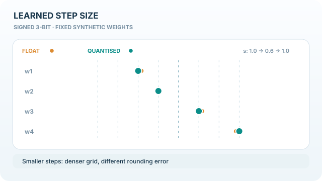
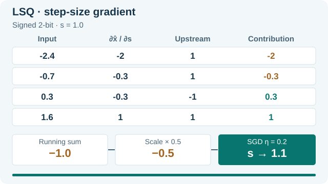

# Learned Step Size Quantisation (LSQ)

Learned Step Size Quantisation (LSQ) is a quantisation-aware training method that treats the quantiser's step size as a trainable parameter, learned by gradient descent together with the network weights. It is one of the variants of [quantisation-aware training](../index.md) that reaches full-precision accuracy at low bit-widths on image classification.

## Problem

Fixed rules for the step size, such as setting it from the statistics of a tensor, are not tuned to the loss. At 2 to 4 bits the choice of step size changes accuracy a great deal, so a rule that works at 8 bits can fail badly at 3 bits.

## Core idea

Make the step size a parameter of each quantiser, and update it from the loss in the same way as the weights. The gradient with respect to the step size passes through the rounding function with the straight-through approximation, to seek lower task loss at the given bit-width, without guaranteeing a global minimum.

## Equation or algorithm

The quantised value is

\[
\hat{x} = s \cdot \operatorname{round}(\operatorname{clip}(x/s, -Q_n, Q_p))
\]

, where \(s\) is the learned step size and \(Q_n\), \(Q_p\) set the integer range for the bit-width. The gradient with respect to \(s\) is taken through the rounding with the straight-through estimator. The paper scales this gradient by \(g = 1/\sqrt{N Q_p}\), where \(N\) is the number of weights (or features) in the layer, so that the step size learns at a sensible rate relative to the weights.

For clarity, the LSQ surrogate step-size derivative retains the rounded value in the forward computation (Esser et al., 2020, Equation 3):

$$
\frac{\partial \hat x}{\partial s} \approx
\begin{cases}
-Q_n,& x/s\le -Q_n,\\
\operatorname{round}(x/s)-x/s,& -Q_n<x/s<Q_p,\\
Q_p,& x/s\ge Q_p.
\end{cases}
$$

## Instructional animation: step-size sweep and rounding error

  

*Original 10-second instructional animation (CC BY-SA 4.0). The four fixed synthetic weights are $(-1.1,-0.6,0.7,1.7)$ in a signed 3-bit grid $[-4,3]$. Sweeping $s$ from 1.0 to 0.6 changes quantised values from $(-1,-1,1,2)$ to $(-1.2,-0.6,0.6,1.8)$, reducing their illustrative summed squared rounding error from $0.35$ to $0.03$. This is a **fixed-weight sweep**, not an observed LSQ gradient-descent trajectory; smaller quantisation error does not guarantee lower task loss.* MkDocs adds keyboard-operable Play/Pause; reduced-motion mode starts with a still image, and the focusable figure can be scrolled horizontally on mobile. [View complete animated SVG](../../../../../assets/concept-animations/lsq-step-size-sweep-motion.svg); [GitHub-readable still](../../../../../assets/concept-animations/lsq-step-size-sweep-still.svg).

All four weights remain inside the clipping range throughout this sweep. Code changes occur exactly at half-integer boundaries; nearest rounding determines the code away from a boundary, while exact-tie conventions are implementation-dependent. The moving grid shows all eight signed 3-bit codes, including −4.

## Instructional animation: accumulate the surrogate scale gradient

[GitHub-readable fallback](../../../../../assets/concept-animations/lsq-surrogate-gradient-still.svg) · [Full animation](../../../../../assets/concept-animations/lsq-surrogate-gradient-motion.svg)

Original 12-second instructional animation (CC BY-SA 4.0). Use the MkDocs keyboard-operable Play/Pause control; reduced motion starts with the still, and the focusable figure can be scrolled horizontally on mobile.

Unlike the fixed-weight sweep above, this example follows a single **surrogate-gradient update** of the step size. Use signed 2-bit codes $[-2,1]$, $s=1$, and four inputs $(-2.4,-0.7,0.3,1.6)$. Assume upstream loss gradients $(1,1,-1,1)$ with respect to the quantised outputs. The piecewise surrogate derivative from Equation 3 of Esser et al. (2020) gives $(-2,-0.3,-0.3,1)$, including the two clipped inputs.

The chain rule multiplies each derivative by its upstream gradient; the resulting signed contributions are $(-2,-0.3,0.3,1)$. Their running sum is $-2,-2.3,-2,-1$. For $N=4$ and $Q_p=1$, the LSQ gradient factor is $g=1/2$. The scaled gradient is $-0.5$; plain SGD with learning rate $\eta=0.2$ gives the next step size $s'=1.1$.

The animation reveals contributions before applying the scaling and update. The derivative is a straight-through surrogate, not the ordinary derivative of rounding. The upstream gradient, step size, and learning rate are synthetic; this is one illustrative update, not a measured training trajectory or a guarantee of loss reduction.

## Results

The abstract says the method achieves the highest accuracy to date on ImageNet for models quantised to 2, 3 and 4 bits, and that 3-bit models reach full-precision baseline accuracy.

## Limitations

Training needs a full or long fine-tuning run with labelled data, which PTQ methods avoid. The reported results are for image classification, and the method has not been shown at the scale of large language models.

## Open issues and related variants

- **Stability under distribution shift.** Learned step sizes are fitted to the training data; whether they stay appropriate when the input distribution changes after deployment is not well measured.
- **Related:** [integer-only inference](../integer-only-inference/index.md) uses a fixed affine mapping during training, and [mixed precision](../../mixed-precision/index.md) assigns different widths to different layers instead of learning a step size per layer.

## Connections

LSQ depends on the number formats supported by the [hardware](../../../../../engineering/hardware/index.md) that runs the quantised model. For large models, the cost of the training run is the main obstacle, and the post-training route in [post-training quantisation](../../post-training/index.md) is more common.

## References

### Seminal papers

- Esser, S. K., et al. (2019). *Learned Step Size Quantization*. arXiv:1902.08153. https://arxiv.org/abs/1902.08153 — Learns the quantiser step size by gradient descent and reaches full-precision accuracy at 3 bits.
- Jacob, B., et al. (2017). *Quantization and Training of Neural Networks for Efficient Integer-Arithmetic-Only Inference*. arXiv:1712.05877. https://arxiv.org/abs/1712.05877 — The fixed-scale quantisation-aware training that LSQ generalises.
- Courbariaux, M., Bengio, Y., David, J.-P. (2015). *BinaryConnect: Training Deep Neural Networks with Binary Weights during Propagations*. arXiv:1511.00363. https://arxiv.org/abs/1511.00363 — Introduces the straight-through style of training with discrete weights that LSQ builds on.

### Surveys and textbooks

- Gholami, A., et al. (2021). *A Survey of Quantization Methods for Efficient Neural Network Inference*. arXiv:2103.13630. https://arxiv.org/abs/2103.13630 — Places learned step sizes among training-aware quantisation methods.

### Articles and documentation

- Dettmers, T., et al. (2022). *LLM.int8(): 8-bit Matrix Multiplication for Transformers at Scale*. arXiv:2208.07339. https://arxiv.org/abs/2208.07339 — A post-training alternative for large language models, for comparison with training-aware methods.
