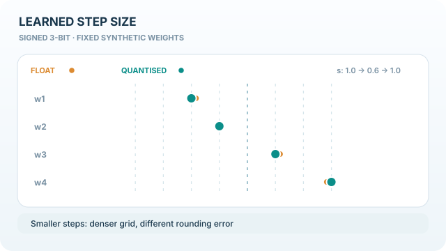
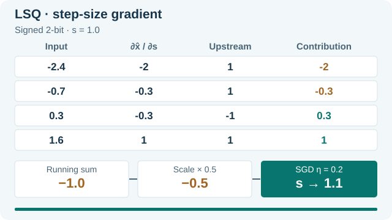

# 可學習步長量化（LSQ）

可學習步長量化（LSQ）是一種量化感知訓練方法，把量化器的步長當作可訓練參數，與網路權重一起以梯度下降學習。它是[量化感知訓練](../index.zh-TW.md)中的一種變體，在影像分類的低位元下能達到全精度準確度。

## 問題

與損失無關的固定步長規則，例如依張量統計量設定步長，沒有針對損失調整。在 2 到 4 位元時，步長的選擇對準確度影響很大，因此在 8 位元有效的規則，在 3 位元時可能會嚴重失效。

## 核心想法

把每個量化器的步長當作參數，並像權重一樣依損失更新。對步長的梯度透過捨入函數、以直通近似取得，以尋找該位元寬度下較低的任務損失，但不保證找到全域最小值。

## 公式或演算法

量化值為

\[
\hat{x} = s \cdot \operatorname{round}(\operatorname{clip}(x/s, -Q_n, Q_p))
\]

，其中 \(s\) 是學習得到的步長，\(Q_n\)、\(Q_p\) 依位元寬度設定整數範圍。對 \(s\) 的梯度以直通估計器穿過捨入運算取得。論文以 \(g = 1/\sqrt{N Q_p}\) 縮放此梯度，其中 \(N\) 為該層權重（或特徵）的數量，使步長相對於權重以合理的速度學習。

LSQ 的步長替代導數仍保留前向計算的捨入值（Esser et al., 2020，式 3）：

$$
\frac{\partial \hat x}{\partial s} \approx
\begin{cases}
-Q_n,& x/s\le -Q_n,\\
\operatorname{round}(x/s)-x/s,& -Q_n<x/s<Q_p,\\
Q_p,& x/s\ge Q_p.
\end{cases}
$$

## 教學動畫：步長改變與量化誤差

  

*原創 10 秒連續教學動畫（CC BY-SA 4.0）。四個固定的人工權重為 $(-1.1,-0.6,0.7,1.7)$。3-bit signed 範圍為 $[-4,3]$，當步長由 $s=1.0$ 改為 $s=0.6$，量化值由 $(-1,-1,1,2)$ 變為 $(-1.2,-0.6,0.6,1.8)$，此例的捨入平方誤差總和由 $0.35$ 變為 $0.03$。這是**固定權重的步長掃描**，不是 LSQ 的梯度下降訓練軌跡；減少捨入誤差也不保證降低任務損失。* 網站支援使用鍵盤操作的播放／暫停，若啟用減少動態效果則預設顯示靜態圖；手機可聚焦圖片區域並左右捲動。 [檢視完整 SVG 動畫](../../../../../assets/concept-animations/lsq-step-size-sweep-motion.svg)；[GitHub 靜態預覽](../../../../../assets/concept-animations/lsq-step-size-sweep-still.svg).

這次掃描的四個權重始終位於裁剪範圍內。整數碼在半整數邊界立即切換；非邊界處採最近捨入，恰好同距離時的處理依實作而異。移動格線包含全部八個有號 3 位元整數碼（含 −4）。

## 教學動畫：累積步長的替代梯度

[GitHub 靜態預覽](../../../../../assets/concept-animations/lsq-surrogate-gradient-still.svg) · [完整動畫](../../../../../assets/concept-animations/lsq-surrogate-gradient-motion.svg)

原創 12 秒教學動畫（CC BY-SA 4.0）。網站支援鍵盤操作的播放／暫停；減少動態效果模式預設顯示靜態圖。手機可聚焦圖形區域後水平捲動。

與前面的固定權重掃描不同，此算例追蹤步長的一次**替代梯度更新**。使用有號 2 位元整數碼 $[-2,1]$、$s=1$，以及四個輸入 $(-2.4,-0.7,0.3,1.6)$。假設損失對量化輸出的上游梯度為 $(1,1,-1,1)$。依 Esser 等人（2020）式 3 的分段替代導數，包含兩個被裁剪的輸入，導數為 $(-2,-0.3,-0.3,1)$。

鏈鎖律將每個導數乘上對應的上游梯度，得到帶符號的貢獻 $(-2,-0.3,0.3,1)$；依序累積為 $-2,-2.3,-2,-1$。由於 $N=4$ 且 $Q_p=1$，LSQ 梯度縮放因子為 $g=1/2$。縮放後梯度為 $-0.5$；採用學習率 $\eta=0.2$ 的普通 SGD，得到下一步長 $s'=1.1$。

動畫先呈現各項貢獻，再進行梯度縮放與更新。此導數是直通估計器的替代導數，並非捨入函數的普通導數。上游梯度、步長與學習率均為人工設定；此為單次教學更新，並非實測訓練軌跡，也不保證損失下降。

## 結果

摘要表示，此方法在 ImageNet 上對量化到 2、3、4 位元的模型達到迄今最高準確度，並且 3 位元模型能達到全精度基準的準確度。

## 限制

訓練成本即完整或較長時間的微調成本，而 PTQ 方法可以避開這個成本。結果針對影像分類，且需要有標籤的訓練資料；大型語言模型的規模下尚未被證實。

## 開放問題與相關變體

- **分布偏移下的穩定性**：可學習步長是依訓練資料擬合的；當部署後的輸入分布改變時，它們是否仍然適用，目前量測不足。
- **相關**：[純整數推論](../integer-only-inference/index.zh-TW.md)在訓練時使用固定的仿射映射；[混合精度](../../mixed-precision/index.zh-TW.md)則為不同層指定不同位元，而不是為每層學習步長。

## 相關連結

LSQ 依賴執行量化模型的[硬體](../../../../../engineering/hardware/index.zh-TW.md)所支援的數字格式。對大型模型而言，訓練成本是主要障礙，因此較常見的是[訓練後量化](../../post-training/index.zh-TW.md)路線。

## 參考文獻

### 開創性論文

- Esser, S. K., 等人 (2019). *Learned Step Size Quantization*. arXiv:1902.08153. https://arxiv.org/abs/1902.08153 — 以梯度下降學習量化步長，3 位元達到全精度準確度。
- Jacob, B., 等人 (2017). *Quantization and Training of Neural Networks for Efficient Integer-Arithmetic-Only Inference*. arXiv:1712.05877. https://arxiv.org/abs/1712.05877 — LSQ 所推廣的固定尺度量化感知訓練。
- Courbariaux, M., Bengio, Y., David, J.-P. (2015). *BinaryConnect: Training Deep Neural Networks with Binary Weights during Propagations*. arXiv:1511.00363. https://arxiv.org/abs/1511.00363 — LSQ 所依據的離散權重直通式訓練。

### 綜述與教科書

- Gholami, A., 等人 (2021). *A Survey of Quantization Methods for Efficient Neural Network Inference*. arXiv:2103.13630. https://arxiv.org/abs/2103.13630 — 把可學習步長放在訓練期量化方法之中。

### 文章與文件

- Dettmers, T., 等人 (2022). *LLM.int8(): 8-bit Matrix Multiplication for Transformers at Scale*. arXiv:2208.07339. https://arxiv.org/abs/2208.07339 — 大型語言模型的訓練後替代方案，用於與訓練期方法比較。
