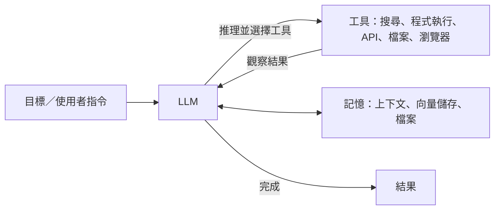

# AI 代理人

## 定義

**代理人**會感知環境、做出決策，並採取行動以達成目標。LLM 代理人以語言模型作為「大腦」，透過**工具**與世界互動，並在多步驟的**循環**中自主工作。

## 核心組件

| 組件 | 角色 | 技術 |
|---|---|---|
| 推理與規劃 | 拆解目標、選擇下一步 | 思維鏈、ReAct、先規劃再執行、樹搜尋、推理模型 |
| 工具使用 | 呼叫外部能力 | 函式呼叫、Model Context Protocol（MCP）、程式執行 |
| 記憶 | 跨步驟與跨工作階段保存資訊 | 上下文視窗、摘要、向量資料庫、檔案系統、知識圖譜 |
| 感知 | 理解多模態輸入 | 視覺語言模型、螢幕截圖理解（電腦操作代理人） |
| 反思與自我修正 | 偵測並修正錯誤 | Reflexion、驗證器、測試 |

## 常見模式

- **ReAct**（Yao et al., 2022）：交錯進行推理、行動與觀察
- **工作流程 vs 代理人**：預先定義的流程（提示鏈、路由、平行化）通常比完全自主的代理人更可靠；只有當步驟無法事先得知時，才使用真正的代理人（Anthropic，"Building effective agents"，2024）
- **協調者—工作者**：主代理人把工作分配給子代理人
- **評估者—最佳化者**：一個模型生成，另一個模型評分並給予回饋
- **多代理人辯論**：模型之間互相檢查

## 應用

| 類型 | 例子 |
|---|---|
| 程式碼代理人 | Claude Code、OpenAI Codex、GitHub Copilot 代理人、Cursor、Devin；SWE-bench 是常用的基準 |
| 研究代理人 | 「深度研究」功能，會搜尋、閱讀並撰寫報告 |
| 電腦操作代理人 | 操作瀏覽器與桌面應用程式 |
| 科學代理人 | 提出假說、設計實驗、分析資料（見[科學發現](../../../applications/science/index.md)） |
| 客服與流程自動化 | 處理工單、查詢系統、執行交易 |
| 遊戲與模擬中的代理人 | Voyager（在 Minecraft 中的終身學習）；Generative Agents（25 個模擬的小鎮居民，展現湧現的社會行為） |

## 協定與框架

- **MCP**：Anthropic 於 2024 年推出的開放協定，用來標準化 LLM 應用如何連接工具與資料來源；之後被整個產業採用
- **A2A**：代理人之間的通訊協定
- 框架：LangGraph、LlamaIndex、CrewAI、AutoGen、OpenAI Agents SDK、Claude Agent SDK、smolagents

## 挑戰

- **誤差累積**：每一步 95% 的準確率，在 20 步之後只剩約 36% 的成功率
- **長時程任務**：METR 的測量發現，在 2019–2025 年間，AI 代理人能自主完成的任務長度大約每七個月加倍
- **安全性**：提示注入、權限過大、不可逆的動作、資料外洩（見[安全與對齊](../../../society/safety-alignment/index.md)）
- **評估**：結果多樣、環境不穩定
- **成本與延遲**

## 認知科學的觀點

LLM 代理人的設計重現了許多來自[認知架構](../../../brain-mind/cognitive-architectures/index.md)的概念：

| 認知概念 | 代理人中的對應 |
|---|---|
| 工作記憶 | 上下文視窗 |
| 長期記憶（情節、語意、程序） | 對話紀錄、知識庫、技能／工具庫 |
| 執行功能（前額葉皮質） | 規劃、任務切換、抑制 |
| 後設認知 | 自我評估、反思 |
| 心智理論 | 對使用者與其他代理人意圖進行建模 |

Sumers et al.（2023），"Cognitive Architectures for Language Agents"（CoALA），有系統地整理了這種對應關係。

## 學習資源

- Anthropic，"Building effective agents"
- Lilian Weng，"LLM Powered Autonomous Agents"
- Hugging Face Agents Course
- Microsoft [AI-Agents-for-Beginners](https://github.com/microsoft/ai-agents-for-beginners)（MIT 授權）
- [Model Context Protocol 文件](https://modelcontextprotocol.io/)

## 參考文獻

### 開創性論文

- Yao, S., et al. (2022). *ReAct: Synergizing Reasoning and Acting in Language Models*. arXiv. https://arxiv.org/abs/2210.03629 — 將推理軌跡與工具行動交錯，使語言模型能在同一個循環中規劃與行動。
- Schick, T., et al. (2023). *Toolformer: Language Models Can Teach Themselves to Use Tools*. arXiv. https://arxiv.org/abs/2302.04761 — 顯示模型可以從自己生成的範例中，學會何時以及如何呼叫外部工具。
- Park, J. S., et al. (2023). *Generative Agents: Interactive Simulacra of Human Behavior*. arXiv. https://arxiv.org/abs/2304.03442 — 具備記憶、反思與規劃能力的模擬角色，在虛擬小鎮中表現得可信。
- Wei, J., et al. (2022). *Chain-of-Thought Prompting Elicits Reasoning in Large Language Models*. arXiv. https://arxiv.org/abs/2201.11903 — 顯示要求模型寫出中間推理步驟，能提升多步驟問題的解題表現，也是上文「先推理再行動」迴圈的基礎。

### 綜述與教科書

- Wang, L., et al. (2023). *A Survey on Large Language Model based Autonomous Agents*. arXiv. https://arxiv.org/abs/2308.11432 — 對 LLM 代理人的設計進行綜述，涵蓋角色設定、記憶、規劃與行動，以及代理人如何被評估。

## 延伸學習

- Erik S. & Zhang, B. (2024). *Building effective agents*. Anthropic Engineering. https://www.anthropic.com/engineering/building-effective-agents — 關於簡單、可組合的代理人工作流程的實務指南，以及何時完全自主的代理人值得付出其成本。
