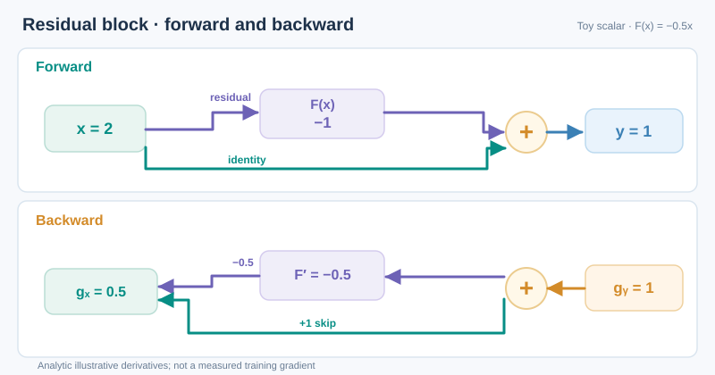
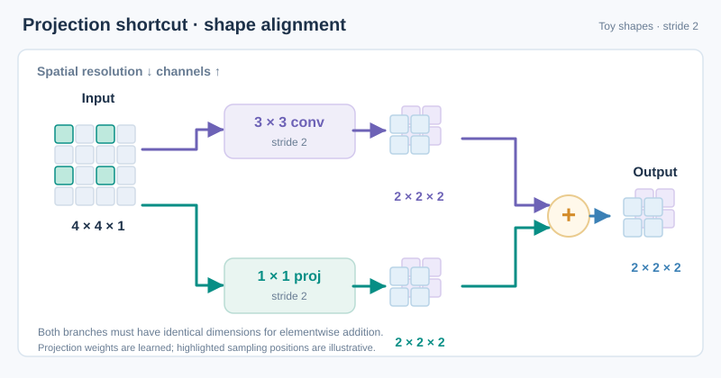

---
related:
- theory/models/cnn/backbones-and-scaling
- theory/models/cnn
aliases:
  - Residual Networks
  - ResNet
  - 殘差網路
tags:
  - residual connections
  - deep networks
  - computer vision
last_reviewed: 2026-10-28
---

# Residual Networks

Residual networks (ResNet) are deep convolutional networks whose blocks add their input back to a learned function of that input. He et al. introduced them in 2015 in "Deep Residual Learning for Image Recognition", and an ensemble of these networks took first place in ILSVRC 2015.

## Visual explanation: residual gradients and projection shortcuts

**1. A shortcut carries both signals and derivatives.** For the *pre-activation, additive* scalar toy block \(y=x+F(x)\), let \(x=2\) and \(F(x)=-0.5x\). The forward result is \(y=1\). By the chain rule, the upstream derivative \(g_y=1\) branches into \(g_y\) through the identity shortcut and \(F'(x)g_y=-0.5\) through the learned branch, then sums to \(g_x=0.5\):

\[
\frac{\partial y}{\partial x}=1+\frac{\partial F}{\partial x},\qquad
g_x=g_y(1+F'(x)).
\]

This is a **local derivative at the addition** (or a pre-activation residual unit), not the complete gradient of a post-addition ReLU block. The identity term provides a direct contribution, but the learned term can still cancel or amplify it; shortcuts do not guarantee non-vanishing gradients.[^resnet-identity]

*Original 8-second SVG teaching animation (CC BY-SA 4.0). GitHub shows the static fallback; MkDocs enhances it with Play/Pause and a reduced-motion alternative. Values and trajectories are analytic illustrations, not measured model activations or gradients.* [Open full SVG animation](../../../../../assets/concept-animations/resnet-identity-gradient-motion.svg). [GitHub static fallback](../../../../../assets/concept-animations/resnet-identity-gradient-still.svg).

**2. A projection is needed when tensor shapes change.** Elementwise residual addition requires \(\operatorname{shape}(F(x))=\operatorname{shape}(P(x))\). In the constructed example, a \(4\times4\times1\) feature map goes through a stride-2 \(3\times3\) main convolution (with padding 1) to reach \(2\times2\times2\), while a learned stride-2 \(1\times1\) projection on the shortcut produces the *same* shape. Only then is \(y=F(x)+P(x)\) defined. A pure identity shortcut is suitable only when shapes already match; the illustrated sizes and channels are examples, not a specific ResNet layer.

*Original 10-second SVG teaching animation (CC BY-SA 4.0). The colored sampling cells and moving markers are explanatory, not computed convolution outputs; projection weights are learned. GitHub renders the still; the MkDocs player provides Play/Pause, keyboard access and reduced-motion fallback.* [Open full SVG animation](../../../../../assets/concept-animations/resnet-projection-shortcut-motion.svg). [GitHub static fallback](../../../../../assets/concept-animations/resnet-projection-shortcut-still.svg).

[^resnet-identity]: He, Zhang, Ren & Sun (2016), *Identity Mappings in Deep Residual Networks*: https://arxiv.org/abs/1603.05027 — Derives direct forward and backward propagation in identity-mapped residual units.

## Problem

Adding more plain layers did not always help. On CIFAR-10 the 56-layer plain network had higher training error than the 20-layer one, and the authors state that this degradation "is not caused by overfitting".

## Core idea

Each block learns a residual F(x) and outputs F(x) + x. The identity shortcuts add no parameters. A linear projection is used on the shortcut when the dimensions change.

## Equation or algorithm

\[
y = \mathcal{F}(x, \{W_i\}) + x
\]

Here x is the block input, y is the block output, and F is the residual mapping learned by the weight layers \(W_i\) inside the block.

## Results

- On ImageNet (10-crop, top-1 error), the 34-layer residual network reached 25.03%, against 28.54% for the plain 34-layer network.
- The 152-layer network reached 21.43% top-1 and 5.71% top-5.
- An ensemble reached 3.57% top-5 on the test set, first place in ILSVRC 2015.

## Limitations

- The paper leaves the optimisation difficulties of very deep plain networks for future study.
- The 1202-layer network does worse than the 110-layer one, which the authors attribute to overfitting.

## Connections

- [Backbones and scaling](../index.md) places residual connections in the wider story of backbone design, next to the scaling rules.
- [EfficientNet and Compound Scaling](../efficientnet/index.md) covers the compound-scaling rule, the other backbone idea in this section.
- [Convolution variants](../../convolution-variants/index.md) covers the convolution operations from which these blocks are built.
- [CNN](../../index.md) gives the wider family context, including the trade-offs of convolutional models.
- [Transformer](../../../transformer/index.md) is the main comparison point for CNN backbones, since the CNN family page sets their inductive biases against Transformers.
- [NeuroAI](../../../../../brain-mind/neuroai/index.md) notes that deep CNN features have been compared with activity in visual cortex, though the match is partial.

## Open issues and further variants

- **Identity mappings.** Whether identity mappings are the right target for the shortcut is still an open question.
- **Depth limits.** The 1202-layer network does worse than the 110-layer one, so the reported results do not show that more depth always helps.
- **Shortcut projections.** A linear projection is used when the dimensions change. Whether another form of projection works better is not covered here.

## References

### Seminal papers

- He, K., Zhang, X., Ren, S. & Sun, J. (2016). *Identity Mappings in Deep Residual Networks*. ECCV. https://arxiv.org/abs/1603.05027 — Analyzes direct forward and backward signal propagation through identity shortcuts and pre-activation residual units.

- He, K., et al. (2015). "Deep Residual Learning for Image Recognition". [arXiv:1512.03385](https://arxiv.org/abs/1512.03385) — Residual connections that allow very deep CNNs to train.
- Simonyan, K. & Zisserman, A. (2015). "Very Deep Convolutional Networks for Large-Scale Image Recognition". [arXiv:1409.1556](https://arxiv.org/abs/1409.1556) — Stacks of small 3×3 convolutions, the plain deep design behind VGG.
- Huang, G., et al. (2017). "Densely Connected Convolutional Networks". [arXiv:1608.06993](https://arxiv.org/abs/1608.06993) — Connects each layer to all later layers, reusing features and easing gradient flow.

### Surveys and textbooks

- Goodfellow, I., Bengio, Y. & Courville, A. (2016). *Deep Learning*. MIT Press. https://www.deeplearningbook.org/ — Chapter 9 covers convolutional networks, with the standard account of the convolution operation.

### Lectures and videos

(none checked for this page)

### Articles and documentation

- Liu, Z., et al. (2022). "A ConvNet for the 2020s". [arXiv:2201.03545](https://arxiv.org/abs/2201.03545) — ConvNeXt, a modernised pure CNN that matches Transformer baselines.
