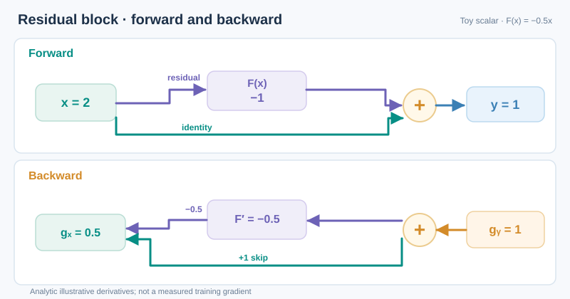
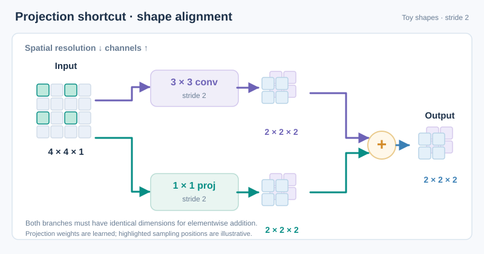

---
related:
- theory/models/cnn/backbones-and-scaling
- theory/models/cnn
aliases:
  - Residual Networks
  - ResNet
  - 殘差網路
tags:
  - residual connections
  - deep networks
  - computer vision
translation_reviewed: 2026-11-17
---

# 殘差網路

殘差網路（ResNet）是深層卷積網路，其區塊會把輸入加回該輸入經過學習函數後的結果。He 等人於 2015 年在〈Deep Residual Learning for Image Recognition〉中提出了它們，而由這些網路組成的集成模型在 ILSVRC 2015 奪得第一名。

## 教學視覺化：殘差梯度與投影捷徑

**1. 恆等捷徑同時傳遞訊號與梯度。** 對加法處的純量示意區塊 \(y=x+F(x)\)，令 \(x=2\)、\(F(x)=-0.5x\)，前向結果為 \(y=1\)。反向傳播時，若上游梯度 \(g_y=1\)，恆等捷徑貢獻 \(1\)，殘差分支貢獻 \(F'(x)g_y=-0.5\)，因此輸入梯度 \(g_x=0.5\)：

\[
\frac{\partial y}{\partial x}=1+\frac{\partial F}{\partial x},\qquad
g_x=g_y(1+F'(x)).
\]

此式是**加法節點的局部導數**（或後接恆等映射的 pre-activation 區塊），沒有包含傳統區塊在加法後 ReLU 的導數。捷徑提供直接的梯度項，但學習分支仍可能抵銷或放大梯度，不能據此保證梯度永不消失。[^resnet-identity]

*原創 8 秒 SVG 教學動畫（CC BY-SA 4.0）。GitHub 顯示靜態回退圖；MkDocs 網站提供播放／暫停與降低動態效果模式。數值與路徑均為解析式示意，並非模型實測激活值或梯度。* [開啟完整動畫](../../../../../assets/concept-animations/resnet-identity-gradient-motion.svg)。 [GitHub 靜態回退圖](../../../../../assets/concept-animations/resnet-identity-gradient-still.svg)。

**2. 改變張量尺寸時必須對齊捷徑。** 逐元素相加要求 \(\operatorname{shape}(F(x))=\operatorname{shape}(P(x))\)。此人工示例將 \(4\times4\times1\) 的特徵圖，透過步幅 2、padding 1 的 \(3\times3\) 主分支卷積映射到 \(2\times2\times2\)；捷徑上可學習的 \(1\times1\) 投影也以步幅 2 產生**相同維度**，之後才執行 \(y=F(x)+P(x)\)。維度原本相同時才可直接使用恆等捷徑。圖中的尺寸與通道數為示意，並非特定 ResNet 層的規格。

*原創 10 秒 SVG 教學動畫（CC BY-SA 4.0）。著色取樣位置與移動標記只說明訊號流程，不是實際卷積數值；投影權重需要學習。GitHub 顯示靜態回退圖，網站提供播放／暫停、鍵盤操作與降低動態效果回退。* [開啟完整動畫](../../../../../assets/concept-animations/resnet-projection-shortcut-motion.svg)。 [GitHub 靜態回退圖](../../../../../assets/concept-animations/resnet-projection-shortcut-still.svg)。

[^resnet-identity]: He、Zhang、Ren 與 Sun（2016），*Identity Mappings in Deep Residual Networks*：https://arxiv.org/abs/1603.05027 — 推導恆等捷徑的前向與反向訊號傳遞。

## 問題

單純增加普通層數並不總是有幫助。在 CIFAR-10 上，56 層的普通網路比 20 層的網路有更高的訓練誤差，作者並指出這種退化「不是由過擬合造成的」。

## 核心想法

每個區塊學習一個殘差 F(x)，並輸出 F(x) + x。恆等捷徑不增加參數。當維度改變時，捷徑上使用線性投影。

## 方程式或演算法

\[
y = \mathcal{F}(x, \{W_i\}) + x
\]

其中 x 是區塊的輸入，y 是區塊的輸出，F 是區塊內權重層 \(W_i\) 所學到的殘差映射。

## 結果

- 在 ImageNet 上（10 裁切，top-1 誤差），34 層的殘差網路達到 25.03%，對照之下，34 層的普通網路為 28.54%。
- 152 層的網路達到 21.43% top-1 與 5.71% top-5。
- 一個集成模型在測試集上達到 3.57% top-5，在 ILSVRC 2015 奪得第一名。

## 限制

- 論文把極深普通網路的最佳化困難留待未來研究。
- 1202 層的網路表現比 110 層的差，作者將此歸因於過擬合。

## 相關連結

- [骨幹與縮放](../index.md)把殘差連接放在骨幹設計的整體脈絡中，與縮放規則並列。
- [EfficientNet 與複合縮放](../efficientnet/index.md)介紹複合縮放規則，這是本節的另一個骨幹想法。
- [卷積變體](../../convolution-variants/index.md)介紹構成這些區塊的卷積運算。
- [CNN](../../index.md)提供更廣的家族脈絡，包括卷積模型的取捨。
- [Transformer](../../../transformer/index.md)是 CNN 骨幹的主要比較對象，因為 CNN 家族頁面把兩者的歸納偏置並列比較。
- [NeuroAI](../../../../../brain-mind/neuroai/index.md)指出，深度 CNN 的特徵已被拿來與視覺皮層的活動比較，但吻合是部分的。

## 未解問題與更多變體

- **恆等映射。** 恆等映射是否是捷徑的正確目標，仍是開放問題。
- **深度的極限。** 1202 層的網路表現比 110 層的差，因此現有結果並未顯示更深總是更好。
- **捷徑投影。** 維度改變時使用線性投影。是否有其他投影形式更好，這裡未涵蓋。

## 參考文獻

### 開創性論文

- He, K.、Zhang, X.、Ren, S. 與 Sun, J.（2016）。*Identity Mappings in Deep Residual Networks*。ECCV。https://arxiv.org/abs/1603.05027 — 分析恆等捷徑與 pre-activation 殘差區塊的前向、反向訊號傳遞。

- He, K., et al. (2015). "Deep Residual Learning for Image Recognition". [arXiv:1512.03385](https://arxiv.org/abs/1512.03385) — 殘差連接，使極深的 CNN 能夠訓練。
- Simonyan, K. & Zisserman, A. (2015). "Very Deep Convolutional Networks for Large-Scale Image Recognition". [arXiv:1409.1556](https://arxiv.org/abs/1409.1556) — 堆疊小型 3×3 卷積的普通深層設計，即 VGG 的基礎。
- Huang, G., et al. (2017). "Densely Connected Convolutional Networks". [arXiv:1608.06993](https://arxiv.org/abs/1608.06993) — 每一層都與其後所有層相連，重用特徵並改善梯度流。

### 綜述與教科書

- Goodfellow, I., Bengio, Y. & Courville, A. (2016). *Deep Learning*. MIT Press. https://www.deeplearningbook.org/ — 第 9 章介紹卷積網路與卷積運算的標準說明。

### 講座與影片

（本頁尚未核對）

### 文章與文件

- Liu, Z., et al. (2022). "A ConvNet for the 2020s". [arXiv:2201.03545](https://arxiv.org/abs/2201.03545) — ConvNeXt，一個現代化的純 CNN，與 Transformer 基線相當。
