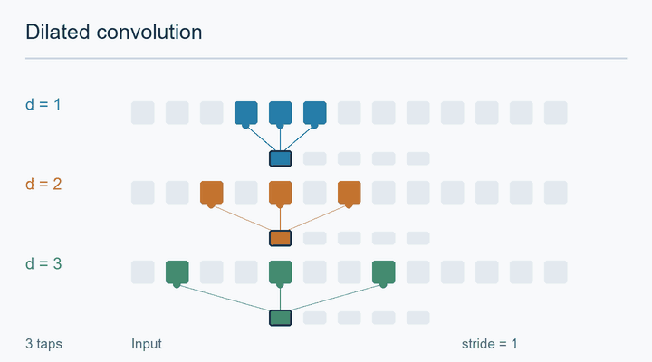

---
related:
- theory/models/cnn/convolution-variants
- theory/models/cnn
aliases:
  - Dilated Convolution
  - Atrous Convolution
  - 空洞卷積
tags:
  - convolution
  - receptive field
  - dense prediction
last_reviewed: 2026-10-28
---

# Dilated Convolution

Dilated convolution spaces the taps of a kernel apart, so one layer covers a wider region of its input without adding parameters. Yu and Koltun (2015), in "Multi-Scale Context Aggregation by Dilated Convolutions", stacked dilated layers for dense prediction, letting the receptive field grow exponentially with depth while the feature map stays at full resolution.

## Problem

Dense prediction, such as labelling every pixel of an image, needs each output to see a large context. A stack of ordinary 3×3 layers adds only two pixels to the receptive field per layer. Pooling or strided layers enlarge the receptive field, but they lower the spatial resolution of the output.

## Core idea

A dilated (or atrous) convolution inserts gaps between the kernel taps. With dilation \(l\), the output at position \(\mathbf{p}\) sums over the inputs at positions \(\mathbf{s}\) that satisfy \(\mathbf{s} + l\mathbf{t} = \mathbf{p}\), and \(l = 1\) gives the ordinary convolution. If the dilation doubles from layer to layer (1, 2, 4, 8, and so on), the receptive field grows exponentially with the number of layers, while each layer keeps the same number of weights and the same feature-map size.

*Original animation by AI Wiki, CC BY-SA 4.0.*

Read each row as a separate one-dimensional convolution with three learned taps. From top to bottom, dilation is 1, 2 and 3: the sampled span is 3, 5 and 7 input positions, but only three positions contribute to each output. The moving dots trace contributions to the outlined output; the window advances by one input position in all rows (stride 1). Dilation changes tap spacing, not output spacing.[^sampling] Only five interior output positions are shown; boundaries and padding are omitted. A 2D 3×3 kernel applies this spacing along both axes. These rows compare separate settings, not successive layers. Colours, activations and timing are schematic, not model measurements. The jump at the loop boundary restarts the scan.

[^sampling]: Yu & Koltun (2015), [Multi-Scale Context Aggregation by Dilated Convolutions](https://arxiv.org/abs/1511.07122), Section 2; listed in References.

## Equation or algorithm

For a discrete feature map \(F\) and kernel \(k\), the paper defines the \(l\)-dilated convolution as

\[
(F *_{l} k)(\mathbf{p}) = \sum_{\mathbf{s} + l\mathbf{t} = \mathbf{p}} F(\mathbf{s})\, k(\mathbf{t}),
\]

and notes that the ordinary discrete convolution is the 1-dilated case. The paper's context module stacks 3×3 layers with dilations 1, 1, 2, 4, 8, 16 and 1, followed by a 1×1 layer. It gives the receptive field of each element in \(F_{i+1}\) as \((2^{i+2}-1) \times (2^{i+2}-1)\), so \(F_1\), \(F_2\) and \(F_3\) have receptive fields of 3×3, 7×7 and 15×15. Its Table 1 lists receptive-field sizes of 3, 5, 9, 17, 33, 65, 67 and 67 for the eight layers. The paper stops the exponential growth after layer 6, because its front end outputs 64×64 maps.

## Results

On the PASCAL VOC 2012 validation set, the paper reports mIoU of 69.8 for its front end alone, 71.3 with the basic context module and 72.1 with the large one. Adding CRF-RNN raises the best validation result to 73.9. On the test set, the large context module reaches 73.5, and 75.3 with CRF-RNN. On CamVid, the paper's Dilation8 model reaches 65.3, against 61.6 for DeepLab-LFOV, the comparison given in its appendix.

## Limitations

The paper states its own caveats. "Our initial attempts to train the context module failed to yield an improvement in prediction accuracy," and joint training of the context module with the front end "did not yield a significant improvement." The feature maps of the basic module "are not normalized and no loss is defined inside the module." The authors also say that state-of-the-art segmentation systems "leave significant room for future advances." The gridding problem named in the approach text is not among these caveats.

## Connections

The [convolution variants](../index.md) page compares dilation with the other forms, and the [CNN family](../../index.md) page places it among the components of a CNN. The goal of wider context at full resolution also appears in the [attention variants](../../../transformer/attention-variants/index.md), where local windows and global attention widen what each output sees. The [computer vision](../../../computer-vision/index.md) page covers the dense tasks, such as segmentation, that use dilated layers. A different way to change the sampling pattern, by learning offsets instead of fixing gaps, is covered in the [deformable convolution](../deformable-convolution/index.md) page.

## Open issues and further variants

- **Gridding.** Stacked dilations can leave some input pixels never sampled. The convolution variants page notes that later designs use mixed dilation rates to address this, but how to choose those rates is not settled.
- **Training the context module.** The paper reports that its first attempts did not improve accuracy and that joint training gave no significant gain, so the training recipe matters and is not fully explored.
- **Long-range context.** Dilated stacks extend context, but each layer is still local. Whether they can match global attention on tasks that need long-range relations remains open.

## References

### Seminal papers

- Yu, F. & Koltun, V. (2015). "Multi-Scale Context Aggregation by Dilated Convolutions". [arXiv:1511.07122](https://arxiv.org/abs/1511.07122) — Dilated convolutions for dense prediction with exponentially growing receptive fields.
- Dai, J., et al. (2017). "Deformable Convolutional Networks". [arXiv:1703.06211](https://arxiv.org/abs/1703.06211) — Learns sampling offsets so the convolution adapts to object shape.
- Chollet, F. (2016). "Xception: Deep Learning with Depthwise Separable Convolutions". [arXiv:1610.02357](https://arxiv.org/abs/1610.02357) — Shows that factorising spatial and channel mixing can outperform standard Inception-style designs at lower cost.
- Chen, L.-C., et al. (2016). "DeepLab: Semantic Image Segmentation with Deep Convolutional Nets, Atrous Convolution, and Fully Connected CRFs". [arXiv:1606.00915](https://arxiv.org/abs/1606.00915) — Atrous convolution with fully connected CRFs for dense segmentation.

### Surveys and textbooks

- Goodfellow, I., Bengio, Y. & Courville, A. (2016). *Deep Learning*. MIT Press. https://www.deeplearningbook.org/ — Chapter 9 covers convolutional networks, with the standard account of the convolution operation.

### Lectures and videos

(none checked for this page)

### Articles and documentation

(none checked for this page)
