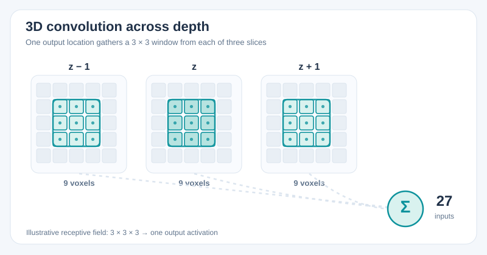
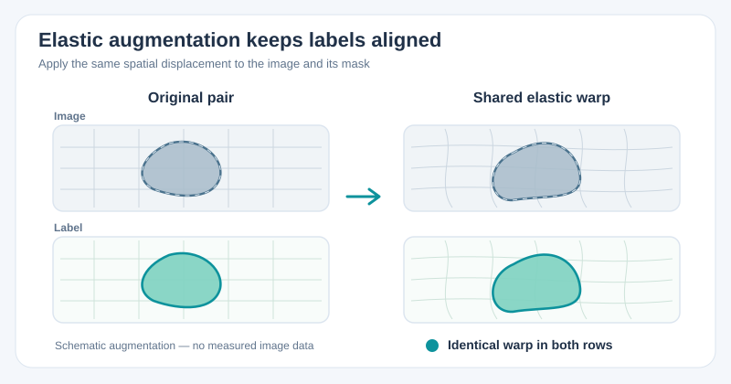
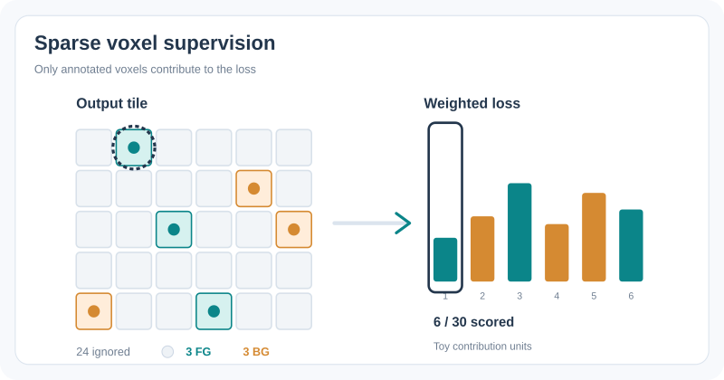
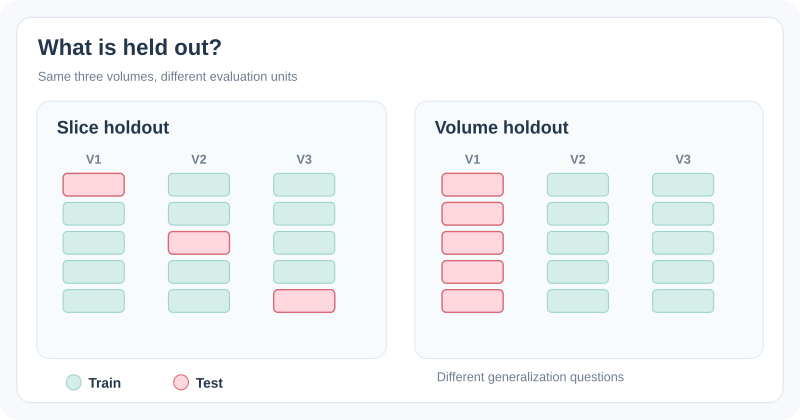

# 3D U-Net

3D U-Net is a version of [U-Net](index.md) that segments volumetric images directly, using 3D operations in place of 2D ones. It is designed to learn from sparse annotation: a user labels a few slices, and the network produces a dense 3D segmentation. Çiçek et al. (2016) introduced it for biomedical volumes.

## Overview

The parent [U-Net](index.md) segments 2D images with an encoder that downsamples, a decoder that upsamples, and skip connections between them. 3D U-Net keeps that design and changes every 2D operation to its 3D counterpart, so the filters move through depth as well as width and height.

## Problem

Dense 3D labels are costly to make: a clinician would have to annotate every voxel of every volume. Many practical tasks only have a few annotated slices, and a 2D network applied slice by slice ignores the structure between slices. The question is whether a 3D network can learn a full segmentation from sparse labels.

## Core idea

Replace all 2D operations of U-Net with 3D ones, train end to end from scratch, and make the training data rich with on-the-fly elastic deformations. The network then learns from sparsely annotated volumes and generalises to new volumes.

## Algorithm

The network follows the U-Net encoder–decoder with skip connections. The encoder uses $3\times3\times3$ convolutions and $2\times2\times2$ max pooling. The decoder upsamples in all three spatial dimensions and combines features from matching encoder levels. A final $1\times1\times1$ convolution produces per-voxel class scores. In the original architecture, a $132\times132\times116$ input tile yields a $44\times44\times28$ prediction tile. This allows the network to use surrounding voxels as context for a smaller output region.[^original]

### How a 3D kernel uses neighboring slices

A $3\times3\times3$ kernel at one output location reads a $3\times3$ spatial window at **each of three adjacent depth positions**. The figure follows one input channel: each plane supplies nine values, giving 27 spatial samples in total. Multiple input channels would each contribute their own 27 samples; the final convolution sums their weighted contributions to produce each output channel. Unlike an independent 2D slice convolution, this receptive field can directly combine information across depth.[^original]

*Original CC BY-SA 4.0 teaching animation.* Each moving pulse represents one **plane contribution**, not an individual arithmetic multiply-accumulate. The numbers 9, 18 and 27 are exact kernel geometry for a **single input channel** in this toy view, **not measured feature magnitudes or GPU timings**. The MkDocs site offers Play/Pause and a reduced-motion still; [GitHub-readable static preview](../../../../assets/concept-animations/3d-unet-depth-kernel-still.svg).[^original]

### Learning from sparse labels

The loss is a weighted softmax cross-entropy. Let $\mathcal{A}$ be the set of annotated voxels in the output tile, $y_v$ the known label, $w_{y_v}$ its class weight and $p_v(y_v)$ the predicted probability of that label. The following sum shows which voxels contribute.[^original]

$$
\mathcal{L}=-\sum_{v\in\mathcal{A}}w_{y_v}\log p_v(y_v).
$$

The paper assigns zero loss weight to unlabelled voxels and uses class weights to balance the annotated classes. In particular, an unlabelled voxel and a voxel annotated as background have different roles. Only the annotated background voxel contributes a background error. The network still takes the full input tile as context and produces scores throughout the output tile. During training, the same elastic deformation is applied to the image and its labels to keep them aligned.[^original]

#### Why image and label must share the same spatial warp

The original 3D U-Net training procedure applies on-the-fly elastic deformation to the image and its corresponding labels.[^original] Both must use the **same displacement field**: otherwise the deformed tissue location and its supervision target disagree. Image intensities and categorical labels may require different interpolation rules (for example, class-preserving nearest-neighbor resampling for discrete labels), even though their spatial coordinates are transformed consistently.

*Original CC BY-SA 4.0 teaching animation.* The grid and boundary are **synthetic 2D cross-sections** used to explain a deformation that can be applied to 3D training data. The identical spatial warp is the teaching point; neither a real clinical image nor an experimental augmentation trace is shown. On MkDocs use Play/Pause; reduced-motion mode uses the static [GitHub preview](../../../../assets/concept-animations/3d-unet-paired-warp-still.svg).[^original]

#### How the sparse-loss mask changes the gradient

*Original CC BY-SA 4.0 teaching animation.* The **synthetic** 30-voxel tile has six annotated voxels: three simplified foreground and three labelled background voxels. As the marker visits each label, the corresponding contribution on the right is highlighted; the other 24 voxels have zero loss weight. **Unlabelled does not mean background.** The bars are arbitrary toy weighted-loss contributions, not predictions, measured training loss, or a reproduction of the paper's three-class annotation scheme. On the MkDocs site use Play/Pause (including keyboard activation); reduced-motion visitors receive the still. [GitHub-readable still](../../../../assets/concept-animations/3d-unet-sparse-loss-still.svg).[^original]

### Evaluation protocols

1. **Semi-automated**. The model learns from annotations in the volumes it will segment. In the three-fold evaluation, the authors split 77 annotated slices across the three volumes into three subsets. Each fold treats one subset as unlabelled during training and uses it for evaluation.[^original]
2. **Fully automated**. Each fold trains on two sparsely annotated volumes and predicts on the third. IoU is measured on the annotated slices of the held-out volume. This tests transfer to a different volume within the same dataset.[^original]

### Which evaluation unit is held out?

*Original CC BY-SA 4.0 teaching animation.* In this **illustrative** three-volume, five-slice-per-volume model, rose cells denote evaluation data and teal cells training data. On the left, a different annotated **slice** is held out within each volume while other slices from those same volumes remain available for training. On the right, an entire **volume** is held out, so its slices never appear during training in that fold. The rotating selections are **schematic, not the original paper's slice counts or fold assignments**. This difference matters: within-volume completion and unseen-volume transfer answer different generalisation questions. [GitHub-readable still](../../../../assets/concept-animations/3d-unet-evaluation-holdout-still.svg); the MkDocs player supports Play/Pause and reduced motion.[^original]

## Key results

The study reports IoU on three Xenopus kidney volumes. Slice holdout and volume holdout give different comparisons.[^original]

| Evaluation | 3D without BN | 3D with BN | 2D with BN |
| --- | --- | --- | --- |
| Held-out slices (Table 1) | 0.842 | 0.863 | 0.796 |
| Held-out volumes (Table 3) | 0.723 | 0.704 | 0.547 |

In the volume holdout, batch normalisation (BN) improved IoU on two volumes. On the third, IoU fell from 0.779 to 0.554, leaving the three-volume average lower with BN. The paper also varied the amount of supervision in a separate semi-automated experiment. Using one annotated slice per orthogonal plane, IoU ranged from 0.331 to 0.483 across the three volumes. Using the reported 5, 5 and 3 slices, it ranged from 0.849 to 0.872 (Table 2).[^original]

## Limitations

- Results are reported on one kind of volume, the Xenopus kidney, so the generality of the method is not shown.
- 3D convolutions cost more memory and compute than their 2D counterparts, which limits the volume size that can be processed.
- The two evaluations hold out different units. Slice holdout measures completion within partly annotated volumes. Volume holdout measures transfer within the three-volume dataset.[^original]

## Connections

- [U-Net](index.md) is the 2D design that 3D U-Net extends.
- [Segmentation metrics](../../../evaluation/metrics/segmentation/index.md) explain IoU and Dice, the overlap measures used to judge volumetric segmentation.
- [Convolution variants](../convolution-variants/index.md) covers the 3D and dilated operations that volumetric networks depend on.
- [Fully convolutional networks (Long et al., 2014)](https://arxiv.org/abs/1411.4038) are the earlier fully convolutional segmentation design that U-Net builds on.

## Applications

- Biomedical volumetric segmentation from sparse annotation, the setting of the paper's Xenopus kidney experiments.
- Semi-automated annotation, where a user labels a few slices and the network completes the rest of the volume.

## Open questions

- How many annotated slices are needed before the semi-automated setting is reliable, and which slices should be chosen?
- Does the method transfer to other organs and imaging modalities without retraining from scratch?

[^original]: Çiçek et al., [*3D U-Net*](https://arxiv.org/html/1606.06650), §§2–4 and Tables 1–3.

## References

### Seminal papers

- Çiçek, Ö., Abdulkadir, A., Lienkamp, S. S., Brox, T. & Ronneberger, O. (2016). *3D U-Net: Learning Dense Volumetric Segmentation from Sparse Annotation*. arXiv. https://arxiv.org/abs/1606.06650 — Introduces 3D U-Net and reports IoU on Xenopus kidney volumes in semi-automated and fully-automated settings.
- Ronneberger, O., Fischer, P. & Brox, T. (2015). *U-Net: Convolutional Networks for Biomedical Image Segmentation*. arXiv. https://arxiv.org/abs/1505.04597 — The 2D encoder–decoder with skip connections that 3D U-Net extends.
- Milletari, F., Navab, N. & Ahmadi, S.-A. (2016). *V-Net: Fully Convolutional Neural Networks for Volumetric Medical Image Segmentation*. arXiv. https://arxiv.org/abs/1606.04797 — A contemporaneous fully convolutional network for 3D medical segmentation.
- Long, J., Shelhamer, E. & Darrell, T. (2014). *Fully Convolutional Networks for Semantic Segmentation*. arXiv. https://arxiv.org/abs/1411.4038 — The fully convolutional design for dense prediction.
- Sudre, C. H., et al. (2017). *Generalised Dice overlap as a deep learning loss function for highly unbalanced segmentations*. arXiv. https://arxiv.org/abs/1707.03237 — Overlap-based loss for highly unbalanced segmentation, relevant to sparse volumetric labels.
