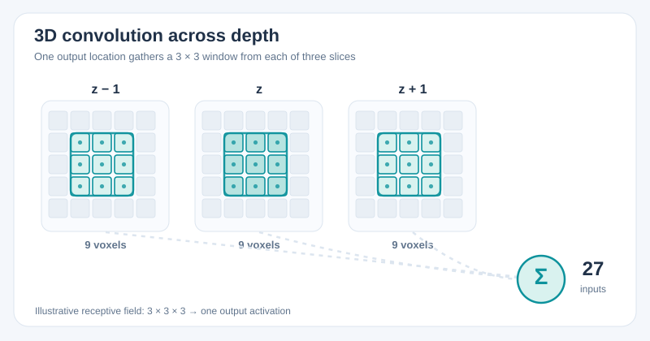
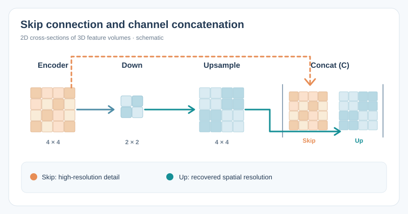
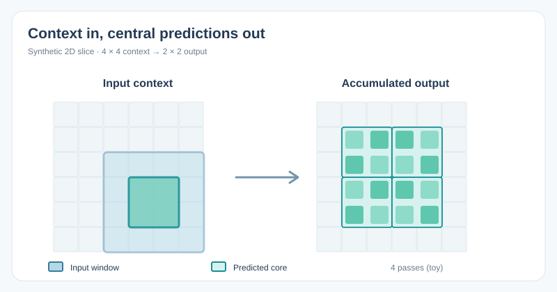
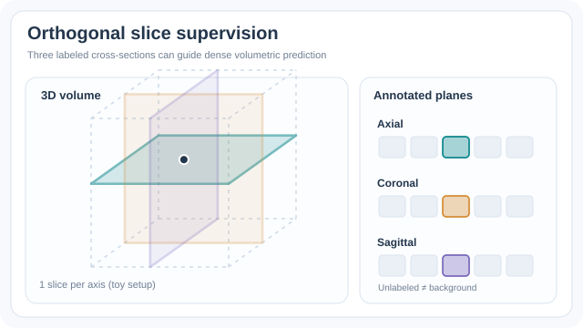
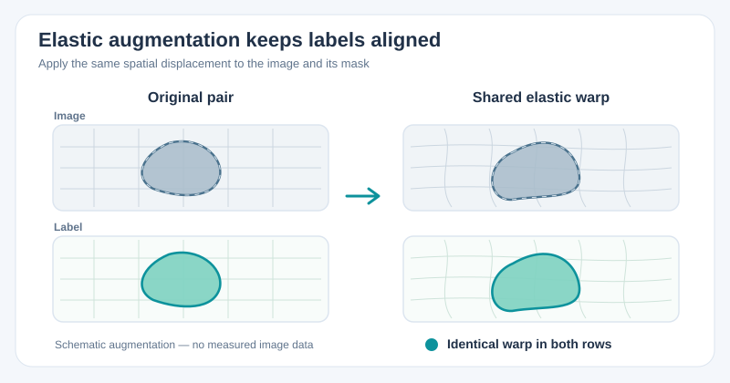
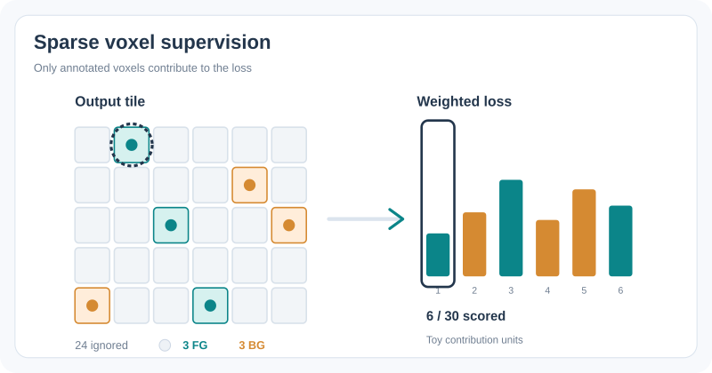
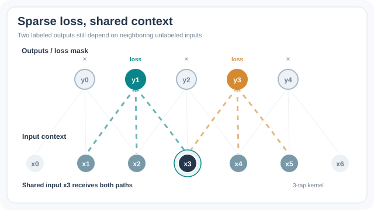
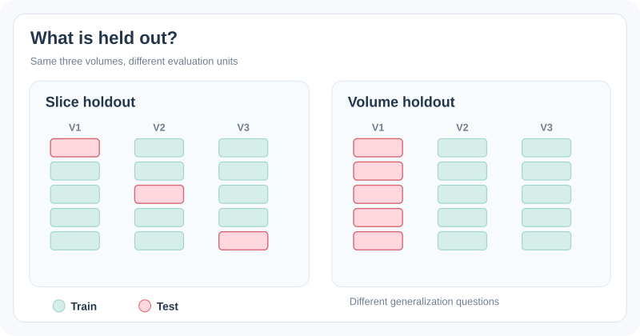

# 三維 U-Net

3D U-Net 是 [U-Net](index.zh-TW.md) 的版本，直接以三維運算分割體積影像，取代二維運算。它的設計目的是從稀疏標註學習：使用者標註少數切片，網路便產生稠密的三維分割。Çiçek 等人（2016）為生物醫學體積資料提出此方法。

## 概述

上層的 [U-Net](index.zh-TW.md) 以二維影像分割，其編碼器下採樣、解碼器上採樣，並在兩者之間有跳接連線。3D U-Net 保留這個設計，把每一個二維運算換成三維的對應運算，使濾波器同時沿深度、寬度與高度移動。

## 問題

製作稠密的三維標註成本很高：標註者必須標記每一個體素的每一個體積。許多實務任務只有少數標註切片，而逐切片套用二維網路會忽略切片之間的結構。問題在於，三維網路能否從稀疏標註學出完整的分割。

## 核心想法

把 U-Net 的所有二維運算換成三維運算，從頭端到端訓練，並以即時的彈性形變豐富訓練資料。網路因此能從稀疏標註的體積學習，並推廣到新的體積。

## 演算法

網路沿用 U-Net 的編碼器、解碼器與跳接連線。編碼器使用 $3\times3\times3$ 卷積與 $2\times2\times2$ 最大池化。解碼器沿三個空間維度上採樣，並結合編碼器相同解析度的特徵。最後以 $1\times1\times1$ 卷積產生各體素的類別分數。原始架構輸入 $132\times132\times116$ 的區塊，輸出 $44\times44\times28$ 的預測區塊，因此能使用周圍體素作為較小輸出區域的上下文。[^original]

### 三維卷積如何結合相鄰切片

對單一輸出位置而言，$3\times3\times3$ 卷積核會同時讀取**三個相鄰深度位置**，每個深度各取一個 $3\times3$ 的空間視窗。圖中只考慮一個輸入通道：每層提供 9 個值，合計 27 個空間取樣值。若有多個輸入通道，每個通道都會提供相應的 27 個取樣值，再由卷積的權重加總形成各輸出通道。相較於逐張切片獨立運算的二維卷積，三維卷積可以直接融合跨深度資訊。[^original]

*原創 CC BY-SA 4.0 教學動畫。* 每個光點代表**一個深度平面的貢獻**，不是一次乘加運算。9、18、27 為單一輸入通道在此人工幾何範例中的精確取樣數，**並非特徵強度或 GPU 效能實測**。MkDocs 網站可播放／暫停，也提供降低動態效果的靜態回退。[GitHub 靜態預覽](../../../../assets/concept-animations/3d-unet-depth-kernel-still.svg)。[^original]

### 編碼器跳接特徵如何與解碼器合併

跳接連線讓編碼器的高解析度特徵繞過低解析度的瓶頸，直接提供給解碼器。解碼器的上採樣卷積提高空間解析度後，必須先讓兩路特徵的**空間尺寸對齊**，再沿著**通道維度串接（concatenation）**，而不是逐元素相加。原始 3D U-Net 採用 valid 卷積，因此必要時要裁切編碼器的特徵，才能與解碼器尺寸相符。[^original]

*原創教學動畫，CC BY-SA 4.0。* 圖中的**人工二維剖面**代表三維特徵體積，$4\times4$ 與 $2\times2$ 僅用於說明相對解析度，**不是原論文各層的實際尺寸**。終點兩組網格表示空間大小相同、通道群組不同。實際架構所需的跳接裁切已於上文說明，但這張簡化示意沒有另外演示裁切步驟；顏色及光點也不是模型活化值或 GPU 實際執行軌跡。MkDocs 網站支援播放／暫停及鍵盤操作，減少動態效果時使用[GitHub 靜態回退](../../../../assets/concept-animations/3d-unet-skip-concat-still.svg)。[^original]

### 為何輸入區塊比預測區塊更大

原始架構使用 $132\times132\times116$ 體素輸入，但只輸出 $44\times44\times28$ 體素。valid 卷積會縮小空間尺寸，而較大的輸入區塊則為每個輸出體素提供周圍上下文。下圖以**人工二維剖面**展示這個結果：每個 $4\times4$ 輸入視窗只產生中央 $2\times2$ 的預測區塊；當輸入視窗在 $6\times6$ 的區域移動，四個重疊輸入區塊所產生的中央預測，逐步拼成內部 $4\times4$ 區域。[^original]

*原創教學動畫，CC BY-SA 4.0。* 圖內的 **$4\times4$／$2\times2$ 尺寸、四次掃描及二維排列皆為人工示例**，不代表論文中的實際網路尺寸、推論排程或效能量測。外圍留白是刻意設計：此圖未展示完整體積邊界如何處理，實務上需另訂邊界策略。MkDocs 網站可播放／暫停，減少動態效果時顯示靜態圖；[GitHub 靜態預覽](../../../../assets/concept-animations/3d-unet-context-tiling-still.svg)。[^original]

### 三個正交方向的稀疏切片如何提供監督

稀疏標註不一定只沿著單一方向選取連續切片。原始研究在極少標註的實驗中，也探討沿三個**互相正交的空間方向**選擇標註切面。動畫以人工體積依序強調軸向（axial）、冠狀面（coronal）與矢狀面（sagittal）。只有標註平面上的已知體素能提供對應監督；**其餘未標註體素不等於背景類別**。[^original]

*原創 CC BY-SA 4.0 教學動畫。* 人工立方體、切片位置及**每個方向五張中取一張**都是幾何示意，不是原始臨床影像、論文資料尺寸或實際標註配置。MkDocs 網站可使用播放／暫停與鍵盤操作，偏好減少動態效果時顯示 [GitHub 靜態回退](../../../../assets/concept-animations/3d-unet-orthogonal-slices-still.svg)。[^original]

### 從稀疏標註學習

訓練使用加權的 softmax 交叉熵。設 $\mathcal{A}$ 為輸出區塊中已標註的體素集合，$y_v$ 為已知標籤，$w_{y_v}$ 為其類別權重，$p_v(y_v)$ 為模型對該標籤預測的機率。下式列出哪些體素會計入損失。[^original]

$$
\mathcal{L}=-\sum_{v\in\mathcal{A}}w_{y_v}\log p_v(y_v).
$$

論文將未標註體素的損失權重設為零，並以類別權重平衡已標註的各類別。未標註體素與標為背景的體素扮演不同角色，只有後者會計入背景分類的誤差。網路仍使用整個輸入區塊作為上下文，並為整個輸出區塊產生分數。訓練時，影像與標籤會套用相同的彈性形變，以維持對齊。[^original]

#### 為何影像與標註需要一致的空間形變

原始 3D U-Net 訓練會對影像與其標註套用即時的彈性形變。[^original] 兩者必須使用**相同的空間位移場**，才能讓變形後的組織位置仍對應正確的監督標籤。影像強度與離散類別標籤的插值方式可以不同（例如離散標籤可採保持類別值的最近鄰取樣），但空間座標的形變必須一致。

*原創 CC BY-SA 4.0 教學動畫。* 此圖以**人工設計的二維剖面**說明同樣可用於三維訓練資料的空間形變；不是臨床影像，也不是論文中的實際增強紀錄。MkDocs 網站支援播放／暫停，降低動態效果時顯示靜態圖。[GitHub 靜態預覽](../../../../assets/concept-animations/3d-unet-paired-warp-still.svg)。[^original]

#### 稀疏損失遮罩如何影響梯度

*原創教學動畫，CC BY-SA 4.0。* 本圖是**人工設定**的 30 個體素範例：三個簡化的前景標註、三個背景標註，其餘 24 個體素損失權重為零。游標逐一停在已標註位置，右側同步強調對應的損失項。**「未標註」不等於「標為背景」**。長條數值僅是任意設定的加權損失貢獻，並非模型預測、實測損失，或原論文三類標註的重現。MkDocs 網站提供播放／暫停與鍵盤操作；偏好減少動態效果時顯示靜態圖。[GitHub 可直接閱讀的回退預覽](../../../../assets/concept-animations/3d-unet-sparse-loss-still.svg)。[^original]

#### 為何未標註的輸入上下文仍可能獲得梯度

對**未標註的輸出體素**將監督損失設為零，不代表周圍的**輸入體素**會從卷積或梯度計算中消失。考慮以下**人工設計的一維 valid 卷積**：七個輸入、三個卷積核係數、五個輸出。

$$
y_i=w_0x_i+w_1x_{i+1}+w_2x_{i+2},\qquad
\mathcal{L}=\ell(y_1)+\ell(y_3).
$$

若 $\delta_j=\partial\ell(y_j)/\partial y_j$，同一個輸入 $x_3$ 會沿兩條已標註輸出路徑取得梯度貢獻：

$$
\frac{\partial\mathcal{L}}{\partial x_3}=w_2\delta_1+w_0\delta_3.
$$

雖然 $y_0,y_2,y_4$ 不計入監督損失，共用的輸入上下文仍會影響兩個有標註的預測。動畫光點展示的是**鏈式法則的依賴關係**，不是實測活化值或 GPU 執行排程。

*原創 CC BY-SA 4.0 教學動畫。* **一維三元素卷積是數學類比**，不是實際 3D U-Net 層、訓練紀錄或效能測量。被遮罩的輸出不提供直接的監督誤差，但共用輸入仍可能影響已標註的輸出。MkDocs 網站支援播放／暫停與鍵盤操作，減少動態效果時顯示 [GitHub 靜態回退](../../../../assets/concept-animations/3d-unet-sparse-context-gradient-still.svg)。[^original]

### 評估方式

1. **半自動**。模型使用待分割體積內的標註學習。在三折評估中，作者將三個體積的 77 張已標註切片分成三組。每折將其中一組視為未標註，並保留供評估。[^original]
2. **全自動**。每折用兩個稀疏標註的體積訓練，並在第三個體積上預測。IoU 依留出體積中的已標註切片計算。這測試模型能否遷移到同一資料集中的另一個體積。[^original]

### 評估時究竟留出了什麼單位？

*原創教學動畫，CC BY-SA 4.0。* 此處以**人工設定**的三個體積、各五張切片解釋切分單位；粉紅色代表測試資料，青綠色代表訓練資料。左側在每個體積內留出一張已標註**切片**，同一體積的其他切片仍可用於訓練。右側則每次完整留出一個**體積**，該體積的所有切片都不參與當折訓練。輪換的折次、切片數量與位置**不是論文實際的切分配置**。這兩種設計分別衡量部分已知體積的補全能力與跨體積遷移能力。[GitHub 可直接閱讀的回退預覽](../../../../assets/concept-animations/3d-unet-evaluation-holdout-still.svg)；MkDocs 網站提供播放／暫停及減少動態效果的回退顯示。[^original]

## 主要結果

研究回報三個 Xenopus 腎臟體積上的 IoU。留出切片與留出整個體積得到不同的比較結果。[^original]

| 評估方式 | 3D 無 BN | 3D 有 BN | 2D 有 BN |
| --- | --- | --- | --- |
| 留出切片（表 1） | 0.842 | 0.863 | 0.796 |
| 留出體積（表 3） | 0.723 | 0.704 | 0.547 |

在留出體積的實驗中，批次正規化（BN）提高了兩個體積的 IoU。第三個體積的 IoU 從 0.779 降至 0.554，使得使用 BN 時的三體積平均值較低。作者另在半自動實驗中改變標註量。三個正交平面各標註一張切片時，三個體積的 IoU 介於 0.331 到 0.483。採用論文所列的 5、5 和 3 張切片時，IoU 介於 0.849 到 0.872（表 2）。[^original]

## 限制

- 結果只在一種體積上回報，即 Xenopus 腎臟，因此方法的一般性尚未展示。
- 三維卷積比二維的對應運算需要更多記憶體與運算，限制了可處理的體積大小。
- 兩種評估留出的單位不同。切片留出衡量模型在部分已標註體積內補齊分割的表現，體積留出則衡量模型在三個體積之間遷移的表現。[^original]

## 關聯

- [U-Net](index.zh-TW.md)是 3D U-Net 所擴展的二維設計。
- [分割指標](../../../evaluation/metrics/segmentation/index.zh-TW.md)說明 IoU 與 Dice，這兩種重疊度量被用來評估體積分割。
- [卷積變體](../convolution-variants/index.zh-TW.md)涵蓋體積網路所依賴的三維與空洞運算。
- [全卷積網路（Long 等人，2014）](https://arxiv.org/abs/1411.4038)是 U-Net 所建立於其上的較早全卷積分割設計。

## 應用

- 從稀疏標註進行生物醫學體積分割，即論文中 Xenopus 腎臟實驗的設定。
- 半自動標註：使用者標註少數切片，網路完成體積其餘部分。

## 開放問題

- 需要多少標註切片，半自動設定才可靠？應選擇哪些切片？
- 方法能否在不從頭重訓的情況下，轉移到其他器官與影像模態？

[^original]: Çiçek 等人，[*3D U-Net*](https://arxiv.org/html/1606.06650)，第 2 至 4 節及表 1 至 3。

## 參考文獻

### 開創性論文

- Çiçek, Ö., Abdulkadir, A., Lienkamp, S. S., Brox, T. 與 Ronneberger, O.（2016）。*3D U-Net: Learning Dense Volumetric Segmentation from Sparse Annotation*。arXiv。https://arxiv.org/abs/1606.06650 — 提出 3D U-Net，並在 Xenopus 腎臟體積上回報半自動與全自動設定的 IoU。
- Ronneberger, O., Fischer, P. & Brox, T.（2015）。*U-Net: Convolutional Networks for Biomedical Image Segmentation*。arXiv。https://arxiv.org/abs/1505.04597 — 3D U-Net 所擴展的、帶跳接連線的二維編碼器–解碼器。
- Milletari, F., Navab, N. & Ahmadi, S.-A.（2016）。*V-Net: Fully Convolutional Neural Networks for Volumetric Medical Image Segmentation*。arXiv。https://arxiv.org/abs/1606.04797 — 同期用於三維醫學分割的全卷積網路。
- Long, J., Shelhamer, E. & Darrell, T.（2014）。*Fully Convolutional Networks for Semantic Segmentation*。arXiv。https://arxiv.org/abs/1411.4038 — 用於稠密預測的全卷積設計。
- Sudre, C. H., 等人（2017）。*Generalised Dice overlap as a deep learning loss function for highly unbalanced segmentations*。arXiv。https://arxiv.org/abs/1707.03237 — 適用於高度不平衡分割的重疊度損失，與稀疏的體積標註相關。
