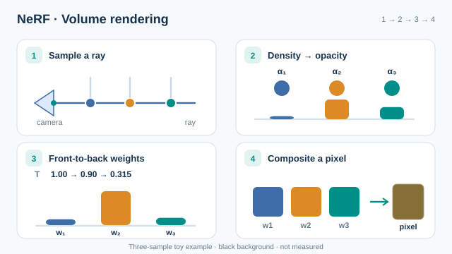

# NeRF: neural radiance fields

NeRF represents a static scene as a multilayer perceptron that maps a 3D position and a viewing direction to a colour and a volume density. New views are rendered by integrating this function along camera rays. The network is fitted to photographs of the scene whose camera poses are known.

## Overview

The [chapter](index.md) describes the field. This page covers the method.

## Problem

Given photographs of a scene with known camera poses, render views from camera positions that are not in the input set. The abstract frames this as novel-view synthesis of complex scenes.

## Core idea

The scene is a function $F_\Theta$ that takes a position $\mathbf{x}$ and a viewing direction $\mathbf{d}$ and returns a colour $\mathbf{c}$ and a density $\sigma$. The density depends on position only, $\sigma = \sigma(\mathbf{x})$, while the colour depends on both, $\mathbf{c} = \mathbf{c}(\mathbf{x}, \mathbf{d})$. Two details matter for quality. Inputs pass through a positional encoding with $L = 10$ frequencies for position and $L = 4$ for direction, which lets the network represent high-frequency detail. Networks given raw coordinates tend to learn low-frequency functions first, the bias that motivates this encoding (Rahaman et al., 2018). Sampling is hierarchical: a coarse network is evaluated at $N_c = 64$ points along each ray, and a fine network at $N_c + N_f = 192$ points, the coarse samples plus $N_f = 128$ new ones placed where the coarse density is high.

## Equation

The colour of a pixel is the volume rendering integral along the camera ray $\mathbf{r}(t) = \mathbf{o} + t\mathbf{d}$:

$$C(\mathbf{r}) = \int_{t_n}^{t_f} T(t)\,\sigma(\mathbf{r}(t))\,\mathbf{c}(\mathbf{r}(t), \mathbf{d})\,dt, \qquad T(t) = \exp\!\left(-\int_{t_n}^{t}\sigma(\mathbf{r}(s))\,ds\right)$$

Here $T(t)$ is the accumulated transmittance. The training loss sums the squared error between rendered and observed pixel colours for the coarse and fine renderings (Eq. 6 of the paper).

### Visual walkthrough: transmittance and pixel compositing

*Original teaching animation, CC BY-SA 4.0.* For a **three-sample toy ray**, let the per-interval opacities be `α = (0.10, 0.65, 0.40)`. In the discrete approximation, `αᵢ = 1 − exp(−σᵢδᵢ)`, `T₁ = 1`, `wᵢ = Tᵢαᵢ`, and `Tᵢ₊₁ = Tᵢ(1 − αᵢ)`. The entering transmittances are **(1, 0.90, 0.315)** and the colour weights are **(0.100, 0.585, 0.126)**, leaving **0.189** transmittance for the background. The last panel composites three illustrative RGB sample colours against **black**; it does not show a measured NeRF output. This simplified ray omits the coarse/fine hierarchical sampling of the full model. On MkDocs, Play/Pause is keyboard-accessible; [view the four-stage static fallback](../../../../assets/concept-animations/nerf-volume-rendering-still.svg) on GitHub.

## Results

The paper evaluates on two synthetic object datasets and eight real forward-facing scenes. Its Table 1 reports PSNR and SSIM (higher is better) and LPIPS (lower is better). The values below are copied from that table. Each cell reads PSNR / SSIM / LPIPS.

| Method | Diffuse Synthetic 360° | Realistic Synthetic 360° | Real Forward-Facing |
|---|---|---|---|
| SRN | 33.20 / 0.963 / 0.073 | 22.26 / 0.846 / 0.170 | 22.84 / 0.668 / 0.378 |
| Neural Volumes | 29.62 / 0.929 / 0.099 | 26.05 / 0.893 / 0.160 | not evaluated |
| LLFF | 34.38 / 0.985 / 0.048 | 24.88 / 0.911 / 0.114 | 24.13 / 0.798 / 0.212 |
| NeRF | 40.15 / 0.991 / 0.023 | 31.01 / 0.947 / 0.081 | 26.50 / 0.811 / 0.250 |

Three points qualify these numbers:

- On the realistic synthetic scenes, NeRF's PSNR is about 6 dB above LLFF's (31.01 against 24.88).
- On the real forward-facing scenes NeRF has the highest PSNR and SSIM, but LLFF has the lower LPIPS (0.212 against 0.250). The paper calls the LPIPS gap slight and points readers to its supplementary video for multiview consistency.
- The baselines were not all run at the same resolution. Because of its memory use, the paper ran SRN at 512 × 512 pixels on the synthetic scenes and at 504 × 376 on the real scenes, while the other methods ran at higher resolution.

The ablation (Table 2) averages over the eight realistic synthetic scenes, each with 100 input images. Each row changes one part of the full model or the input:

| Variant | PSNR | SSIM | LPIPS |
|---|---|---|---|
| Complete model | 31.01 | 0.947 | 0.081 |
| No positional encoding | 28.77 | 0.924 | 0.108 |
| No view dependence | 27.66 | 0.925 | 0.117 |
| No hierarchical sampling (256 samples, no fine network) | 30.06 | 0.938 | 0.109 |
| 50 input images | 29.79 | 0.940 | 0.096 |
| 25 input images | 27.78 | 0.925 | 0.107 |

Using 5 frequencies instead of 10 lowers PSNR to 30.59. Using 15 gives 30.81, so the paper finds no further gain beyond L = 10 in this setting.

Training takes 100,000 to 300,000 iterations on a single V100 GPU, about one to two days per scene. Rendering takes about 30 seconds per image on the same GPU. The paper's images need 640,000 rays (800 × 800 pixels) or 762,000 rays (real scenes), so each image costs 150 to 200 million network queries.

## Limitations

- **Per-scene training.** Each scene needs its own optimisation, about one to two days on the paper's hardware.
- **Slow rendering.** Each image needs 150 to 200 million network queries, about 30 seconds on one V100 in the paper.
- **Dependence on many views.** Quality falls when training uses 50 or 25 images instead of 100 (Table 2), so the method is not a sparse-view solution.
- **Static scenes and known poses.** The method assumes a static scene and known camera poses. For real data, the paper estimates the poses with COLMAP (Schönberger and Frahm, 2016), so pose errors enter the training data.
- **Perceptual gaps on real scenes.** LLFF's better LPIPS on the forward-facing data shows that a higher PSNR does not guarantee lower perceptual error.

## Connections

The explicit alternative to this implicit representation is [3D Gaussian splatting](gaussian-splatting.md). Training uses gradients through the rendering integral, which are computed as described in [Automatic differentiation](../../../math/automatic-differentiation/index.md).

## Open questions

- Can radiance fields be trained and rendered at interactive speed without losing quality?
- How should the representation handle moving objects and changing lighting?

## References

### Seminal papers

- Mildenhall, Srinivasan, Tancik, Barron, Ramamoorthi and Ng, *NeRF: Representing Scenes as Neural Radiance Fields for View Synthesis*, European Conference on Computer Vision (2020). https://doi.org/10.1007/978-3-030-58452-8_24 — The NeRF paper, with the volume rendering formulation and positional encoding.
- Barron et al., *Mip-NeRF: A Multiscale Representation for Anti-Aliasing Neural Radiance Fields*, IEEE/CVF International Conference on Computer Vision (2021). https://doi.org/10.1109/iccv48922.2021.00580 — Extends NeRF with a multiscale representation for anti-aliasing.
- Kerbl, Kopanas, Leimkuehler and Drettakis, *3D Gaussian Splatting for Real-Time Radiance Field Rendering*, ACM Transactions on Graphics (2023). https://doi.org/10.1145/3592433 — Introduces 3D Gaussian splatting, an explicit alternative to the NeRF representation.
- Kajiya and Von Herzen, *Ray tracing volume densities*, SIGGRAPH (1984). https://doi.org/10.1145/964965.808594 — An early formulation of ray tracing through volume densities.
- Rahaman, Baratin, Arpit, Draxler, Lin, Hamprecht, Bengio and Courville, *On the Spectral Bias of Neural Networks*, arXiv (2018). https://arxiv.org/abs/1806.08734 — Shows that networks fit low-frequency functions before high-frequency ones, the motivation for NeRF's positional encoding.
- Schönberger and Frahm, *Structure-from-Motion Revisited*, IEEE Conference on Computer Vision and Pattern Recognition (2016). https://doi.org/10.1109/CVPR.2016.445 — The COLMAP structure-from-motion system used to estimate camera poses for the real scenes.

### Surveys and textbooks

- Max, *Optical models for direct volume rendering*, IEEE Transactions on Visualization and Computer Graphics (1995). https://doi.org/10.1109/2945.468400 — A survey of the optical models behind volume rendering.
