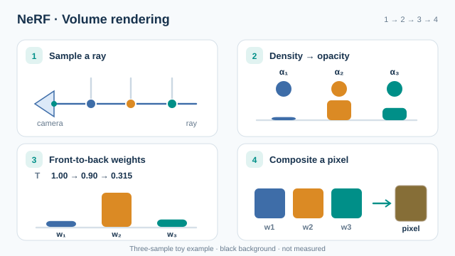

# NeRF：神經輻射場

NeRF 把靜態場景表示為一個多層感知器，它把三維位置與觀看方向映射到顏色與體積密度。新視角沿相機射線對這個函數積分來渲染。網路擬合的是一組已知相機位姿的場景照片。

## 概觀

[本章](index.zh-TW.md)描述了這個領域。本頁說明此方法。

## 問題

給定一個場景的照片與已知的相機位姿，渲染出不在輸入集合中的相機位置所對應的視角。摘要把這項任務描述為複雜場景的新視角合成。

## 核心想法

場景是一個函數 $F_\Theta$，它接收位置 $\mathbf{x}$ 與觀看方向 $\mathbf{d}$，回傳顏色 $\mathbf{c}$ 與密度 $\sigma$。密度只依賴位置，$\sigma = \sigma(\mathbf{x})$；顏色則同時依賴兩者，$\mathbf{c} = \mathbf{c}(\mathbf{x}, \mathbf{d})$。有兩個細節對品質很重要。輸入會先經過位置編碼，位置使用 $L = 10$ 個頻率，方向使用 $L = 4$ 個頻率，使網路能表示高頻細節。取樣採階層式：粗網路在每條射線上取 $N_c = 64$ 個點，細網路則在粗網路密度高的地方取 $N_f = 128$ 個點。

## 方程式

像素的顏色是沿相機射線 $\mathbf{r}(t) = \mathbf{o} + t\mathbf{d}$ 的體積渲染積分：

$$C(\mathbf{r}) = \int_{t_n}^{t_f} T(t)\,\sigma(\mathbf{r}(t))\,\mathbf{c}(\mathbf{r}(t), \mathbf{d})\,dt, \qquad T(t) = \exp\!\left(-\int_{t_n}^{t}\sigma(\mathbf{r}(s))\,ds\right)$$

這裡 $T(t)$ 是累積透射率。訓練損失是粗渲染與細渲染的像素顏色與觀察值之間平方誤差的總和（論文的式 6）。

### 動畫解說：透射率與像素合成

*原創教學動畫，CC BY-SA 4.0。* 在**三個取樣區間的示意射線**中，假設不透明度 `α = (0.10, 0.65, 0.40)`。離散體積渲染使用 `αᵢ = 1 − exp(−σᵢδᵢ)`、`T₁ = 1`、`wᵢ = Tᵢαᵢ` 與 `Tᵢ₊₁ = Tᵢ(1 − αᵢ)`。各取樣點進入時的透射率為 **(1, 0.90, 0.315)**，顏色權重為 **(0.100, 0.585, 0.126)**，最後仍有 **0.189** 的背景透射率。末階段將三種示意 RGB 顏色與**黑色背景**合成，並非 NeRF 模型的實測輸出；此簡化範例亦未呈現完整模型的粗細兩階段階層取樣。MkDocs 網站提供可用鍵盤操作的播放／暫停按鈕；GitHub 可查看[四階段靜態回退圖](../../../../assets/concept-animations/nerf-volume-rendering-still.svg)。

## 結果

摘要報告，此方法在複雜場景的新視角合成上達到最佳水準。論文報告，訓練需要 10 萬至 30 萬次迭代，在單張 V100 GPU 上約一至兩天一個場景，渲染一幀約需 30 秒。與先前方法的比較見論文的結果表。

## 限制

- 每個場景都需要各自最佳化，在論文所用的硬體上約需一至兩天。
- 渲染一幀約需 30 秒。
- 此方法假設場景是靜態的，且相機位姿已知。對於真實資料，論文以 COLMAP 估計位姿。

## 關聯

與這種隱式表示相對的顯式替代方案是[三維高斯潑濺](gaussian-splatting.zh-TW.md)。訓練會透過體積渲染積分計算梯度，其計算方式見[自動微分](../../../math/automatic-differentiation/index.zh-TW.md)。

## 開放問題

- 輻射場能否在不損失品質的前提下，以互動速度訓練與渲染？
- 表示法應如何處理移動的物體與變化的光照？

## 參考文獻

### 奠基性論文

- Mildenhall、Srinivasan、Tancik、Barron、Ramamoorthi 與 Ng，*NeRF: Representing Scenes as Neural Radiance Fields for View Synthesis*，European Conference on Computer Vision（2020）。https://doi.org/10.1007/978-3-030-58452-8_24 — NeRF 原始論文，包含體積渲染的公式與位置編碼。
- Barron 等人，*Mip-NeRF: A Multiscale Representation for Anti-Aliasing Neural Radiance Fields*，IEEE/CVF International Conference on Computer Vision（2021）。https://doi.org/10.1109/iccv48922.2021.00580 — 以多尺度表示擴展 NeRF，用於抗混疊。
- Kerbl、Kopanas、Leimkuehler 與 Drettakis，*3D Gaussian Splatting for Real-Time Radiance Field Rendering*，ACM Transactions on Graphics（2023）。https://doi.org/10.1145/3592433 — 提出三維高斯潑濺，是隱式 NeRF 表示法的顯式替代方案。

### 綜述與教科書

- Kajiya 與 Von Herzen，*Ray tracing volume densities*，SIGGRAPH（1984）。https://doi.org/10.1145/964965.808594 — 透過體積密度進行光線追蹤的早期公式。
- Max，*Optical models for direct volume rendering*，IEEE Transactions on Visualization and Computer Graphics（1995）。https://doi.org/10.1109/2945.468400 — 體積渲染背後光學模型的綜述。
