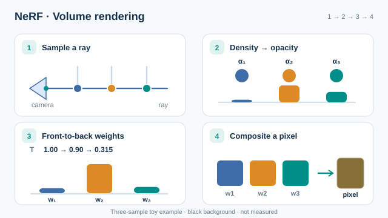

# NeRF：神經輻射場

NeRF 把靜態場景表示為一個多層感知器，它把三維位置與觀看方向映射到顏色與體積密度。新視角沿相機射線對這個函數積分來渲染。網路擬合的是一組已知相機位姿的場景照片。

## 概觀

[本章](index.zh-TW.md)描述了這個領域。本頁說明此方法。

## 問題

給定一個場景的照片與已知的相機位姿，渲染出不在輸入集合中的相機位置所對應的視角。摘要把這項任務描述為複雜場景的新視角合成。

## 核心想法

場景是一個函數 $F_\Theta$，它接收位置 $\mathbf{x}$ 與觀看方向 $\mathbf{d}$，回傳顏色 $\mathbf{c}$ 與密度 $\sigma$。密度只依賴位置，$\sigma = \sigma(\mathbf{x})$；顏色則同時依賴兩者，$\mathbf{c} = \mathbf{c}(\mathbf{x}, \mathbf{d})$。有兩個細節對品質很重要。輸入會先經過位置編碼，位置使用 $L = 10$ 個頻率，方向使用 $L = 4$ 個頻率，使網路能表示高頻細節。在原始座標上訓練的網路傾向於先學習低頻函數，這種偏差正是此編碼的動機（Rahaman 等人，2018）。取樣採階層式：粗網路在每條射線上取 $N_c = 64$ 個點，細網路則以 $N_c + N_f = 192$ 個點評估，即粗取樣點加上在粗網路密度高處新增的 $N_f = 128$ 個點。

## 方程式

像素的顏色是沿相機射線 $\mathbf{r}(t) = \mathbf{o} + t\mathbf{d}$ 的體積渲染積分：

$$C(\mathbf{r}) = \int_{t_n}^{t_f} T(t)\,\sigma(\mathbf{r}(t))\,\mathbf{c}(\mathbf{r}(t), \mathbf{d})\,dt, \qquad T(t) = \exp\!\left(-\int_{t_n}^{t}\sigma(\mathbf{r}(s))\,ds\right)$$

這裡 $T(t)$ 是累積透射率。訓練損失是粗渲染與細渲染的像素顏色與觀察值之間平方誤差的總和（論文的式 6）。

### 動畫解說：透射率與像素合成

*原創教學動畫，CC BY-SA 4.0。* 在**三個取樣區間的示意射線**中，假設不透明度 `α = (0.10, 0.65, 0.40)`。離散體積渲染使用 `αᵢ = 1 − exp(−σᵢδᵢ)`、`T₁ = 1`、`wᵢ = Tᵢαᵢ` 與 `Tᵢ₊₁ = Tᵢ(1 − αᵢ)`。各取樣點進入時的透射率為 **(1, 0.90, 0.315)**，顏色權重為 **(0.100, 0.585, 0.126)**，最後仍有 **0.189** 的背景透射率。末階段將三種示意 RGB 顏色與**黑色背景**合成，並非 NeRF 模型的實測輸出；此簡化範例亦未呈現完整模型的粗細兩階段階層取樣。MkDocs 網站提供可用鍵盤操作的播放／暫停按鈕；GitHub 可查看[四階段靜態回退圖](../../../../assets/concept-animations/nerf-volume-rendering-still.svg)。

## 結果

論文在兩組合成物體資料集與八個真實前向拍攝場景上評估。其表 1 報告 PSNR 與 SSIM（越高越好）以及 LPIPS（越低越好）。下表數值取自該表，每格格式為 PSNR / SSIM / LPIPS。

| 方法 | 漫射合成 360° | 寫實合成 360° | 真實前向拍攝 |
|---|---|---|---|
| SRN | 33.20 / 0.963 / 0.073 | 22.26 / 0.846 / 0.170 | 22.84 / 0.668 / 0.378 |
| Neural Volumes | 29.62 / 0.929 / 0.099 | 26.05 / 0.893 / 0.160 | 未評估 |
| LLFF | 34.38 / 0.985 / 0.048 | 24.88 / 0.911 / 0.114 | 24.13 / 0.798 / 0.212 |
| NeRF | 40.15 / 0.991 / 0.023 | 31.01 / 0.947 / 0.081 | 26.50 / 0.811 / 0.250 |

有三點需要補充說明：

- 在寫實合成場景上，NeRF 的 PSNR 比 LLFF 高出約 6 dB（31.01 對 24.88）。
- 在真實前向拍攝場景上，NeRF 的 PSNR 與 SSIM 最高，但 LLFF 的 LPIPS 較低（0.212 對 0.250）。論文稱此 LPIPS 差距很小，並請讀者觀看補充影片，以比較多視角一致性。
- 各基準方法的解析度並不一致。因記憶體用量，論文以 512 × 512 像素執行 SRN 於合成場景，以 504 × 376 像素執行於真實場景；其他方法則以較高解析度執行。

消融實驗（表 2）平均八個寫實合成場景，每個場景使用 100 張輸入影像。每列只改變完整模型的一個部分或輸入：

| 變體 | PSNR | SSIM | LPIPS |
|---|---|---|---|
| 完整模型 | 31.01 | 0.947 | 0.081 |
| 無位置編碼 | 28.77 | 0.924 | 0.108 |
| 無視角相依 | 27.66 | 0.925 | 0.117 |
| 無階層取樣（256 個樣本，無細網路） | 30.06 | 0.938 | 0.109 |
| 50 張輸入影像 | 29.79 | 0.940 | 0.096 |
| 25 張輸入影像 | 27.78 | 0.925 | 0.107 |

使用 5 個頻率（而非 10 個）時，PSNR 降為 30.59；使用 15 個頻率時為 30.81，因此論文在此設定下未發現 L = 10 以上的進一步改善。

訓練在單張 V100 GPU 上需 10 萬至 30 萬次迭代，每個場景約一至兩天；在同一 GPU 上渲染一張影像約需 30 秒。論文中的影像需要 640,000 條射線（800 × 800 像素）或 762,000 條射線（真實場景），因此每張影像需要 1.5 億至 2 億次網路查詢。

## 限制

- **逐場景訓練。** 每個場景都需要各自最佳化，在論文所用的硬體上約需一至兩天。
- **渲染緩慢。** 每張影像需要 1.5 億至 2 億次網路查詢，論文中在一張 V100 上約需 30 秒。
- **依賴大量視角。** 訓練影像從 100 張減為 50 或 25 張時，品質下降（表 2），因此此方法並不是稀疏視角的解決方案。
- **靜態場景與已知位姿。** 此方法假設場景靜態且相機位姿已知。對於真實資料，論文以 COLMAP（Schönberger 與 Frahm，2016）估計位姿，因此位姿誤差會進入訓練資料。
- **真實場景的感知差距。** 在前向拍攝資料上，LLFF 的 LPIPS 較佳，顯示較高的 PSNR 並不保證較低的感知誤差。

## 關聯

與這種隱式表示相對的顯式替代方案是[三維高斯潑濺](gaussian-splatting.zh-TW.md)。訓練會透過體積渲染積分計算梯度，其計算方式見[自動微分](../../../math/automatic-differentiation/index.zh-TW.md)。

## 開放問題

- 輻射場能否在不損失品質的前提下，以互動速度訓練與渲染？
- 表示法應如何處理移動的物體與變化的光照？

## 參考文獻

### 奠基性論文

- Mildenhall、Srinivasan、Tancik、Barron、Ramamoorthi 與 Ng，*NeRF: Representing Scenes as Neural Radiance Fields for View Synthesis*，European Conference on Computer Vision（2020）。https://doi.org/10.1007/978-3-030-58452-8_24 — NeRF 原始論文，包含體積渲染的公式與位置編碼。
- Barron 等人，*Mip-NeRF: A Multiscale Representation for Anti-Aliasing Neural Radiance Fields*，IEEE/CVF International Conference on Computer Vision（2021）。https://doi.org/10.1109/iccv48922.2021.00580 — 以多尺度表示擴展 NeRF，用於抗混疊。
- Kerbl、Kopanas、Leimkuehler 與 Drettakis，*3D Gaussian Splatting for Real-Time Radiance Field Rendering*，ACM Transactions on Graphics（2023）。https://doi.org/10.1145/3592433 — 提出三維高斯潑濺，是隱式 NeRF 表示法的顯式替代方案。
- Kajiya 與 Von Herzen，*Ray tracing volume densities*，SIGGRAPH（1984）。https://doi.org/10.1145/964965.808594 — 透過體積密度進行光線追蹤的早期公式。
- Rahaman 等人，*On the Spectral Bias of Neural Networks*，arXiv（2018）。https://arxiv.org/abs/1806.08734 — 說明網路會先擬合低頻函數，再擬合高頻函數，這是 NeRF 位置編碼的動機。
- Schönberger 與 Frahm，*Structure-from-Motion Revisited*，IEEE Conference on Computer Vision and Pattern Recognition（2016）。https://doi.org/10.1109/CVPR.2016.445 — 用於估計真實場景相機位姿的 COLMAP 結構自運動系統。

### 綜述與教科書

- Max，*Optical models for direct volume rendering*，IEEE Transactions on Visualization and Computer Graphics（1995）。https://doi.org/10.1109/2945.468400 — 體積渲染背後光學模型的綜述。
