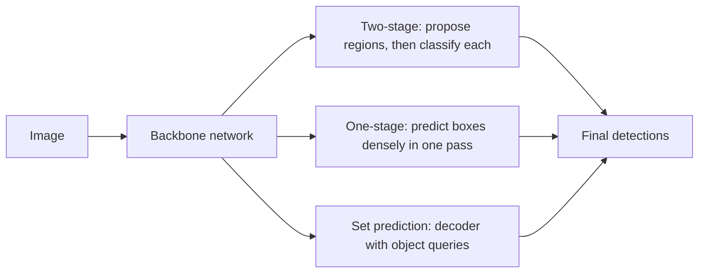

# Object Detection

Object detection finds the objects in an image and reports, for each one, a bounding box and a class label. It sits between image classification, which names what a picture shows, and segmentation, which labels every pixel. Since about 2014 most detectors have been deep networks trained end to end. They fall into three families: two-stage detectors, which propose regions and then classify them; one-stage detectors, which predict boxes densely in a single pass; and set-prediction detectors, which use a Transformer to output the whole set of objects at once.

## Overview

A classifier answers one question per image. A detector has to answer an unknown number of questions: how many objects are present, where each one is, and what it is. Its output therefore has a variable size, and the training signal has to decide which predicted box corresponds to which real object.

Detection is also a building block for tracking, pose estimation and instance segmentation, which add information on top of a box. The [Computer Vision](../index.md) overview places it beside segmentation and tracking in its task map.

## Key concepts

- **Bounding box**: a rectangle around an object, usually described by its centre, width and height, or by its corners.
- **Anchors (default boxes)**: a fixed set of reference boxes, with several scales and aspect ratios, placed at every location of a feature map. The detector scores each anchor and predicts a correction to it. [Faster R-CNN](faster-rcnn/index.md) uses nine anchors per location.
- **Intersection over union (IoU)**: the area where two boxes overlap, divided by the area they cover together. It measures how well a predicted box matches a ground-truth box, and it is the test for a correct detection. Faster R-CNN treats an anchor as a negative when its IoU with every ground-truth box is below 0.3.[^2]
- **Non-maximum suppression (NMS)**: a post-processing step that keeps the highest-scoring box in a group of heavily overlapping duplicates and removes the rest. The YOLO paper reports that it adds 2–3% to mAP.[^3]
- **Feature pyramid**: a set of feature maps at several resolutions, so that small and large objects each have a map at a suitable scale. Feature pyramid networks (FPN) and RetinaNet use one.[^10]
- **Class imbalance**: a dense detector evaluates a very large number of candidate locations, and nearly all of them are background. The RetinaNet paper puts this at between 10^4 and 10^5 locations per image.[^4]

## How it works

Every detector has to propose or predict candidate boxes, score them, and remove duplicates. The families differ in how they do the first step, and therefore in how they handle the rest.

### Two-stage detectors

R-CNN ran a CNN separately on each of the roughly 2,000 Selective Search region proposals per image.[^9] Fast R-CNN computed the convolutional features once for the whole image and pooled a fixed-size feature vector for each proposal, which made training and testing much faster. Faster R-CNN went one step further: a small network, the region proposal network, learns to generate the proposals from the same shared features. [Faster R-CNN](faster-rcnn/index.md) has its own page.

### One-stage detectors

YOLO treats detection as a single regression problem. The image is divided into a grid, and each cell predicts a few boxes, their confidences and the class probabilities, all in one forward pass. SSD predicts from several feature maps at different resolutions. RetinaNet attaches a dense prediction head to each level of a feature pyramid. These detectors have no proposal stage, which makes them fast, but they must cope with the flood of background locations. [YOLO](yolo/index.md) and [RetinaNet](retinanet/index.md) have their own pages.

### Set prediction

DETR removes anchors and NMS altogether. A CNN backbone produces image features, and a Transformer encoder and decoder turn them into a fixed set of predictions. The decoder works from a set of learned object queries; the main model uses 100 of them. During training, the predictions are matched one-to-one to the ground-truth objects with the Hungarian algorithm, and the loss is computed on the matched pairs. Because each object is matched to only one prediction, duplicates are discouraged in the loss itself, and no NMS step is needed.[^5] [DETR](detr/index.md) has its own page.

### Evaluation with mAP

A detector's output is ranked by confidence. A detection counts as correct when its IoU with an unmatched ground-truth box of the same class exceeds a threshold, usually 0.5 on PASCAL VOC. Sweeping the confidence threshold traces a precision–recall curve for each class. The average precision (AP) of a class is the area under that curve, and mean average precision (mAP) is the mean of AP over the classes.[^6] The COCO benchmark reports AP as an integral over several IoU thresholds.[^5] Because the scores depend on the threshold and on the training split, numbers from different papers are only comparable when the protocol is the same.

## Key methods

Four landmark methods are compared below. Each links to its own page, which holds the equations, results and limitations.

| Method | Year | Family | What separates it | Page |
|---|---|---|---|---|
| Faster R-CNN | 2015 | Two-stage | A region proposal network shares convolutional features with the detector | [Faster R-CNN](faster-rcnn/index.md) |
| YOLO | 2015 | One-stage | Detection as a single regression over a grid, at real-time speed | [YOLO](yolo/index.md) |
| RetinaNet | 2017 | One-stage, dense | Focal loss down-weights easy background examples, so a dense detector can match two-stage accuracy | [RetinaNet](retinanet/index.md) |
| DETR | 2020 | Set prediction | Transformer decoder with object queries and bipartite matching, with no anchors or NMS | [DETR](detr/index.md) |

R-CNN and Fast R-CNN are the direct ancestors of Faster R-CNN, and their ideas are explained on its page. SSD is the other major one-stage detector; it is not given a page of its own here.

## Connections

- **Brain and mind.** The two-stage idea, a fast bottom-up selection of candidate regions followed by slower recognition, loosely resembles the saliency model of Itti, Koch and Niebur (1998), which chooses locations to attend from feature contrast alone. See [Saliency-Based Visual Attention](../../../../brain-mind/attention-brain-machine/saliency-map/index.md). The resemblance is one of organisation, not evidence of a shared mechanism.
- **Backbones.** Almost every detector takes its features from a backbone designed for classification, such as the [residual networks](../../cnn/backbones-and-scaling/resnet/index.md) of the [CNN](../../cnn/index.md) family. Better backbones tend to lift all the detector families.
- **Transformers.** DETR brings the [Transformer](../../transformer/index.md) and its attention mechanism into detection. Open-vocabulary detectors, which find objects named in text, combine detection with the vision-language models covered in [Multimodal Models](../../multimodal/index.md).

## Applications

- **Driving.** Detecting pedestrians, cyclists and other vehicles in real time, [Autonomous Driving](../../../../applications/autonomous-driving/index.md).
- **Medicine.** Locating lesions and anatomical structures in scans and images, [Healthcare](../../../../applications/healthcare/index.md).
- **Industry.** Finding parts and defects on production lines, [Manufacturing](../../../../applications/manufacturing/index.md).

## Open questions

- **Small objects.** Small objects remain the weak point across the families. The DETR paper reports an APS of 20.5 for its model against 24.2 for Faster R-CNN with an FPN backbone, while its large-object AP is higher.[^7] The YOLO paper also reports that its first version struggled with small objects.[^3]
- **The cost of set prediction.** DETR removed the hand-designed components but needed long training. Deformable DETR reports better accuracy than DETR with ten times fewer training epochs, and names slow convergence and limited feature resolution as the problems it addresses.[^8]
- **Are anchors and NMS needed?** Set prediction shows that they can be removed, but the trade-off between simplicity and training cost is still being studied.
- **Open vocabulary.** Closed-set detectors recognise only the classes they were trained on. Whether detectors can reliably find objects named by arbitrary text is an active question.

[^2]: Ren et al. (2015): an anchor is assigned a negative label if its IoU is lower than 0.3 for all ground-truth boxes.
[^3]: Redmon et al. (2015): non-maximal suppression adds 2–3% to mAP, and the authors note that YOLO struggles to localise small objects.
[^4]: Lin et al. (2017): dense detectors evaluate 10^4 to 10^5 candidate locations per image, of which only a few contain objects.
[^5]: Carion et al. (2020): AP is reported as the integral metric over multiple IoU thresholds.
[^6]: Everingham et al. (2009) define the VOC scoring protocol; mAP is the mean over classes of the area under each class's precision–recall curve.
[^7]: Carion et al. (2020), Table 1: DETR 42.0 AP (APS 20.5, APL 61.1) against Faster R-CNN with FPN at 40.2 AP (APS 24.2, APL 52.0).
[^8]: Zhu et al. (2020), abstract: Deformable DETR performs better than DETR, especially on small objects, with 10 times fewer training epochs.
[^9]: Girshick et al. (2013): R-CNN uses around 2,000 category-independent region proposals per image, generated with Selective Search at test time.
[^10]: Lin et al. (2016), abstract: feature pyramids are a basic component of recognition systems for detecting objects at different scales.

## References

### Seminal papers

- Girshick, R., Donahue, J., Darrell, T. & Malik, J. (2013). *Rich feature hierarchies for accurate object detection and semantic segmentation*. arXiv. https://arxiv.org/abs/1311.2524 — R-CNN, which combines region proposals with CNN features and starts the two-stage family.
- Girshick, R. (2015). *Fast R-CNN*. arXiv. https://arxiv.org/abs/1504.08083 — Shares convolutional computation across proposals with RoI pooling and trains the detector end to end.
- Ren, S., He, K., Girshick, R. & Sun, J. (2015). *Faster R-CNN: Towards Real-Time Object Detection with Region Proposal Networks*. arXiv. https://arxiv.org/abs/1506.01497 — Adds a region proposal network that shares features with the detector, making proposals nearly cost-free.
- Redmon, J., Divvala, S., Girshick, R. & Farhadi, A. (2015). *You Only Look Once: Unified, Real-Time Object Detection*. arXiv. https://arxiv.org/abs/1506.02640 — Frames detection as a single regression over a grid of cells, running in real time.
- Liu, W., et al. (2015). *SSD: Single Shot MultiBox Detector*. arXiv. https://arxiv.org/abs/1512.02325 — A one-stage detector that predicts from several feature maps at different scales with default boxes.
- Lin, T.-Y., Goyal, P., Girshick, R., He, K. & Dollár, P. (2017). *Focal Loss for Dense Object Detection*. arXiv. https://arxiv.org/abs/1708.02002 — Introduces focal loss and the RetinaNet detector, which closes the accuracy gap between one-stage and two-stage detectors.
- Carion, N., et al. (2020). *End-to-End Object Detection with Transformers*. arXiv. https://arxiv.org/abs/2005.12872 — DETR, which treats detection as direct set prediction with a Transformer and bipartite matching.
- Zhu, X., et al. (2020). *Deformable DETR: Deformable Transformers for End-to-End Object Detection*. arXiv. https://arxiv.org/abs/2010.04159 — Replaces DETR's dense attention with attention over a few sampling points, speeding up convergence and helping small objects.
- Lin, T.-Y., Dollár, P., Girshick, R., He, K., Hariharan, B. & Belongie, S. (2016). *Feature Pyramid Networks for Object Detection*. arXiv. https://arxiv.org/abs/1612.03144 — Builds a top-down feature pyramid from a CNN backbone, the multi-scale feature design used by RetinaNet.
- Lin, T.-Y., et al. (2014). *Microsoft COCO: Common Objects in Context*. arXiv. https://arxiv.org/abs/1405.0312 — The COCO dataset and benchmark, the main testbed for modern detectors.
- Everingham, M., Van Gool, L., Williams, C. K. I., Winn, J. & Zisserman, A. (2009). *The Pascal Visual Object Classes (VOC) Challenge*. International Journal of Computer Vision. https://doi.org/10.1007/s11263-009-0275-4 — The VOC benchmark and the scoring protocol that early detection papers reported against.

### Surveys and textbooks

- Zou, Z., et al. (2019). *Object Detection in 20 Years: A Survey*. arXiv. https://arxiv.org/abs/1905.05055 — A broad survey of detection from the early hand-crafted detectors to deep learning, with the main benchmarks.
- Zhao, Z.-Q., Zheng, P., Xu, S.-t. & Wu, X. (2018). *Object Detection with Deep Learning: A Review*. arXiv. https://arxiv.org/abs/1807.05511 — A review of deep detectors that groups them into two-stage and one-stage methods and compares their results.
