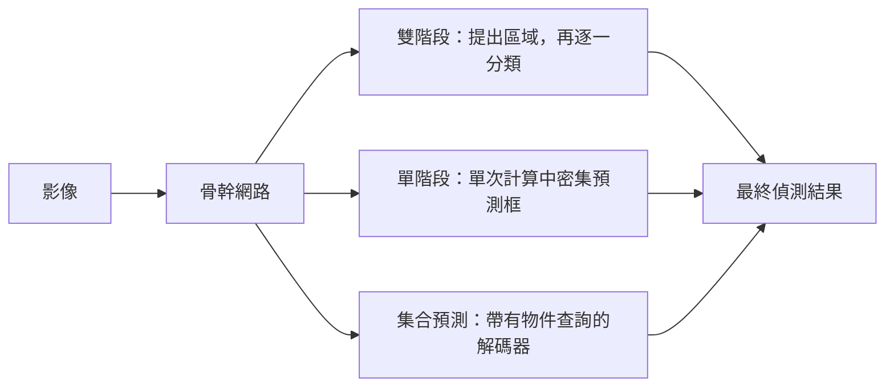

# 物件偵測

物件偵測會找出影像中的物件，並為每個物件提供一個邊界框與一個類別標籤。它介於影像分類（說明一張圖片呈現了什麼）與語意分割（為每個像素加上標籤）之間。大約從 2014 年起，多數偵測器都是以端到端方式訓練的深度網路。它們大致分為三類：雙階段偵測器，先提出區域再逐一分類；單階段偵測器，在單次前向計算中密集地預測邊界框；以及集合預測偵測器，使用 Transformer 一次輸出所有物件。

## 概述

分類器對每張影像只回答一個問題。偵測器則必須回答數量未知的問題：影像中有多少物件、每個物件在哪裡、它是什麼。因此輸出的大小是可變的，而訓練訊號必須決定哪個預測框對應哪個真實物件。

偵測也是追蹤、姿態估計與實例分割的基礎模組，這些任務都是在邊界框之上再加入更多資訊。[電腦視覺](../index.md)的任務地圖把它與分割、追蹤並列。

## 關鍵概念

- **邊界框（bounding box）**：包圍物件的矩形，通常以中心、寬與高，或以角點座標描述。
- **錨框（anchors，預設框）**：在特徵圖的每個位置放置一組固定的參考框，具有數種尺度與長寬比。偵測器為每個錨框評分，並預測對它的修正。[Faster R-CNN](faster-rcnn/index.md) 每個位置使用九個錨框。
- **交並比（intersection over union, IoU）**：兩個框重疊的面積，除以兩者共同涵蓋的面積。它衡量預測框與真實框的吻合程度，也是判定一次偵測是否正確的依據。Faster R-CNN 將與所有真實框的 IoU 都低於 0.3 的錨框視為負樣本。[^2]
- **非極大值抑制（non-maximum suppression, NMS）**：一種後處理步驟，在一群高度重疊的重複框中保留分數最高的框，其餘移除。YOLO 論文報告它能使 mAP 增加 2–3%。[^3]
- **特徵金字塔（feature pyramid）**：同一個網路在多種解析度下的特徵圖，讓小物件與大物件各自都有合適尺度的特徵圖。特徵金字塔網路（FPN）與 RetinaNet 都使用它。[^10]
- **類別不平衡（class imbalance）**：密集偵測器會評估非常大量的候選位置，而其中幾乎都是背景。RetinaNet 論文估計每張影像有 10^4 到 10^5 個候選位置。[^4]

## 運作方式

每個偵測器都必須提出或預測候選框、為它們評分，並移除重複項。各類方法的差別在於第一步如何完成，因此也影響後續步驟的處理方式。

### 雙階段偵測器

R-CNN 對每張影像約 2,000 個選擇性搜尋（Selective Search）區域提議，分別執行一次 CNN。[^9]Fast R-CNN 則只對整張影像計算一次卷積特徵，再為每個提議池化出固定大小的特徵向量，使訓練與測試都快得多。Faster R-CNN 更進一步：由一個小型網路，即區域提議網路，從同一組共享特徵中學習產生提議。[Faster R-CNN](faster-rcnn/index.md) 有自己的專頁。

### 單階段偵測器

YOLO 把偵測視為單一回歸問題。影像被切成格狀，每個格子在一次前向計算中預測數個框、它們的信心值與類別機率。SSD 從多個不同解析度的特徵圖進行預測。RetinaNet 則在特徵金字塔的每一層上接一個密集預測頭。這些偵測器沒有提議階段，因此速度快，但必須應付大量的背景位置，而焦點損失正是為了解決這個問題。[YOLO](yolo/index.md) 與 [RetinaNet](retinanet/index.md) 各有專頁。

### 集合預測

DETR 完全移除了錨框與 NMS。CNN 骨幹網路產生影像特徵，Transformer 編碼器與解碼器再把它們轉換為一組固定數量的預測。解碼器從一組學習而來的物件查詢出發；主要模型使用 100 個查詢。訓練時，預測與真實物件以匈牙利演算法做一對一配對，損失則只計算在配對上的項目。由於每個物件只配對給一個預測，損失本身就會抑制重複，因此不需要 NMS 步驟。[^5] [DETR](detr/index.md) 有自己的專頁。

### 以 mAP 評估

偵測器的輸出依信心值排序。當某個偵測與同類別、尚未配對的真實框之 IoU 超過門檻（PASCAL VOC 通常為 0.5），即視為正確。掃過信心門檻，可以得到每個類別的精確率—召回率曲線。某類別的平均精度（AP）是該曲線下的面積，而平均精度均值（mAP）則是各類別 AP 的平均。[^6] COCO 基準則把 AP 定義為多個 IoU 門檻上的積分。[^5] 由於分數取決於門檻與訓練切分，不同論文的數字只有在評估協定相同時才能比較。

## 主要方法

下面比較四個里程碑式的方法。每個方法都連結到自己的專頁，那裡有方程式、結果與限制。

| 方法 | 年份 | 類型 | 區別所在 | 頁面 |
|---|---|---|---|---|
| Faster R-CNN | 2015 | 雙階段 | 區域提議網路與偵測器共享卷積特徵 | [Faster R-CNN](faster-rcnn/index.md) |
| YOLO | 2015 | 單階段 | 以格狀網格上的單次回歸進行偵測，達到即時速度 | [YOLO](yolo/index.md) |
| RetinaNet | 2017 | 單階段、密集 | 焦點損失降低容易的背景樣本權重，使密集偵測器能達到雙階段的精度 | [RetinaNet](retinanet/index.md) |
| DETR | 2020 | 集合預測 | 具有物件查詢與二分匹配的 Transformer 解碼器，沒有錨框與 NMS | [DETR](detr/index.md) |

R-CNN 與 Fast R-CNN 是 Faster R-CNN 的直接前身，其想法在該頁說明。SSD 是另一個重要的單階段偵測器，本頁沒有為它設立專頁。

## 關聯

- **大腦與心智。** 雙階段的想法，先快速地自下而上選出候選區域，再進行較慢的辨識，與 Itti、Koch 與 Niebur（1998）的顯著性模型在結構上有些相似。該模型只根據特徵對比來選擇要注意的位置。見[基於顯著性的視覺注意](../../../../brain-mind/attention-brain-machine/saliency-map/index.md)。這種相似是組織方式上的，並不是共同機制的證據。
- **骨幹網路。** 幾乎所有偵測器的特徵都來自為分類而設計的骨幹網路，例如 [CNN](../../cnn/index.md) 家族中的[殘差網路](../../cnn/backbones-and-scaling/resnet/index.md)。更好的骨幹網路往往會提升各類偵測器的表現。
- **Transformer。** DETR 把 [Transformer](../../transformer/index.md) 及其注意力機制帶入偵測。開放詞彙偵測器（能找出以文字描述之物件的偵測器）結合了偵測與[多模態模型](../../multimodal/index.md)所涵蓋的視覺語言模型。

## 應用

- **自動駕駛。** 即時偵測行人、騎車者與其他車輛，見[自動駕駛](../../../../applications/autonomous-driving/index.md)。
- **醫療。** 在掃描影像與照片中定位病灶與解剖結構，見[醫療保健](../../../../applications/healthcare/index.md)。
- **工業。** 在生產線上找出零件與瑕疵，見[製造](../../../../applications/manufacturing/index.md)。

## 開放問題

- **小物件。** 小物件在各類方法中都是較弱的環節。DETR 論文報告，其模型的 APS 為 20.5，而帶有 FPN 骨幹網路的 Faster R-CNN 為 24.2，但它的大物件 AP 較高。[^7] YOLO 論文也指出，其第一版在小物件上有困難。[^3]
- **集合預測的成本。** DETR 移除了人工設計的組件，但需要很長的訓練時間。Deformable DETR 報告在訓練週期減少為十分之一的情況下，準確率仍優於 DETR，並指出它所處理的問題包括收斂緩慢與特徵解析度受限。[^8]
- **錨框與 NMS 是否必要？** 集合預測顯示它們可以被移除，但簡潔性與訓練成本之間的取捨仍在研究中。
- **開放詞彙。** 封閉集合的偵測器只能辨識訓練時見過的類別。偵測器能否可靠地找出以任意文字描述的物件，是一個活躍的研究問題。

[^2]: Ren et al. (2015)：若錨框與所有真實框的 IoU 都低於 0.3，則該錨框被標為負樣本。
[^3]: Redmon et al. (2015)：非極大值抑制使 mAP 增加 2–3%；作者指出 YOLO 難以定位小物件。
[^4]: Lin et al. (2017)，第 1 節：密集偵測器每張影像評估 10^4 到 10^5 個候選位置，其中只有少數包含物件。
[^5]: Carion et al. (2020)：AP 以多個 IoU 門檻上的積分指標報告。
[^6]: Everingham et al. (2009) 定義了 VOC 的評分協定；mAP 是各類別精確率—召回率曲線下面積的類別平均。
[^7]: Carion et al. (2020)，表 1：DETR 為 42.0 AP（APS 20.5，APL 61.1），帶有 FPN 的 Faster R-CNN 為 40.2 AP（APS 24.2，APL 52.0）。
[^8]: Zhu et al. (2020)，摘要：Deformable DETR 在小物件上尤其優於 DETR，且訓練週期減少為十分之一。
[^9]: Girshick et al. (2013)：R-CNN 在測試時對每張影像使用約 2,000 個與類別無關的區域提議，由選擇性搜尋產生。
[^10]: Lin et al. (2016)，摘要：特徵金字塔是辨識系統中偵測不同尺度物件的基本組件。

## 參考文獻

### 開創性論文

- Girshick, R., Donahue, J., Darrell, T. & Malik, J. (2013). *Rich feature hierarchies for accurate object detection and semantic segmentation*. arXiv. https://arxiv.org/abs/1311.2524 — R-CNN，結合區域提議與 CNN 特徵，開啟了雙階段家族。
- Girshick, R. (2015). *Fast R-CNN*. arXiv. https://arxiv.org/abs/1504.08083 — 以 RoI 池化在各提議之間共享卷積計算，並端到端地訓練偵測器。
- Ren, S., He, K., Girshick, R. & Sun, J. (2015). *Faster R-CNN: Towards Real-Time Object Detection with Region Proposal Networks*. arXiv. https://arxiv.org/abs/1506.01497 — 加入與偵測器共享特徵的區域提議網路，使提議幾乎沒有額外成本。
- Redmon, J., Divvala, S., Girshick, R. & Farhadi, A. (2015). *You Only Look Once: Unified, Real-Time Object Detection*. arXiv. https://arxiv.org/abs/1506.02640 — 把偵測表述為格狀網格上的單次回歸，可即時執行。
- Liu, W., et al. (2015). *SSD: Single Shot MultiBox Detector*. arXiv. https://arxiv.org/abs/1512.02325 — 單階段偵測器，從多個不同尺度的特徵圖以預設框進行預測。
- Lin, T.-Y., Goyal, P., Girshick, R., He, K. & Dollár, P. (2017). *Focal Loss for Dense Object Detection*. arXiv. https://arxiv.org/abs/1708.02002 — 提出焦點損失與 RetinaNet 偵測器，縮小了單階段與雙階段偵測器之間的精度差距。
- Carion, N., et al. (2020). *End-to-End Object Detection with Transformers*. arXiv. https://arxiv.org/abs/2005.12872 — DETR，以 Transformer 與二分匹配把偵測視為直接的集合預測。
- Zhu, X., et al. (2020). *Deformable DETR: Deformable Transformers for End-to-End Object Detection*. arXiv. https://arxiv.org/abs/2010.04159 — 以只關注少數取樣點的注意力取代 DETR 的密集注意力，加快收斂並改善小物件。
- Lin, T.-Y., Dollár, P., Girshick, R., He, K., Hariharan, B. & Belongie, S. (2016). *Feature Pyramid Networks for Object Detection*. arXiv. https://arxiv.org/abs/1612.03144 — 從 CNN 骨幹網路建立自上而下的特徵金字塔，後續的偵測器用它來進行多尺度偵測。
- Lin, T.-Y., et al. (2014). *Microsoft COCO: Common Objects in Context*. arXiv. https://arxiv.org/abs/1405.0312 — COCO 資料集與基準，是現代偵測器的主要測試平台。
- Everingham, M., Van Gool, L., Williams, C. K. I., Winn, J. & Zisserman, A. (2009). *The Pascal Visual Object Classes (VOC) Challenge*. International Journal of Computer Vision. https://doi.org/10.1007/s11263-009-0275-4 — VOC 基準，以及早期偵測論文所據以報告的評分協定。

### 綜述與教科書

- Zou, Z., et al. (2019). *Object Detection in 20 Years: A Survey*. arXiv. https://arxiv.org/abs/1905.05055 — 涵蓋偵測方法的廣泛綜述，從早期的人工特徵偵測器到深度學習。
- Zhao, Z.-Q., Zheng, P., Xu, S.-t. & Wu, X. (2018). *Object Detection with Deep Learning: A Review*. arXiv. https://arxiv.org/abs/1807.05511 — 深度偵測器的回顧，將其分為雙階段與單階段方法並比較結果。
