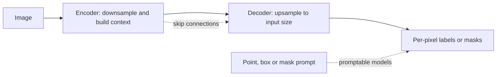

# Image Segmentation

Image segmentation labels the pixels of an image, so that each region or object is outlined by its exact shape rather than by a box. It comes in three main forms, semantic, instance and panoptic segmentation, and most systems learn all three from pixel-level labels with convolutional or Transformer networks. The same machinery now underlies promptable models that segment whatever object a user points at, and U-Net-style networks served as the denoisers of many early diffusion models.

## Overview

Image classification answers "what is in this picture?". Object detection answers "what is where, roughly?" by drawing a box around each object. Segmentation answers "which exact pixels belong to what?". Its output is a mask: a map the same size as the image in which every pixel carries a label or an object identity.

The task predates deep learning. Interactive tools such as GrabCut, which separates foreground from background using graph cuts and a rough user selection, were widely used in image editing before convolutional networks arrived.[^1] Since the fully convolutional network of 2015, most systems have been trained end to end on pixel labels.

## Key concepts

- **Semantic segmentation**: assigns each pixel a class, such as road, sky or person. Two people in the same image receive the same label and are not separated.
- **Instance segmentation**: gives each object its own mask, so two people receive two masks. It applies to countable objects.
- **Panoptic segmentation**: asks for both at once. Every pixel receives a class ("stuff" such as sky or road, or "things" such as people), and countable objects also receive an instance identity. Kirillov et al. introduced the task and its panoptic quality (PQ) metric.[^2]
- **Promptable segmentation**: given a point, a box or a rough mask, return the mask of the object it refers to. No fixed label set is needed.
- **Intersection over union (IoU)**: the overlap of a predicted mask and a ground-truth mask, divided by their union. Mean IoU (mIoU), averaged over classes, is the usual semantic segmentation score.[^3]

## How it works

Most segmentation networks follow an encoder–decoder pattern. The encoder lowers the resolution while building features that describe what a region is. The decoder raises the resolution again so that the output matches the input. Skip connections copy high-resolution features from the encoder to the decoder, so that edges can be recovered in fine detail.

Four design choices account for most of the differences among the landmark methods:

1. **Turning a classifier into a pixel labeller.** [FCN](fcn/index.md) removes the fully connected layers of a classification network, so that it accepts images of any size and produces a coarse grid of predictions. It then upsamples that grid, and its skip layers fuse coarse and fine predictions.
2. **A symmetric encoder–decoder with skip connections.** [U-Net](unet/index.md) pairs a contracting path with a mirrored expanding path and joins them by concatenation. It was designed for biomedical images, where few labelled examples are available.
3. **A mask branch on a detector.** [Mask R-CNN](mask-rcnn/index.md) runs a [Faster R-CNN](../object-detection/faster-rcnn/index.md) detector and, for each region it proposes, predicts a small mask in parallel with the box. Its RoIAlign operation keeps the features aligned with the pixels.
4. **Prompts and a very large dataset.** [Segment Anything](sam/index.md) runs a heavy image encoder once per image, then a light prompt decoder that answers each prompt in tens of milliseconds. It was trained on more than a billion masks.

Training usually minimises a per-pixel cross-entropy or a mask loss. Dilated (atrous) convolution keeps resolution high without losing context, as described on its [own page](../../cnn/convolution-variants/dilated-convolution/index.md). DeepLab combined it with atrous spatial pyramid pooling and a conditional random field.[^4]

A later line of work uses one architecture for all three tasks. Mask2Former decodes masks with Transformer queries, and its masked attention limits each query to the pixels of its predicted mask.[^5]

## Key methods

Four landmark methods are compared below. Each links to its own page, which holds the equations, results and limitations.

| Method | Year | Output | What separates it | Page |
|---|---|---|---|---|
| FCN | 2015 | Semantic | A classification network reinterpreted as fully convolutional, with learned upsampling and skip fusion | [FCN](fcn/index.md) |
| U-Net | 2015 | Semantic, biomedical | A symmetric encoder–decoder with concatenating skip connections, trained from few images | [U-Net](unet/index.md) |
| Mask R-CNN | 2017 | Instance | A mask branch added to Faster R-CNN, with RoIAlign for pixel-accurate features | [Mask R-CNN](mask-rcnn/index.md) |
| Segment Anything | 2023 | Promptable masks | A reusable image embedding and a light prompt decoder, trained on the SA-1B dataset | [Segment Anything](sam/index.md) |

## Connections

- **Brain and mind.** Segmentation asks how the visual system decides which regions form an object and which form the background. Neurons in monkey visual cortex have been found to code border ownership, meaning which side of an edge the figure lies on.[^6] A segmentation model solves a version of this figure–ground problem from pixels alone. The resemblance is one of problem, not of mechanism. See [Perception and the Visual System](../../../../brain-mind/visual-perception/index.md).
- **Detection.** Detection and segmentation share backbones and proposal ideas. Mask R-CNN is a detector with a mask head. See [Object Detection](../object-detection/index.md).
- **Transformers.** Newer models use attention. Mask2Former decodes masks with queries, and the Segment Anything image encoder is a Transformer pre-trained with masked autoencoding.[^7] See [Vision Transformer](../../transformer/vision-transformer/index.md).
- **Diffusion.** The denoiser of a pixel-space diffusion model can be a U-Net with time-step conditioning.[^8] Latent diffusion adds cross-attention so that the model can be conditioned on text or boxes.[^9] Transformer denoisers have since replaced the U-Net in some models. See [Diffusion Models](../../../paradigms/unsupervised/density-and-generative-models/diffusion/index.md).

## Applications

- **Medicine.** Outlining organs, tumours and cells in scans and microscope images. U-Net was built for this purpose. See [Healthcare](../../../../applications/healthcare/index.md).
- **Driving.** Labelling road surfaces, lanes, vehicles and pedestrians pixel by pixel. The Cityscapes dataset of urban street scenes is a standard benchmark.[^10] See [Autonomous Driving](../../../../applications/autonomous-driving/index.md).
- **Image editing.** Selecting an object with a click or a box, then cutting it out or changing it.

## Open questions

- **Annotation cost.** Drawing masks is slow. The Segment Anything data engine interleaved annotation with model training, and its final stage generated masks automatically.[^11] Whether such engines carry over to specialised domains is open.
- **Video.** SAM 2 extends promptable segmentation to video with a streaming memory and needs fewer interactions than earlier video methods.[^12] Long videos and occlusion remain hard.
- **One architecture or several.** Mask2Former argues that a single design can handle all three tasks. Whether specialised designs remain better for particular domains is debated.
- **Evaluation.** Ground-truth masks rarely list every valid answer, and an ambiguous prompt can refer to several objects. Segment Anything predicts several masks per prompt and complements mIoU with human ratings.[^13]

[^1]: Rother et al. (2004): the abstract describes efficient interactive foreground/background segmentation with graph cuts.
[^2]: Kirillov et al. (2019): panoptic segmentation unifies semantic and instance segmentation, scored by the panoptic quality metric.
[^3]: Long et al. (2015) use mean pixel intersection over union, averaged over all classes including background, as the standard metric.
[^4]: Chen et al. (2018): atrous convolution controls feature resolution without adding parameters.
[^5]: Cheng et al. (2022), abstract: 57.8 PQ on COCO panoptic, 50.1 AP on COCO instance and 57.7 mIoU on the semantic benchmark.
[^6]: Zhou et al. (2000): the title reports border-ownership coding in monkey visual cortex, that is, which side of an edge owns it.
[^7]: Kirillov et al. (2023), Section 3: the image encoder is an MAE pre-trained Transformer; see He et al. (2022).
[^8]: Ho et al. (2020): the reverse process uses a U-Net backbone with self-attention.
[^9]: Rombach et al. (2022), abstract: cross-attention layers allow conditioning on inputs such as text or bounding boxes.
[^10]: Cordts et al. (2016), abstract: 5000 images with high-quality pixel-level annotations, from 50 cities.
[^11]: Kirillov et al. (2023), Sections 4 and 5: the data engine has three stages and yields 1.1 billion masks on 11 million images.
[^12]: Ravi et al. (2024), abstract: SAM 2 reaches better video accuracy with three times fewer interactions than prior approaches.
[^13]: Kirillov et al. (2023), Section 7.1: mIoU is supplemented by a human study, since one point can refer to several objects.

## References

### Seminal papers

- Long, J., Shelhamer, E. & Darrell, T. (2015). *Fully Convolutional Networks for Semantic Segmentation*. CVPR. https://arxiv.org/abs/1411.4038 — Turns classification networks into pixel predictors with skip fusion.
- Ronneberger, O., Fischer, P. & Brox, T. (2015). *U-Net: Convolutional Networks for Biomedical Image Segmentation*. MICCAI. https://doi.org/10.1007/978-3-319-24574-4_28 — A symmetric encoder–decoder with skip connections, trained from few images.
- He, K., Gkioxari, G., Dollár, P. & Girshick, R. (2017). *Mask R-CNN*. ICCV. https://arxiv.org/abs/1703.06870 — Adds a mask branch and RoIAlign to Faster R-CNN for instance segmentation.
- Kirillov, A., Mintun, E., Ravi, N., et al. (2023). *Segment Anything*. ICCV. https://arxiv.org/abs/2304.02643 — A promptable segmentation model and the SA-1B dataset of over one billion masks.
- Ren, S., He, K., Girshick, R. & Sun, J. (2015). *Faster R-CNN: Towards Real-Time Object Detection with Region Proposal Networks*. arXiv. https://arxiv.org/abs/1506.01497 — The two-stage detector that Mask R-CNN extends with a mask branch.
- Kirillov, A., He, K., Girshick, R., Rother, C. & Dollár, P. (2019). *Panoptic Segmentation*. CVPR. https://arxiv.org/abs/1801.00868 — Defines panoptic segmentation and the panoptic quality metric.
- Ravi, N., et al. (2024). *SAM 2: Segment Anything in Images and Videos*. arXiv. https://arxiv.org/abs/2408.00714 — Extends promptable segmentation to video with a streaming memory.
- Chen, L.-C., Papandreou, G., Kokkinos, I., Murphy, K. & Yuille, A. L. (2018). *DeepLab: Semantic Image Segmentation with Deep Convolutional Nets, Atrous Convolution, and Fully Connected CRFs*. IEEE TPAMI. https://doi.org/10.1109/TPAMI.2017.2699184 — Introduces atrous convolution and atrous spatial pyramid pooling for segmentation.
- Cheng, B., Misra, I., Schwing, A. G., Kirillov, A. & Girdhar, R. (2022). *Masked-attention Mask Transformer for Universal Image Segmentation*. CVPR. https://arxiv.org/abs/2112.01527 — One Transformer architecture for panoptic, instance and semantic segmentation.
- Lin, T.-Y., et al. (2014). *Microsoft COCO: Common Objects in Context*. ECCV. https://arxiv.org/abs/1405.0312 — The COCO dataset, the main benchmark for modern segmenters.
- Ho, J., Jain, A. & Abbeel, P. (2020). *Denoising Diffusion Probabilistic Models*. NeurIPS. https://arxiv.org/abs/2006.11239 — Uses a U-Net backbone as the denoiser of a diffusion model.
- Rombach, R., Blattmann, A., Lorenz, D., Esser, P. & Ommer, B. (2022). *High-Resolution Image Synthesis with Latent Diffusion Models*. CVPR. https://arxiv.org/abs/2112.10752 — Runs diffusion in an autoencoder's latent space, with cross-attention for conditioning.
- He, K., Chen, X., Xie, S., Li, Y., Dollár, P. & Girshick, R. (2022). *Masked Autoencoders Are Scalable Vision Learners*. CVPR. https://arxiv.org/abs/2111.06377 — Masked-image pre-training for Vision Transformers, used by the Segment Anything encoder.
- Rother, C., Kolmogorov, V. & Blake, A. (2004). *"GrabCut": Interactive Foreground Extraction Using Iterated Graph Cuts*. ACM Transactions on Graphics. https://doi.org/10.1145/1015706.1015720 — Interactive foreground extraction with graph cuts, the classical approach.
- Zhou, H., Friedman, H. S. & von der Heydt, R. (2000). *Coding of Border Ownership in Monkey Visual Cortex*. The Journal of Neuroscience. https://doi.org/10.1523/JNEUROSCI.20-17-06594.2000 — Neurons that code which side of an edge owns the border.
- Cordts, M., et al. (2016). *The Cityscapes Dataset for Semantic Urban Scene Understanding*. CVPR. https://arxiv.org/abs/1604.01685 — A benchmark of urban street scenes with pixel-level and instance-level labels.

### Surveys and textbooks

- Minaee, S., Boykov, Y., Porikli, F., Plaza, A., Kehtarnavaz, N. & Terzopoulos, D. (2021). *Image Segmentation Using Deep Learning: A Survey*. IEEE TPAMI. https://doi.org/10.1109/TPAMI.2021.3059968 — A broad review of deep segmentation methods, datasets and metrics.
