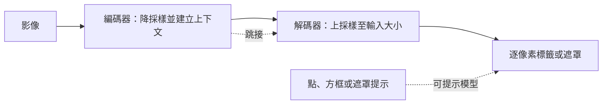

# 圖像分割

圖像分割會為影像中的每個像素加上標籤，使每個區域或物件以其精確的形狀而非方框來勾勒輪廓。它有三種主要形式：語意分割、實例分割與全景分割。多數系統使用卷積或 Transformer 網路，從像素級的標籤中學習這三種任務。同樣的機制如今也支撐了可提示的模型，使用者指向任何物件即可將其分割出來；而 U-Net 式的網路曾是許多早期擴散模型的去噪器。

## 概述

影像分類回答「這張圖片裡有什麼？」；物件偵測以方框圈出每個物件，回答「大致在哪裡？」；分割則回答「哪些確切的像素屬於什麼？」。它的輸出是一個遮罩：大小與影像相同的圖，其中每個像素都帶有一個標籤或物件識別碼。

這項任務早於深度學習。像 GrabCut 這類互動式工具，利用圖割（graph cut）與使用者粗略框選的區域，把前景從背景中分離出來，在卷積網路出現之前已廣泛用於影像編輯。[^1] 自 2015 年的全卷積網路以來，多數系統都以像素標籤進行端到端訓練。

## 關鍵概念

- **語意分割**：為每個像素指定一個類別，例如道路、天空或人。同一張影像中的兩個人會得到相同的標籤，因而無法區分。
- **實例分割**：為每個物件給出各自的遮罩，因此兩個人會得到兩個遮罩。它適用於可計數的物件。
- **全景分割**：同時要求兩者。每個像素都得到一個類別（「事物背景」如天空或道路，或「可數物件」如人），而可數物件還會得到實例識別碼。Kirillov 等人提出了這項任務及其全景品質（PQ）指標。[^2]
- **可提示的分割**：給定一個點、一個方框或一個粗略的遮罩，回傳其所指物件的遮罩。不需要固定的標籤集合。
- **交集聯集比（IoU）**：預測遮罩與真實遮罩的重疊面積，除以兩者的聯集面積。依類別平均後的平均 IoU（mIoU）是語意分割的常用分數。[^3]

## 運作方式

多數分割網路遵循編碼器—解碼器的模式。編碼器降低解析度，同時建立描述區域特徵的表示；解碼器再把解析度提高回輸入的大小。跳接把編碼器的高解析度特徵複製到解碼器，使邊緣能以精細的細節被還原。

有四種設計選擇，解釋了各代表性方法之間的大部分差異：

1. **把分類器改造成像素標記器。** [FCN](fcn/index.md) 移除分類網路的全連接層，使其能接受任意大小的影像，並輸出粗略的分數網格。接著它對該網格上採樣，而其跳接層融合粗與細的預測。
2. **對稱的編碼器—解碼器加上跳接。** [U-Net](unet/index.md) 將收縮路徑與鏡像的擴張路徑配對，並以串接相連。它是為可用標註樣本很少的生醫影像所設計。
3. **在偵測器上加上遮罩分支。** [Mask R-CNN](mask-rcnn/index.md) 執行 [Faster R-CNN](../object-detection/faster-rcnn/index.md) 偵測器，並對每個提議區域，與方框平行地預測一個小遮罩。它的 RoIAlign 運算使特徵與像素保持對齊。
4. **提示與超大型資料集。** [Segment Anything](sam/index.md) 每張影像只執行一次沉重的影像編碼器，然後以輕量的提示解碼器回應每個提示，耗時僅數十毫秒。它在超過十億個遮罩上訓練而成。

訓練通常會最小化逐像素的交叉熵，或某種遮罩損失。擴張（atrous）卷積是另一種在不損失上下文的前提下維持高解析度的方法，詳見[其自身頁面](../../cnn/convolution-variants/dilated-convolution/index.md)。DeepLab 將它與空洞空間金字塔池化及條件隨機場結合。[^4]

後續的一條研究路線，是讓同一個架構處理三種任務。Mask2Former 以 Transformer 查詢解碼遮罩，其遮罩注意力把每個查詢限制在其預測遮罩內的像素上。[^5]

## 主要方法

下表比較四種代表性方法。每個方法都連結到其自身的頁面，其中包含方程式、結果與限制。

| 方法 | 年份 | 輸出 | 區別之處 | 頁面 |
|---|---|---|---|---|
| FCN | 2015 | 語意 | 將分類網路重新詮釋為全卷積網路，具有學習式上採樣與跳接融合 | [FCN](fcn/index.md) |
| U-Net | 2015 | 語意，生醫 | 對稱的編碼器—解碼器，以串接的跳接相連，可用少量影像訓練 | [U-Net](unet/index.md) |
| Mask R-CNN | 2017 | 實例 | 在 Faster R-CNN 上加入遮罩分支，並以 RoIAlign 取得像素精確的特徵 | [Mask R-CNN](mask-rcnn/index.md) |
| Segment Anything | 2023 | 可提示的遮罩 | 可重複使用的影像嵌入與輕量的提示解碼器，在 SA-1B 資料集上訓練 | [Segment Anything](sam/index.md) |

## 關聯

- **大腦與心智。** 分割所問的是：視覺系統如何判定哪些區域構成物件、哪些構成背景。已有研究在猴子視覺皮質中發現編碼「邊界歸屬」的神經元，即邊緣的哪一側屬於前景。[^6] 分割模型必須僅從像素出發，解決這個圖與底（figure–ground）問題的一個版本。兩者相似之處在於問題本身，而非機制。見[知覺與視覺系統](../../../../brain-mind/visual-perception/index.md)。
- **偵測。** 偵測與分割共享骨幹與提議的概念。Mask R-CNN 就是一個加上遮罩頭的偵測器。見[物件偵測](../object-detection/index.md)。
- **Transformer。** 較新的模型使用注意力機制。Mask2Former 以查詢解碼遮罩，而 Segment Anything 的影像編碼器是以遮罩自編碼預訓練的 Transformer。[^7] 見[視覺 Transformer](../../transformer/vision-transformer/index.md)。
- **擴散模型。** 像素空間擴散模型的去噪器可以是帶有時間步條件的 U-Net。[^8] 潛在擴散加入交叉注意力，使模型能以文字或方框為條件。[^9] 之後，部分模型已以 Transformer 去噪器取代 U-Net。見[擴散模型](../../../generative/diffusion/index.md)。

## 應用

- **醫學。** 在掃描影像與顯微影像中勾勒器官、腫瘤與細胞。U-Net 正是為此而設計。見[醫療保健](../../../../applications/healthcare/index.md)。
- **自動駕駛。** 逐像素標示道路表面、車道、車輛與行人。Cityscapes 這個城市街景資料集是標準的基準。[^10] 見[自動駕駛](../../../../applications/autonomous-driving/index.md)。
- **影像編輯。** 以一次點擊或一個方框選取物件，再將其剪下或修改。以可提示模型為基礎的互動工具採用了這種模式。

## 開放問題

- **標註成本。** 繪製遮罩很慢。Segment Anything 的資料引擎讓標註與模型訓練交錯進行，最後一個階段則自動產生遮罩。[^11] 這類引擎能否推廣到專門領域，仍是未解的問題。
- **影片。** SAM 2 以串流記憶把可提示的分割延伸到影片，並且比先前的影片方法需要更少的互動。[^12] 長影片與遮擋仍然困難。
- **單一架構或多個架構。** Mask2Former 主張一種設計即可處理三種任務。特化的設計在特定領域是否仍然更好，尚有爭議。
- **評估。** 真實遮罩很少列出所有有效答案，而模糊的提示可能指向多個物件。Segment Anything 對每個提示預測多個遮罩並加以排序，並以人工評分補充 mIoU。[^13]

[^1]: Rother 等人（2004）：摘要描述以圖割進行高效的互動式前景／背景分割。
[^2]: Kirillov 等人（2019）：全景分割統合了語意分割與實例分割，以全景品質指標評分。
[^3]: Long 等人（2015）以平均像素交集聯集比作為標準指標，對包括背景在內的所有類別取平均。
[^4]: Chen 等人（2018）：擴張卷積能在不增加參數的情況下控制特徵解析度。
[^5]: Cheng 等人（2022）摘要：COCO 全景分割 57.8 PQ，COCO 實例分割 50.1 AP，語意分割基準 57.7 mIoU。
[^6]: Zhou 等人（2000）：標題指出猴子視覺皮質中存在邊界歸屬的編碼，即邊緣的哪一側屬於物件。
[^7]: Kirillov 等人（2023），第 3 節：影像編碼器是以 MAE 預訓練的 Transformer；見 He 等人（2022）。
[^8]: Ho 等人（2020）：反向過程使用帶有自注意力的 U-Net 骨幹。
[^9]: Rombach 等人（2022）摘要：交叉注意力層使模型能以文字或方框等輸入為條件。
[^10]: Cordts 等人（2016）摘要：5000 張具有高品質逐像素標註的影像，取自 50 座城市。
[^11]: Kirillov 等人（2023），第 4 與第 5 節：資料引擎分為三個階段，共產生 11 億個遮罩，涵蓋 1100 萬張影像。
[^12]: Ravi 等人（2024）摘要：SAM 2 以比先前方法少三倍的互動次數達到更好的影片準確度。
[^13]: Kirillov 等人（2023），第 7.1 節：由於一個點可能指向多個物件，mIoU 以人工研究加以補充。

## 參考文獻

### 開創性論文

- Long, J., Shelhamer, E. & Darrell, T. (2015). *Fully Convolutional Networks for Semantic Segmentation*. CVPR. https://arxiv.org/abs/1411.4038 — 將分類網路轉換為逐像素預測器，並融合粗與細的層，是現代分割的起點。
- Ronneberger, O., Fischer, P. & Brox, T. (2015). *U-Net: Convolutional Networks for Biomedical Image Segmentation*. MICCAI. https://doi.org/10.1007/978-3-319-24574-4_28 — 具有跳接的對稱編碼器—解碼器，以少量標註影像搭配大量資料擴增訓練。
- He, K., Gkioxari, G., Dollár, P. & Girshick, R. (2017). *Mask R-CNN*. ICCV. https://arxiv.org/abs/1703.06870 — 在 Faster R-CNN 上加入遮罩分支與 RoIAlign，用於實例分割。
- Kirillov, A., Mintun, E., Ravi, N., et al. (2023). *Segment Anything*. ICCV. https://arxiv.org/abs/2304.02643 — 可提示的分割模型，以及超過十億個遮罩的 SA-1B 資料集。
- Ren, S., He, K., Girshick, R. & Sun, J. (2015). *Faster R-CNN: Towards Real-Time Object Detection with Region Proposal Networks*. arXiv. https://arxiv.org/abs/1506.01497 — Mask R-CNN 所擴充的兩階段偵測器。
- Kirillov, A., He, K., Girshick, R., Rother, C. & Dollár, P. (2019). *Panoptic Segmentation*. CVPR. https://arxiv.org/abs/1801.00868 — 定義全景分割與全景品質指標。
- Ravi, N., et al. (2024). *SAM 2: Segment Anything in Images and Videos*. arXiv. https://arxiv.org/abs/2408.00714 — 以串流記憶把可提示的分割延伸至影片。
- Chen, L.-C., Papandreou, G., Kokkinos, I., Murphy, K. & Yuille, A. L. (2018). *DeepLab: Semantic Image Segmentation with Deep Convolutional Nets, Atrous Convolution, and Fully Connected CRFs*. IEEE TPAMI. https://doi.org/10.1109/TPAMI.2017.2699184 — 為語意分割引入擴張卷積與空洞空間金字塔池化。
- Cheng, B., Misra, I., Schwing, A. G., Kirillov, A. & Girdhar, R. (2022). *Masked-attention Mask Transformer for Universal Image Segmentation*. CVPR. https://arxiv.org/abs/2112.01527 — 用於全景、實例與語意分割的單一 Transformer 架構。
- Lin, T.-Y., et al. (2014). *Microsoft COCO: Common Objects in Context*. ECCV. https://arxiv.org/abs/1405.0312 — COCO 資料集，是現代分割器的主要基準。
- Ho, J., Jain, A. & Abbeel, P. (2020). *Denoising Diffusion Probabilistic Models*. NeurIPS. https://arxiv.org/abs/2006.11239 — 以 U-Net 骨幹作為擴散模型的去噪器。
- Rombach, R., Blattmann, A., Lorenz, D., Esser, P. & Ommer, B. (2022). *High-Resolution Image Synthesis with Latent Diffusion Models*. CVPR. https://arxiv.org/abs/2112.10752 — 在自編碼器的潛在空間中執行擴散，並以交叉注意力進行條件化。
- He, K., Chen, X., Xie, S., Li, Y., Dollár, P. & Girshick, R. (2022). *Masked Autoencoders Are Scalable Vision Learners*. CVPR. https://arxiv.org/abs/2111.06377 — 視覺 Transformer 的遮罩影像預訓練，Segment Anything 的編碼器即採用此法。
- Rother, C., Kolmogorov, V. & Blake, A. (2004). *"GrabCut": Interactive Foreground Extraction Using Iterated Graph Cuts*. ACM Transactions on Graphics. https://doi.org/10.1145/1015706.1015720 — 以圖割進行互動式前景擷取，是深度網路之前的經典方法。
- Zhou, H., Friedman, H. S. & von der Heydt, R. (2000). *Coding of Border Ownership in Monkey Visual Cortex*. The Journal of Neuroscience. https://doi.org/10.1523/JNEUROSCI.20-17-06594.2000 — 編碼邊緣哪一側屬於邊界的神經元。
- Cordts, M., et al. (2016). *The Cityscapes Dataset for Semantic Urban Scene Understanding*. CVPR. https://arxiv.org/abs/1604.01685 — 城市街景的基準資料集，附有逐像素與實例層級的標註。

### 綜述與教科書

- Minaee, S., Boykov, Y., Porikli, F., Plaza, A., Kehtarnavaz, N. & Terzopoulos, D. (2021). *Image Segmentation Using Deep Learning: A Survey*. IEEE TPAMI. https://doi.org/10.1109/TPAMI.2021.3059968 — 對深度分割方法、資料集與指標的廣泛回顧。
