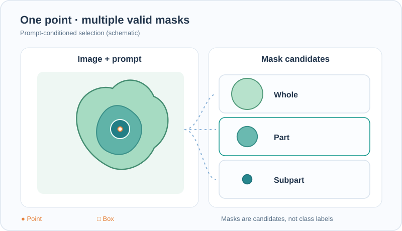

# Segment Anything (SAM)

Segment Anything is a task, a model and a dataset for promptable image segmentation. Kirillov et al. (2023) trained a model that returns a valid mask for whatever object a user indicates with a point, a box or a mask. The model was built with a data engine that produced over a billion masks, and it transfers to new image distributions without retraining. The authors release it as a foundation model for computer vision research.

This page is part of [Image segmentation](index.md).

## Problem

The methods on this section's [overview](index.md) are trained for a fixed label set. [FCN](fcn.md) and [U-Net](../../cnn/unet/index.md) learn the classes of their training data, and [Mask R-CNN](mask-r-cnn.md) learns the object categories of its dataset. Adding a new kind of object needs new annotated masks. The authors ask whether a single model can segment any object on request, so that a user can indicate the target and receive a mask, without a category list. The authors therefore treat the problem as one of data as well as modelling, and build a large dataset with a data engine.

## Core idea

The paper proposes three linked parts.

- **The task.** Promptable segmentation: given an image and a prompt that points to an object, return at least one valid mask for it. Ambiguity is allowed, so the model may return several masks for one prompt.
- **The model.** Three components. An image encoder computes a feature embedding of the image once. A prompt encoder embeds points, boxes, masks or text. A lightweight mask decoder combines the two and predicts masks quickly, so that many prompts can be answered after one image embedding.
- **The data engine.** A loop in which the current model helps annotators label masks, and the newly labelled masks train the next model. The loop has three stages, described below.

The image encoder is a Vision Transformer (ViT-H/16) initialised with masked autoencoder pretraining, and adapted with minimal changes to high-resolution inputs. Because the heavy encoder runs once per image, the decoder can run interactively for each prompt.

## Animated walkthrough: ambiguous prompt, several valid masks

A single point in the nested object is consistent with several mask granularities: **whole**, **part**, or **subpart**. The three candidate silhouettes on the right are **distinct plausible outputs**, not a categorical softmax or three segmentation class labels. When an additional box prompt appears, the diagram highlights one constrained response; in the original [Segment Anything study](https://arxiv.org/abs/2304.02643), **ambiguous single prompts can yield three masks**, while multiple prompts use a single output mask. The silhouettes and their timing are **constructed illustrations**, not actual SAM predictions, confidence estimates, or recorded decoder attention.

GitHub displays the reviewed static SVG without executing scripts. On MkDocs, Play/Pause (Tab, Enter or Space) and reduced-motion fallback reuse the same shared assets. Focus and scroll the figure horizontally on narrow screens.

*Original concept animation and static fallback, CC BY-SA 4.0.*

## Equation and procedure

Masks are predicted with a linear combination of focal loss and dice loss, weighted 20 to 1 in favour of focal loss. A separate head predicts the quality of each mask as its IoU with the ground truth, and is trained with mean-squared error. Writing $\mathcal{L}_{\text{focal}}$ and $\mathcal{L}_{\text{dice}}$ for the two mask losses and $\mathcal{L}_{\text{IoU}}$ for the quality term,

$$
\mathcal{L} = 20\,\mathcal{L}_{\text{focal}} + \mathcal{L}_{\text{dice}} + \mathcal{L}_{\text{IoU}}.
$$

Ambiguity is handled by predicting three masks for a single prompt, which the authors describe as corresponding to the whole object, a part and a subpart. During training only the mask with the lowest loss receives gradient, so each output specialises in one level of granularity. At inference the predicted IoU scores rank the three masks. When several prompts are given, the model returns a single mask.

The data engine runs in three stages.

1. **Assisted-manual.** Annotators label masks with the help of an interactive model that is retrained during the stage. The paper reports 4.3 million masks from 120,000 images in this stage.
2. **Semi-automatic.** The model proposes masks for objects it can segment, and annotators add masks for the remaining objects. This stage adds 5.9 million masks from 180,000 images, giving 10.2 million in total.
3. **Fully automatic.** The model, prompted with a grid of points, produces masks for all images. The paper states that 99.1% of the final masks were generated this way.

The resulting dataset, SA-1B, has about 11 million images and about 1.1 billion masks. The abstract describes the images as licensed and privacy-respecting.

## Results

The results below are those reported in the paper.

- **Zero-shot single-point segmentation.** Across 23 segmentation datasets not used in training, the model gives higher results on 16 of them than RITM, an interactive segmentation baseline, with gains as large as about 47 IoU on some datasets.
- **Object proposals.** On LVIS v1 the model reaches 59.3 average recall at 1,000 proposals, against 63.0 for ViTDet-H, a detector trained with full supervision on that dataset. The paper reports that the model outperforms ViTDet-H on medium and large objects and on rare and common categories.
- **Overall claim.** The abstract describes the zero-shot performance as often competitive with, or superior to, prior fully supervised results.

These comparisons measure the model without fine-tuning on each benchmark. They do not show that every segmentation task is solved, and the paper reports results on its chosen evaluation protocols only.

## Limitations

The authors state the following limitations.

- **Fine structures.** The model can miss fine structures and sometimes hallucinates small, disconnected components.
- **Speed with the large encoder.** Overall performance is not real-time when the heavy image encoder is used.
- **Text prompts.** Text-to-mask prompting is presented as a preliminary experiment, and the authors describe it as not entirely robust.
- **Semantic and panoptic tasks.** The paper states that it is unclear how to design simple prompts for semantic and panoptic segmentation, which label every region rather than one indicated object.

The model returns masks for objects, not class labels. Naming the object requires a separate recogniser, which is the job of the detection and classification methods covered on [Object detection](../object-detection/index.md).

## Connections

- The task variants that SAM does not cover directly, semantic and panoptic segmentation, are defined on the [overview](index.md).
- The measures used to score its masks, IoU and Dice, are on the [Segmentation metrics](../../../evaluation/metrics/segmentation/index.md) page.
- Its promptable design contrasts with the detection-first approach of [Mask R-CNN](mask-r-cnn.md), which predicts masks only for the categories it was trained on.

## References

### Seminal papers

- Kirillov, A., Mintun, E., Ravi, N., Mao, H., Rolland, C., Gustafson, L., Xiao, T., Whitehead, S., Berg, A. C., Lo, W.-Y., Dollár, P. & Girshick, R. (2023). *Segment Anything*. ICCV, pp. 3992–4003. doi:[10.1109/ICCV51070.2023.00371](https://doi.org/10.1109/ICCV51070.2023.00371). Also available as [arXiv:2304.02643](https://arxiv.org/abs/2304.02643). — Introduces the promptable segmentation task, the SAM model and the SA-1B dataset, with zero-shot transfer to new image distributions.
- He, K., Chen, X., Xie, S., Li, Y., Dollár, P. & Girshick, R. (2022). *Masked Autoencoders Are Scalable Vision Learners*. CVPR, pp. 15979–15988. doi:[10.1109/CVPR52688.2022.01553](https://doi.org/10.1109/CVPR52688.2022.01553). Also available as [arXiv:2111.06377](https://arxiv.org/abs/2111.06377). — Masked autoencoder pretraining, used to initialise the image encoder of SAM.
- Kirillov, A., He, K., Girshick, R., Rother, C. & Dollár, P. (2019). *Panoptic Segmentation*. CVPR, pp. 9396–9405. doi:[10.1109/CVPR.2019.00963](https://doi.org/10.1109/CVPR.2019.00963). Also available as [arXiv:1801.00868](https://arxiv.org/abs/1801.00868). — Defines the panoptic segmentation task, one of the variants that SAM's paper discusses as hard to prompt.
- Dosovitskiy, A. et al. (2020). *An Image is Worth 16x16 Words: Transformers for Image Recognition at Scale*. arXiv. https://arxiv.org/abs/2010.11929 — The Vision Transformer architecture on which the SAM image encoder (ViT-H/16) is based.
- Sofiiuk, K., Petrov, I. A. & Konushin, A. (2021). *Reviving Iterative Training with Mask Guidance for Interactive Segmentation*. arXiv. https://arxiv.org/abs/2102.06583 — The RITM interactive segmenter, the baseline in the paper's single-point comparison.
- Li, Y., Mao, H., Girshick, R. & He, K. (2022). *Exploring Plain Vision Transformer Backbones for Object Detection*. arXiv. https://arxiv.org/abs/2203.16527 — The ViTDet detector, the fully supervised comparison on LVIS in the paper.

### Surveys and textbooks

- Minaee, S., Boykov, Y., Porikli, F. et al. (2021). Image Segmentation Using Deep Learning: A Survey. *IEEE Transactions on Pattern Analysis and Machine Intelligence*. doi:[10.1109/TPAMI.2021.3059968](https://doi.org/10.1109/TPAMI.2021.3059968). — Survey of deep-learning methods for image segmentation, for readers who want the wider landscape.
