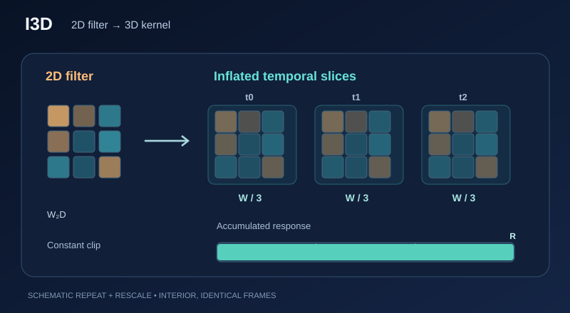

# I3D：膨脹的三維卷積網路

I3D 是一個影片動作辨識模型，它把二維影像濾波器膨脹為三維。它的三維濾波器由二維濾波器初始化，並在 Kinetics 影片資料集上訓練。摘要報告，在 Kinetics 上預訓練後，HMDB-51 的準確度為 80.9%，UCF-101 為 98.0%。

## 概觀

[影片章節](index.zh-TW.md)描述了這項任務。本頁說明模型：把影像網路的濾波器沿時間膨脹，並重用其預訓練權重。

## 問題

三維卷積網路能直接學習運動，但在影片上從頭訓練很困難。問題在於如何重用影像預訓練，同時仍能建模運動。

## 核心想法

每個二維濾波器沿時間軸膨脹。它的權重沿時間重複，並除以時間長度，得到三維濾波器。論文指出，對於由相同影格組成的「無聊影片」，膨脹後的網路給出的響應，與把影像網路套用到單一影格時相同。論文稱之為無聊影片的不動點。

### 視覺解說：複製、縮放與累加

*原創教學視覺（CC BY-SA 4.0）。* 將示意性的二維空間卷積核 \(W\) 複製到三個時間切片，每個權重縮小為 \(1/3\)。當**三個輸入影格完全相同**且不考慮時間邊界補零時，三份線性卷積貢獻相加會還原原本的二維響應 \(R\)，即 \(3(R/3)=R\)。動畫中的發光邊框與累加長條顯示的是**三個概念性貢獻**，不是量測到的激活時間序列或訓練軌跡。後續訓練仍能讓三個時間切片的權重產生差異。MkDocs 提供播放／暫停、鍵盤操作及減少動態效果時的靜態顯示。[檢視 SVG 動畫](../../../../assets/concept-animations/i3d-filter-inflation-motion.svg)。詳見 [Carreira 與 Zisserman（2017）](https://arxiv.org/abs/1705.07750)。

### 互動實驗：恆定影片不動點何時不再成立

這個**人工構造的單一位置線性卷積**使用二乘二空間濾波器 \(W=[1,-1,0.5,0.5]\) 與參考輸入 \(X=[2,1,3,2]\)，二維響應為 \(W\cdot X=3.5\)。沿時間複製三份 \(W/3\) 後，三個相同影格的輸出仍為 \(3.5\)。只把中間影格的第一個像素改變 \(\Delta\)，三維響應就成為 \(3.5+\Delta/3\)。逐步查看各影格的加權貢獻，以及最後的總和如何變化。

可使用「上一步／下一步」、「播放／暫停」、進度與速度控制、重設，或滑桿方向鍵。小型網格與響應都是**教學數值，不是 I3D 模型實測激活或推論結果**；未納入時間邊界補零、訓練後的時間權重變化與網路非線性。此處不動點相等性只針對相同影格的內部線性運算。

## 方程式

對於一個 $N \times N$ 濾波器 $W$，論文沿時間重複 $N$ 次並除以 $N$，得到 $N \times N \times N$ 濾波器：

$$W_{\text{3D}}(t, i, j) = \frac{1}{N} W(i, j), \qquad t = 1, \ldots, N$$

對常數輸入的 $N$ 個時間副本求和，即得到 $W$，這就是上述的不動點性質。

## 結果

摘要報告，在 Kinetics 上預訓練後，HMDB-51 為 80.9%，UCF-101 為 98.0%。論文的表格給出完整比較。

## 限制

- 報告的準確度是在 Kinetics 預訓練之後得到的，摘要並未報告沒有此預訓練的結果。
- 膨脹規則是針對這種形式的濾波器所述。其他架構需要各自推導。

## 關聯

被膨脹的影像網路是[電腦視覺](../index.zh-TW.md)中涵蓋的卷積骨幹。若要看只使用注意力的影片模型，見 [ViViT](vivit.zh-TW.md)。

## 應用

在 HMDB-51、UCF-101 等影片基準上進行動作辨識，數字見論文報告。

## 開放問題

- 膨脹規則如何套用到論文所用以外的架構？
- 準確度有多少來自 Kinetics 預訓練，又有多少來自膨脹後的架構？

## 參考文獻

### 奠基性論文

- Carreira 與 Zisserman，*Quo Vadis, Action Recognition? A New Model and the Kinetics Dataset*（2017）。https://arxiv.org/abs/1705.07750 — 提出 I3D 與 Kinetics 資料集。
- Szegedy 等人，*Going deeper with convolutions*，IEEE Conference on Computer Vision and Pattern Recognition（2015）。https://doi.org/10.1109/CVPR.2015.7298594 — Inception 架構，即 I3D 所膨脹的影像網路。
- Kay、Carreira、Simonyan、Zhang、Hillier、Vijayanarasimhan、Viola、Green、Back、Natsev、Suleyman 與 Zisserman，*The Kinetics Human Action Video Dataset*（2017）。https://arxiv.org/abs/1705.06950 — 提出 I3D 所用預訓練的 Kinetics 資料集。
- Simonyan 與 Zisserman，*Two-Stream Convolutional Networks for Action Recognition in Videos*（2014）。https://arxiv.org/abs/1406.2199 — 提出用於影片動作辨識的雙流卷積設計。
- Tran、Bourdev、Fergus、Torresani 與 Paluri，*Learning Spatiotemporal Features with 3D Convolutional Networks*（2015）。https://arxiv.org/abs/1412.0767 — 提出 C3D，一個早期的影片三維卷積模型。
