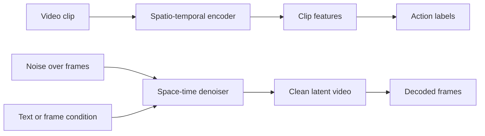

# Video Understanding and Generation

Video understanding asks what happens in a clip: which action is taking place, and when. Video generation asks for a sequence of frames that is coherent over time. Both tasks need a model that carries information across frames, and the most recent systems combine them into models that simulate how a scene evolves.

## Overview

A video is a sequence of images, so a naive model that treats each frame separately can recognise objects but misses what changes between them. A ten-second clip at 25 frames per second has 250 frames, so the cost of processing every frame grows quickly. Video methods therefore need a way to share information across frames, and they must decide how much of the time axis to keep.

The tasks split into two families. In **understanding**, the output is a label, such as an action class, or a set of events in time. Action recognition is the core task, and it is the one the [Computer Vision](../index.md) overview lists under video understanding. In **generation**, the output is a video, produced from text, from an image, or from earlier frames. The same spatio-temporal machinery serves both. Image tasks such as [object detection](../object-detection/index.md) and [segmentation](../segmentation/index.md) extend to video as well, and tracking connects them across time.

## Key concepts

- **Spatio-temporal features.** Representations that vary across both space and time, so that a motion pattern is encoded as well as an appearance.
- **Clip.** A short run of consecutive frames, which is the unit a video network reads. Predictions for a whole video are usually averages over several clips.
- **Optical flow.** A field of apparent motion between two frames. It was the main motion signal before networks learned motion directly from pixels.
- **Temporal redundancy.** Neighbouring frames are very similar. This lets models sample frames sparsely, and it allows much higher masking ratios in video pre-training than in images.[^1]
- **Kinetics.** A large benchmark of 400 human action classes drawn from YouTube, with about 240,000 training clips, which made large-scale pre-training of video models practical.[^2]
- **Fréchet Video Distance (FVD).** A score for generated video that compares the feature statistics of real and generated clips, using features from an action-recognition network.[^3]

## How it works

Understanding pipelines follow three families of architecture. Two-stream networks combine an RGB network with an optical-flow network.[^4] 3D convolutional networks such as C3D learn spatio-temporal filters directly, and [I3D](i3d/index.md) makes them trainable by inflating image filters into three dimensions.[^5] Video Transformers, such as TimeSformer, apply attention over space-time patches, and self-supervised objectives such as [VideoMAE](videomae/index.md) let them learn from video alone.[^6][^7] SlowFast uses two pathways at different frame rates, one for semantics and one for motion.[^8]

Generation pipelines are built on diffusion, as described on the [Diffusion Models](../../../generative/diffusion/index.md) page. A denoiser that works over space and time removes noise from a clip. Video diffusion models add temporal layers to an image model or train a space-time network from the start, and they often compress video into a latent space first. [Video diffusion models](video-diffusion/index.md) show the basic recipe.[^3]

## Key methods

The methods below are the landmarks for the two families. Each links to its own page.

| Method | Year | Family | What separates it | Page |
|---|---|---|---|---|
| I3D | 2017 | 3D convolution | Inflates a 2D image network into 3D and pre-trains on Kinetics | [I3D](i3d/index.md) |
| VideoMAE | 2022 | Video Transformer, self-supervised | Masks about 90% of spacetime cubes and reconstructs them, without image pre-training | [VideoMAE](videomae/index.md) |
| Video diffusion | 2022 | Diffusion | A space-time denoiser, trained jointly on images and videos | [Video diffusion](video-diffusion/index.md) |

SlowFast and TimeSformer are the other landmarks named above, and the [Vision Transformer](../../transformer/vision-transformer/index.md) page covers the image architecture that video Transformers extend.

## Connections

- **Brain and mind.** The two-stream networks are related to the two-streams hypothesis, in which a dorsal pathway handles motion and a ventral pathway handles objects.[^4][^9] The resemblance is one of organisation, not evidence of a shared mechanism. See [Perception and the Visual System](../../../../brain-mind/visual-perception/index.md).
- **World models.** Sora was described as a "world simulator", a framing the Sora review examines in detail.[^10] The [World Models](../../world-models/index.md) page covers this route, in which a model predicts how a scene evolves under actions. A related route predicts future video features rather than pixels, as in [V-JEPA](https://arxiv.org/abs/2404.08471).[^11]
- **Predictive coding.** Predicting upcoming frames resembles the predictive-coding account of perception, in which the brain compares its predictions with input. The analogy is loose, and the [Predictive coding](../../../../brain-mind/predictive-coding/index.md) page sets out the account itself.
- **Diffusion and Transformers.** Video generation reuses the [diffusion](../../../generative/diffusion/index.md) training objective, and video understanding reuses the [CNN](../../cnn/index.md) and Transformer families.

## Applications

- **Video search and analytics.** Action recognition indexes footage by what happens in it, for example in sports analytics and in safety monitoring. The Kinetics dataset covers a broad range of human actions in ordinary YouTube clips, and pre-training on it transfers to other action datasets.[^2]
- **Driving and robotics.** Video world models generate driving scenarios and support robot planning, as the [World Models](../../world-models/index.md) page describes. See [Autonomous Driving](../../../../applications/autonomous-driving/index.md) and [Robotics](../../../../applications/robotics/index.md).
- **Creative tools.** Text-to-video systems are discussed for film-making, education and marketing, with the Sora review treating their impact across these industries.[^10] See [Creative](../../../../applications/creative/index.md).

## Open questions

- **Long videos.** Most models read clips of seconds, and their outputs are short. Reasoning over minutes or hours is still hard.
- **Cost.** Attention over space-time tokens and many denoising steps are expensive. Latent compression reduces cost, and the choice of latent space shapes what the model captures.
- **Evaluation.** FVD changes with the sampling protocol, so scores from different papers are not directly comparable.[^3]
- **Physical consistency.** Whether video generators learn physics or only the statistics of their training data is debated, as discussed on the [World Models](../../world-models/index.md) page.
- **Pre-training.** Whether video self-supervision can replace image pre-training at scale is still open. VideoMAE shows that video data alone can suffice on mid-sized benchmarks, but it also shows a domain shift between datasets.[^7]

[^1]: Tong et al. (2022), abstract and Section 3: temporal redundancy across consecutive frames supports masking ratios of 90% to 95%.
[^2]: Kay et al. (2017): 400 classes, at least 400 clips per class, each about ten seconds from a different YouTube video. The 240,000 training clips figure is in Carreira and Zisserman (2017), Section 3, which also reports transfer from Kinetics to UCF-101 and HMDB-51.
[^3]: Ho et al. (2022): FVD is computed with I3D features, and the paper reports that sampling protocol changes the score.
[^4]: Simonyan and Zisserman (2014), abstract and Introduction, including the note on the two-streams hypothesis.
[^5]: Carreira and Zisserman (2017), Section 2, on inflating 2D filters into 3D.
[^6]: Bertasius et al. (2021), abstract.
[^7]: Tong et al. (2022), Table 2, and the domain-shift discussion in the pre-training dataset section.
[^8]: Feichtenhofer et al. (2018), abstract.
[^9]: Goodale and Milner (1992).
[^10]: Liu et al. (2024), abstract: the review covers the technology behind Sora, its applications across industries, and its limitations.
[^11]: Bardes et al. (2024), abstract: feature prediction without pixel reconstruction.

## References

### Seminal papers

- Simonyan, K. & Zisserman, A. (2014). *Two-Stream Convolutional Networks for Action Recognition in Videos*. arXiv. https://arxiv.org/abs/1406.2199 — RGB and optical-flow ConvNets whose predictions are fused, a landmark of learned action recognition.
- Tran, D., et al. (2014). *Learning Spatiotemporal Features with 3D Convolutional Networks*. arXiv. https://arxiv.org/abs/1412.0767 — The C3D network, which trains 3D convolutions from scratch on video.
- Carreira, J. & Zisserman, A. (2017). *Quo Vadis, Action Recognition? A New Model and the Kinetics Dataset*. arXiv. https://arxiv.org/abs/1705.07750 — Introduces I3D and the Kinetics dataset for pre-training video models.
- Feichtenhofer, C., Fan, H., Malik, J. & He, K. (2018). *SlowFast Networks for Video Recognition*. arXiv. https://arxiv.org/abs/1812.03982 — Slow and fast pathways that capture semantics and motion at different frame rates.
- Bertasius, G., Wang, H. & Torresani, L. (2021). *Is Space-Time Attention All You Need for Video Understanding?* arXiv. https://arxiv.org/abs/2102.05095 — TimeSformer, a convolution-free video Transformer with divided attention.
- Tong, Z., Song, Y., Wang, J. & Wang, L. (2022). *VideoMAE: Masked Autoencoders are Data-Efficient Learners for Self-Supervised Video Pre-Training*. NeurIPS. https://arxiv.org/abs/2203.12602 — Masked cube reconstruction for video Transformers, with tube masking.
- Ho, J., Salimans, T., Gritsenko, A., Chan, W., Norouzi, M. & Fleet, D. J. (2022). *Video Diffusion Models*. arXiv. https://arxiv.org/abs/2204.03458 — The first diffusion model for video, with a space-time U-Net.
- Bardes, A., et al. (2024). *Revisiting Feature Prediction for Learning Visual Representations from Video*. arXiv. https://arxiv.org/abs/2404.08471 — V-JEPA, which learns video features by predicting features rather than pixels.
- Kay, W., et al. (2017). *The Kinetics Human Action Video Dataset*. arXiv. https://arxiv.org/abs/1705.06950 — The 400-class YouTube dataset used throughout video pre-training.
- Goodale, M. A. & Milner, A. D. (1992). *Separate visual pathways for perception and action*. Trends in Neurosciences. https://doi.org/10.1016/0166-2236%2892%2990344-8 — Proposes the ventral and dorsal visual pathways.

### Surveys and textbooks

- Zhu, Y., et al. (2020). *A Comprehensive Study of Deep Video Action Recognition*. arXiv. https://arxiv.org/abs/2012.06567 — Survey of over two hundred deep action recognition papers, with the datasets and protocols they use.
- Xing, Z., et al. (2023). *A Survey on Video Diffusion Models*. arXiv. https://arxiv.org/abs/2310.10647 — Surveys video diffusion architectures, training and evaluation.
- Liu, Y., et al. (2024). *Sora: A Review on Background, Technology, Limitations, and Opportunities of Large Vision Models*. arXiv. https://arxiv.org/abs/2402.17177 — Reviews the text-to-video model Sora, its underlying technology, applications and limitations.
