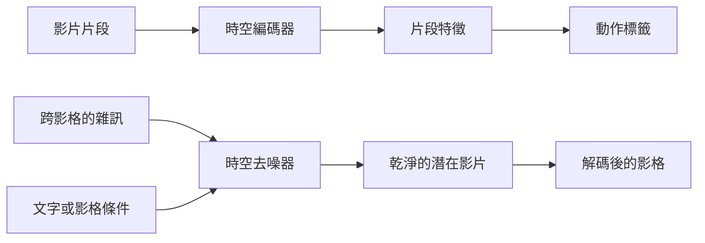

# 影片理解與生成

影片理解要回答的是一段片段裡發生了什麼事，以及何時發生。影片生成則要求生成在時間上前後連貫的影格序列。兩項任務都需要能在影格之間傳遞資訊的模型，而最新的系統正把兩者結合，成為能模擬場景如何演變的模型。

## 概述

影片是一連串影像，因此若把每個影格分開處理，模型可以辨識物體，卻會遺漏影格之間的變化。一段十秒、每秒 25 影格的片段有 250 個影格，逐影格處理的成本增長很快。因此影片方法需要在影格之間共享資訊，也必須決定要保留時間軸的多少細節。

任務可分為兩大類。在**理解**中，輸出是一個標籤，例如動作類別，或時間上的一組事件。動作辨識是核心任務，[電腦視覺](../index.md)概覽也把它列在影片理解之下。在**生成**中，輸出是一段影片，可由文字、一張影像或先前的影格產生。兩者使用相同的時空機制。[物件偵測](../object-detection/index.md)與[分割](../segmentation/index.md)等影像任務也可延伸到影片，而追蹤則將它們串連於時間之中。

## 關鍵概念

- **時空特徵。** 在空間與時間上都有變化的表徵，因此運動模式與外觀都會被編碼。
- **片段。** 由連續影格組成的短段，是影片網路讀取的單位。整段影片的預測通常是多個片段的平均。
- **光流。** 兩張影格之間表觀運動的場。在網路能直接從像素學習運動之前，它是主要的運動訊號。
- **時間冗餘。** 相鄰影格非常相似。這使模型能稀疏地取樣影格，也使影片預訓練可採用遠高於影像的遮罩比率。[^1]
- **Kinetics。** 一個大型基準，包含來自 YouTube 的 400 個人類動作類別，約 24 萬段訓練片段，使大規模預訓練影片模型變得可行。[^2]
- **Fréchet 影片距離（FVD）。** 生成影片的評分方式，以動作辨識網路的特徵比較真實與生成片段的統計量。[^3]

## 運作方式

影片理解的管線依循三類架構。雙流網路結合 RGB 網路與光流網路。[^4] 三維卷積網路，例如 C3D，直接學習時空濾波器，而 [I3D](i3d/index.md) 透過把影像濾波器膨脹為三維，使其可被訓練。[^5] 影片 Transformer，例如 TimeSformer，在時空圖塊上套用注意力，而 [VideoMAE](videomae/index.md) 等自監督目標使它們能只從影片中學習。[^6][^7] SlowFast 採用兩條不同影格率的路徑，一條負責語意，一條負責運動。[^8]

生成管線以擴散為基礎，如[擴散模型](../../../paradigms/unsupervised/density-and-generative-models/diffusion/index.md)頁所述。一個在空間與時間上運作的去噪器，從片段中去除雜訊。影片擴散模型可為影像模型加入時間層，或從頭訓練時空網路，並常先把影片壓縮到潛在空間。[影片擴散模型](video-diffusion/index.md)一頁介紹了其基本做法。[^3]

## 關鍵方法

以下方法是兩大類架構的代表。每一項都連結到其專屬頁面。

| 方法 | 年份 | 系列 | 特點 | 頁面 |
|---|---|---|---|---|
| I3D | 2017 | 三維卷積 | 把二維影像網路膨脹為三維，並在 Kinetics 上預訓練 | [I3D](i3d/index.md) |
| VideoMAE | 2022 | 影片 Transformer，自監督 | 遮住約 90% 的時空方塊並加以重建，不需影像預訓練 | [VideoMAE](videomae/index.md) |
| 影片擴散 | 2022 | 擴散 | 時空去噪器，並在影像與影片上聯合訓練 | [影片擴散](video-diffusion/index.md) |

SlowFast 與 TimeSformer 是上文提及的另外兩個代表。[視覺 Transformer](../../transformer/vision-transformer/index.md)頁介紹了影片 Transformer 所延伸的影像架構。

## 連結

- **腦與心智。** 雙流網路與雙流假說有關，該假說主張背側路徑處理運動，腹側路徑處理物體。[^4][^9] 這種相似只存在於組織方式上，並非共享機制的證據。參見[知覺與視覺系統](../../../../brain-mind/visual-perception/index.md)。
- **世界模型。** Sora 被描述為「世界模擬器」，Sora 綜述詳細檢視了這種說法。[^10] [世界模型](../../world-models/index.md)頁介紹了這條路線，即模型預測場景在動作之下如何演變。另一條路線則預測未來影片的特徵而非像素，例如 [V-JEPA](https://arxiv.org/abs/2404.08471)。[^11]
- **預測編碼。** 預測接下來的影格，類似於預測編碼對知覺的解釋，即大腦將其預測與輸入相比較。這個類比只是鬆散的，[預測編碼](../../../../brain-mind/predictive-coding/index.md)頁則闡述了該理論本身。
- **擴散與 Transformer。** 影片生成沿用[擴散](../../../paradigms/unsupervised/density-and-generative-models/diffusion/index.md)的訓練目標，影片理解則沿用[卷積神經網路](../../cnn/index.md)與 Transformer 的家族。

## 應用

- **影片搜尋與分析。** 動作辨識依影片中發生的事進行索引，例如用於運動分析與安全監控。Kinetics 資料集涵蓋普通 YouTube 片段中廣泛的人類動作，而在其上的預訓練可以遷移到其他動作資料集。[^2]
- **駕駛與機器人。** 影片世界模型可生成駕駛情境，並支援機器人規劃，[世界模型](../../world-models/index.md)頁有相關說明。另見[自動駕駛](../../../../applications/autonomous-driving/index.md)與[機器人](../../../../applications/robotics/index.md)。
- **創意工具。** 文字生成影片的系統被討論於電影製作、教育與行銷，Sora 綜述檢視了它在這些產業的影響。[^10] 另見[創意](../../../../applications/creative/index.md)。

## 開放問題

- **長影片。** 多數模型讀取的是數秒的片段，輸出也很短。對數分鐘或數小時的影片進行推理仍然困難。
- **成本。** 時空 token 上的注意力與大量去噪步驟都很昂貴。潛在壓縮能降低成本，而潛在空間的選擇也會影響模型所捕捉的內容。
- **評估。** FVD 會隨取樣協定而改變，因此不同論文的分數並不能直接比較。[^3]
- **物理一致性。** 影片生成器究竟學到了物理，還是只學到了訓練資料的統計特性，仍有爭議，如[世界模型](../../world-models/index.md)頁所討論。
- **預訓練。** 影片的自監督能否在大規模上取代影像預訓練，仍未解決。VideoMAE 顯示，單靠影片資料便足以應付中等規模的基準，但它也顯示了資料集之間的領域偏移。[^7]

[^1]: Tong 等人（2022）：摘要與第 3 節。跨連續影格的時間冗餘支持 90% 至 95% 的遮罩比率。
[^2]: Kay 等人（2017）：400 類，每類至少 400 段，每段約十秒，來自不同的 YouTube 影片。24 萬段訓練片段的數字見 Carreira 與 Zisserman（2017）第 3 節，該文亦報告了從 Kinetics 遷移到 UCF-101 與 HMDB-51 的結果。
[^3]: Ho 等人（2022）：FVD 以 I3D 特徵計算，論文指出取樣協定會改變分數。
[^4]: Simonyan 與 Zisserman（2014），摘要與引言，包括關於雙流假說的註記。
[^5]: Carreira 與 Zisserman（2017），第 2 節，關於把二維濾波器膨脹為三維。
[^6]: Bertasius 等人（2021），摘要。
[^7]: Tong 等人（2022），表 2，以及預訓練資料集段落中關於領域偏移的討論。
[^8]: Feichtenhofer 等人（2018），摘要。
[^9]: Goodale 與 Milner（1992）。
[^10]: Liu 等人（2024），摘要：此綜述涵蓋 Sora 背後的技術、跨產業的應用以及其限制。
[^11]: Bardes 等人（2024），摘要：不做像素重建的特徵預測。

## 參考文獻

### 開創性論文

- Simonyan, K. & Zisserman, A. (2014). *Two-Stream Convolutional Networks for Action Recognition in Videos*. arXiv. https://arxiv.org/abs/1406.2199 — 分別處理 RGB 影格與光流的卷積網路，其預測結果加以融合，是學習式動作辨識的里程碑。
- Tran, D., et al. (2014). *Learning Spatiotemporal Features with 3D Convolutional Networks*. arXiv. https://arxiv.org/abs/1412.0767 — C3D 網路，在影片上從零開始訓練三維卷積。
- Carreira, J. & Zisserman, A. (2017). *Quo Vadis, Action Recognition? A New Model and the Kinetics Dataset*. arXiv. https://arxiv.org/abs/1705.07750 — 提出 I3D 與用於預訓練影片模型的 Kinetics 資料集。
- Feichtenhofer, C., Fan, H., Malik, J. & He, K. (2018). *SlowFast Networks for Video Recognition*. arXiv. https://arxiv.org/abs/1812.03982 — 以慢速與快速路徑，在不同影格率下捕捉語意與運動。
- Bertasius, G., Wang, H. & Torresani, L. (2021). *Is Space-Time Attention All You Need for Video Understanding?* arXiv. https://arxiv.org/abs/2102.05095 — TimeSformer，一種採用分離式注意力的無卷積影片 Transformer。
- Tong, Z., Song, Y., Wang, J. & Wang, L. (2022). *VideoMAE: Masked Autoencoders are Data-Efficient Learners for Self-Supervised Video Pre-Training*. NeurIPS. https://arxiv.org/abs/2203.12602 — 以管狀遮罩進行影片 Transformer 的遮罩方塊重建。
- Ho, J., Salimans, T., Gritsenko, A., Chan, W., Norouzi, M. & Fleet, D. J. (2022). *Video Diffusion Models*. arXiv. https://arxiv.org/abs/2204.03458 — 第一個影片擴散模型，採用時空 U-Net。
- Bardes, A., et al. (2024). *Revisiting Feature Prediction for Learning Visual Representations from Video*. arXiv. https://arxiv.org/abs/2404.08471 — V-JEPA，透過預測特徵而非像素來學習影片視覺表徵。
- Kay, W., et al. (2017). *The Kinetics Human Action Video Dataset*. arXiv. https://arxiv.org/abs/1705.06950 — 用於影片預訓練的 400 類 YouTube 資料集。
- Goodale, M. A. & Milner, A. D. (1992). *Separate visual pathways for perception and action*. Trends in Neurosciences. https://doi.org/10.1016/0166-2236%2892%2990344-8 — 提出腹側與背側視覺通路。

### 綜述與教科書

- Zhu, Y., et al. (2020). *A Comprehensive Study of Deep Video Action Recognition*. arXiv. https://arxiv.org/abs/2012.06567 — 綜述逾兩百篇深度影片動作辨識論文，涵蓋其使用的資料集與評估協定。
- Xing, Z., et al. (2023). *A Survey on Video Diffusion Models*. arXiv. https://arxiv.org/abs/2310.10647 — 綜述影片擴散的架構、訓練與評估。
- Liu, Y., et al. (2024). *Sora: A Review on Background, Technology, Limitations, and Opportunities of Large Vision Models*. arXiv. https://arxiv.org/abs/2402.17177 — 回顧文字生成影片模型 Sora 的背景技術、應用與限制。
