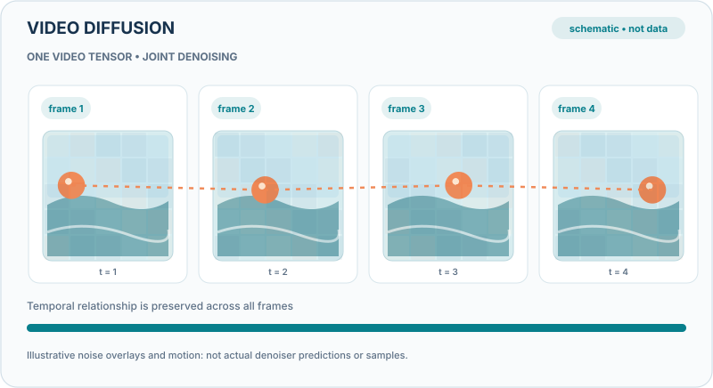

# Video diffusion models

A video diffusion model generates a clip by denoising a sequence of frames, starting from Gaussian noise. The same training objective used for images extends to time, and large systems add text conditioning, cascaded resolution stages, or a compressed latent space to make long, high-resolution video affordable.

## Overview

The [video chapter](index.md) describes the field. This page covers the method. A diffusion model learns to reverse a gradual noising process. For video, the noised object is a tensor of frames, and the network must denoise all frames together so that the motion between them is coherent.

## Problem

Video has far more data than an image, and its frames must agree with one another. A model that makes each frame sharp but not consistent with its neighbours produces flicker and objects that change shape. Generating high-resolution, long clips at reasonable cost is the central engineering problem.

## Core idea

Ho and colleagues extend the image diffusion model to video by denoising a sequence of frames with a network that includes temporal attention or convolution, and they show that the same objective gives coherent short clips [(Ho et al., 2022)](https://arxiv.org/abs/2204.03458). Imagen Video applies a cascade of video diffusion models, from a low-resolution base to higher-resolution super-resolution stages, each conditioned on text [(Ho et al., 2022b)](https://arxiv.org/abs/2210.02303). Latent video diffusion, as in Align your Latents, runs the diffusion process in a compressed latent space produced by an autoencoder, which cuts the compute needed for long, high-resolution clips [(Blattmann et al., 2023)](https://arxiv.org/abs/2304.08818).

### Visual walkthrough: jointly denoising a video

  

*Original teaching visual (CC BY-SA 4.0).* The four frames belong to a **jointly denoised video tensor**, not four independent frame samplers. The orange trajectory indicates temporal dependence; coloured tiles fade as corruption is removed. All frames, motion paths and transitions are **schematic rather than generated samples or measurements**. Joint denoising also does not guarantee perfect long-range coherence. See [Ho et al. (2022)](https://arxiv.org/abs/2204.03458). The website provides Play/Pause with Enter/Space, a static still for reduced-motion preferences, and horizontally scrollable diagrams on narrow screens. [Open the animated SVG](../../../../assets/concept-animations/video-joint-denoising-motion.svg).

### Interactive lab: the forward video-noising equation

  
The GitHub-compatible static animation above remains available without JavaScript.

This **deterministic toy calculation** constructs a four-frame, 12-by-8 grayscale clip and a fixed noise tensor. Scrub the signal-retention parameter `ᾱ` to recompute each noisy frame from `x_t = sqrt(ᾱ) x_0 + sqrt(1−ᾱ) ε`; the displayed **Noise RMS** is the root mean square of the injected term `sqrt(1−ᾱ) ε` over all 384 elements. The noise tensor remains fixed, so any visual change comes from the selected noise level rather than from resampling. A lower `ᾱ` means more corruption; the playable upward sweep merely removes synthetic corruption by changing the equation's parameter. **This is the forward corruption law, not the learned reverse diffusion trajectory**. Real video denoisers are trained to infer noise and preserve temporal dependencies; the lab does not model learned temporal attention or evaluate coherence. Use Previous/Next, Seek, Play/Pause, speed or Reset; native controls work with a keyboard. Reduced-motion preferences disable autoplay. All frames and numerical values are schematic and not model outputs.

## Equation

The training objective is the denoising loss of the diffusion model, applied to a noised video $\mathbf{x}_t$:

$$\mathcal{L} = \mathbb{E}_{\mathbf{x}_0, \boldsymbol{\epsilon}, t}\left[\, \lVert \boldsymbol{\epsilon} - \boldsymbol{\epsilon}_\theta(\mathbf{x}_t, t) \rVert^2 \,\right], \qquad \mathbf{x}_t = \sqrt{\bar\alpha_t}\,\mathbf{x}_0 + \sqrt{1-\bar\alpha_t}\,\boldsymbol{\epsilon}$$

Here $\mathbf{x}_0$ is a clip, $\boldsymbol{\epsilon}$ is Gaussian noise, and $\bar\alpha_t$ is a noise schedule. The network $\boldsymbol{\epsilon}_\theta$ predicts the noise. The image case of this objective was introduced by Ho, Jain and Abbeel [(Ho, Jain and Abbeel, 2020)](https://arxiv.org/abs/2006.11239).

## Results

The papers report high-quality short videos and text-conditioned generation, with quantitative results and samples in their own evaluations. The figures are not restated here.

## Limitations

- Sampling requires many denoising steps, which is slow for long clips.
- Consistency over long durations, physical plausibility and fine detail remain difficult.
- Training data determines the content the model can produce, which raises questions about provenance and consent.

## Connections

The objective is the same as in image diffusion, covered under [Generative models](../../../paradigms/unsupervised/density-and-generative-models/index.md). Learned video dynamics also link to [world models](../../world-models/index.md), which predict how scenes evolve.

## Applications

Pre-visualisation for film, short creative clips, synthetic data for training perception systems, and video editing. The same capability raises concerns about synthetic media covered in [Misinformation and deepfakes](../../../../society/misinformation/index.md).

## Open questions

- How can video generation stay consistent over minutes rather than seconds?
- Do video diffusion models learn physical dynamics, or mainly the appearance of motion?
- How should sampling be accelerated without losing quality?

## References

### Seminal papers

- Ho, Jain and Abbeel, *Denoising Diffusion Probabilistic Models* (2020). https://arxiv.org/abs/2006.11239 — The denoising diffusion objective that video models extend.
- Ho, Salimans, Gritsenko, Chan, Norouzi and Fleet, *Video Diffusion Models* (2022). https://arxiv.org/abs/2204.03458 — Extends the image diffusion objective to video, denoising a sequence of frames together.
- Ho, Chan, Saharia, Whang, Gao, Gritsenko, Kingma, Poole, Norouzi, Fleet and Salimans, *Imagen Video: High Definition Video Generation with Diffusion Models* (2022). https://arxiv.org/abs/2210.02303 — A cascade of text-conditioned video diffusion models.
- Rombach, Blattmann, Lorenz, Esser and Ommer, *High-Resolution Image Synthesis with Latent Diffusion Models*, IEEE/CVF Conference on Computer Vision and Pattern Recognition (2022). https://doi.org/10.1109/CVPR52688.2022.01042 — Latent diffusion, the basis for compressed video diffusion.
- Blattmann, Rombach, Ling, Dockhorn, Kim, Fidler and Kreis, *Align your Latents: High-Resolution Video Synthesis with Latent Diffusion Models* (2023). https://arxiv.org/abs/2304.08818 — Latent video diffusion for high-resolution clips.
