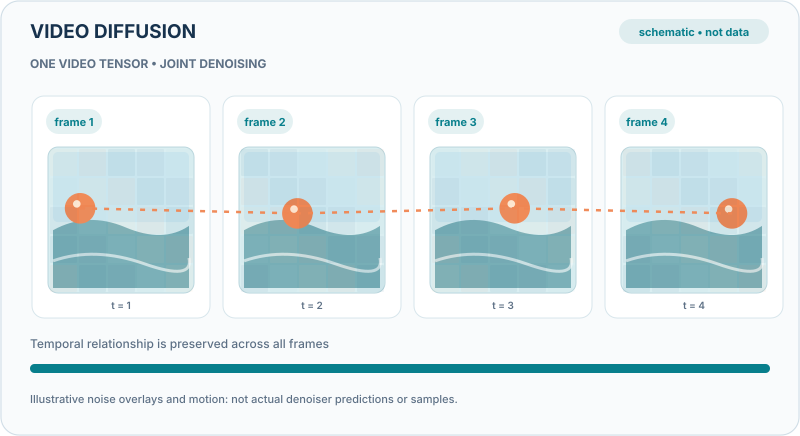

# 影片擴散模型

影片擴散模型從高斯雜訊出發，對一串影格去噪，從而生成影片片段。影像所用的訓練目標可以延伸到時間軸；大型系統再加入文字條件、串接式的解析度階段，或壓縮的潛在空間，使長時間、高解析度的影片在計算上可負擔。

## 概觀

[影片章節](index.zh-TW.md)描述了這個領域。本頁說明此方法。擴散模型學習反轉一個逐步加入雜訊的過程。對影片而言，被加入雜訊的對象是一個影格張量，網路必須同時對所有影格去噪，使影格之間的運動保持連貫。

## 問題

影片的資料量遠大於影像，而且各影格彼此必須一致。如果模型讓每一格都清晰，卻與相鄰影格不一致，就會產生閃爍與物件形狀改變的情況。以合理成本生成高解析度、長時間的片段，是核心的工程問題。

## 核心想法

Ho 等人把影像擴散模型擴展到影片：以包含時間注意力或時間卷積的網路對一串影格去噪，並顯示同一目標可以產生連貫的短片段 [(Ho et al., 2022)](https://arxiv.org/abs/2204.03458)。Imagen Video 採用影片擴散模型的串接：從低解析度的基礎模型開始，再經過高解析度的超解析度階段，每一階段都以文字為條件 [(Ho et al., 2022b)](https://arxiv.org/abs/2210.02303)。潛在影片擴散（如 Align your Latents）則在自編碼器產生的壓縮潛在空間中執行擴散過程，降低生成長時間、高解析度片段所需的計算 [(Blattmann et al., 2023)](https://arxiv.org/abs/2304.08818)。

### 教學動畫：跨影格聯合去噪

  

*原創教學視覺（CC BY-SA 4.0）.* 四個影格組成**共同去噪的影片張量**，不是逐格各自生成。橘色路徑表示影格間的時間關聯；彩色雜訊覆蓋層代表逆擴散過程中逐步降低的雜訊。這些影格、移動軌跡與轉場全是**人工教學示意，非模型輸出或實測結果**。聯合去噪也不保證長時間的完美一致性。參見 [Ho 等人（2022）](https://arxiv.org/abs/2204.03458)。 網站版可播放或暫停動畫，使用 Enter／Space 操作按鈕；偏好減少動態時顯示靜態圖。手機可用鍵盤或觸控左右捲動。 [開啟完整 SVG 動畫](../../../../assets/concept-animations/video-joint-denoising-motion.svg).

### 互動實驗：影片的前向加雜訊方程式

  
未啟用 JavaScript 時，仍可閱讀上方 GitHub 相容的靜態教學圖。

此**可重現的人工計算示例**使用四個 12×8 灰階影格與固定雜訊張量。調整訊號保留參數 `ᾱ`，可依照 `x_t = sqrt(ᾱ) x_0 + sqrt(1−ᾱ) ε` 重新計算每個影格；畫面的**雜訊 RMS** 是注入項 `sqrt(1−ᾱ) ε` 在全部 384 個元素上的均方根。雜訊張量固定，因此畫面差異來自雜訊程度而非重新抽樣。較低的 `ᾱ` 代表較多雜訊；播放時向上改變參數只是以解析式減少人造雜訊，**不是訓練後模型真正執行反向擴散的軌跡**。真實影片去噪網路還需推估雜訊與跨影格依賴；這個實驗不模擬已學得的時間注意力，也不衡量生成一致性。支援上一步／下一步、進度滑桿、播放／暫停、速度與重設，亦可用鍵盤操作。系統偏好減少動態時不自動播放。所有影格與數字均非模型實測。

## 方程式

訓練目標是擴散模型的去噪損失，套用於加入雜訊後的影片 $\mathbf{x}_t$：

$$\mathcal{L} = \mathbb{E}_{\mathbf{x}_0, \boldsymbol{\epsilon}, t}\left[\, \lVert \boldsymbol{\epsilon} - \boldsymbol{\epsilon}_\theta(\mathbf{x}_t, t) \rVert^2 \,\right], \qquad \mathbf{x}_t = \sqrt{\bar\alpha_t}\,\mathbf{x}_0 + \sqrt{1-\bar\alpha_t}\,\boldsymbol{\epsilon}$$

這裡 $\mathbf{x}_0$ 是一段影片，$\boldsymbol{\epsilon}$ 是高斯雜訊，$\bar\alpha_t$ 是雜訊排程。網路 $\boldsymbol{\epsilon}_\theta$ 預測雜訊。此目標的影像版本由 Ho、Jain 與 Abbeel 提出 [(Ho, Jain and Abbeel, 2020)](https://arxiv.org/abs/2006.11239)。

## 結果

論文報告了高品質的短影片，以及文字條件生成的成果，其量化結果與樣本來自各自的評估。此處不重述數字。

## 限制

- 取樣需要許多次去噪步驟，生成長片段很慢。
- 長時間的一致性、物理合理性與細節仍然困難。
- 訓練資料決定了模型能生成的內容，這引發了來源與同意的問題。

## 關聯

此目標與影像擴散相同，見[生成模型](../../../paradigms/unsupervised/density-and-generative-models/index.md)。學習到的影片動態也與預測場景如何演變的[世界模型](../../world-models/index.zh-TW.md)相關。

## 應用

電影的前期視覺化、短篇創意影片、用於訓練感知系統的合成資料，以及影片編輯。同樣的能力也引發了[錯誤資訊與深偽](../../../../society/misinformation/index.zh-TW.md)所涵蓋的合成媒體疑慮。

## 開放問題

- 影片生成如何能在數分鐘而非數秒內保持一致？
- 影片擴散模型學到的是物理動態，還是主要是運動的外觀？
- 如何在不犧牲品質的前提下加速取樣？

## 參考文獻

### 奠基性論文

- Ho、Jain 與 Abbeel，*Denoising Diffusion Probabilistic Models*（2020）。https://arxiv.org/abs/2006.11239 — 影片模型所延伸的去噪擴散目標。
- Ho、Salimans、Gritsenko、Chan、Norouzi 與 Fleet，*Video Diffusion Models*（2022）。https://arxiv.org/abs/2204.03458 — 把擴散模型延伸到影片。
- Ho、Chan、Saharia、Whang、Gao、Gritsenko、Kingma、Poole、Norouzi、Fleet 與 Salimans，*Imagen Video: High Definition Video Generation with Diffusion Models*（2022）。https://arxiv.org/abs/2210.02303 — 文字條件影片擴散模型的串接。
- Rombach、Blattmann、Lorenz、Esser 與 Ommer，*High-Resolution Image Synthesis with Latent Diffusion Models*，IEEE/CVF Conference on Computer Vision and Pattern Recognition（2022）。https://doi.org/10.1109/CVPR52688.2022.01042 — 潛在擴散，是壓縮影片擴散的基礎。
- Blattmann、Rombach、Ling、Dockhorn、Kim、Fidler 與 Kreis，*Align your Latents: High-Resolution Video Synthesis with Latent Diffusion Models*（2023）。https://arxiv.org/abs/2304.08818 — 用於高解析度片段的潛在影片擴散。
