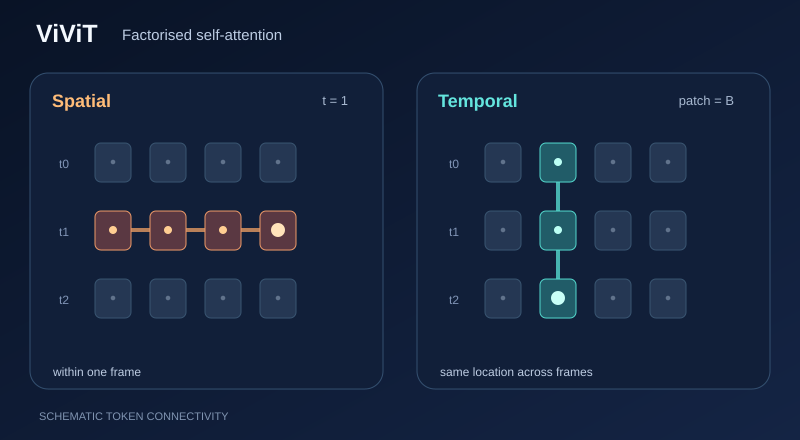

# ViViT: video vision Transformer

ViViT is a video classification model built from Transformer layers. It turns a clip into spatiotemporal tokens, each a tubelet spanning several frames, and applies self-attention over them. The paper proposes several ways to factorise attention across space and time, and reports state-of-the-art results on several video benchmarks.

## Overview

The [video chapter](index.md) gives the wider context. This page covers the model. Following the Vision Transformer, the clip is cut into tubelets, which are embedded as tokens.

## Problem

Attention over all spatiotemporal tokens is costly, because the number of tokens grows with the number of frames and spatial positions together. The paper studies how to factorise attention across space and time to keep the cost manageable.

## Core idea

A clip is cut into non-overlapping tubelets, and each is embedded as a token. The paper proposes factorised encoders:

- **Factorised encoder (Model 2):** a spatial Transformer encoder runs first, then a temporal encoder runs over its output.
- **Factorised self-attention (Model 3):** each block applies multi-head self-attention across the spatial tokens, then across the temporal tokens.
- **Factorised dot-product attention (Model 4):** half of the attention heads attend over space and half over time.

### Visual walkthrough: factorised attention

*Original teaching visual (CC BY-SA 4.0).* **Orange** traces spatial token mixing within one frame; **teal** traces temporal mixing for a fixed spatial location across frames. In **ViViT Model 3**, the two kinds of attention are applied sequentially within a Transformer block. The diagram isolates one row and one column of token connectivity rather than drawing all heads or learned attention weights. These positions and moving highlights are schematic, **not measured attention scores or model inference**. MkDocs automatically enhances the static GitHub preview with Play/Pause (including keyboard and reduced-motion support). [Open the animated SVG](../../../../assets/concept-animations/vivit-factorised-attention-motion.svg). For the actual architecture, see [Arnab et al. (2021)](https://arxiv.org/abs/2103.15691).

### Interactive lab: direct versus indirect token connectivity

The following **synthetic** example uses three temporal positions and four spatial patches at each position. Choose a query frame and patch, then step through ViViT Model 3's **spatial attention → temporal attention** order. Orange marks keys in the same frame, teal marks the same patch across frames, and the final stage shows which tokens can **indirectly influence** the query after both operations. This final reachability is *not* a single dense attention matrix.

For \(T=3\) and \(P=4\), the two attention operations contain \(TP^2=48\) and \(PT^2=36\) directed query–key pairs (self-pairs included), or **84 in total** versus \((TP)^2=144\) for a single full attention operation. These are **structural pair counts**, not measured FLOPs, latency, learned attention weights or results of a trained ViViT. Use **Previous / Next, Play / Pause, Seek, Speed, Reset**, and the native slider arrow keys. On a narrow screen, focus and horizontally scroll the visual.

## Equation

The per-layer computations of the factorised self-attention model are given in Eqs. 4–6 of the paper, which this page does not restate. The attention itself is the standard scaled dot-product form from the Transformer paper.

## Results

The main results use ViViT-L/16x2, with tubelets of size $16 \times 16 \times 2$. The abstract reports state-of-the-art results on Kinetics 400 and 600, Epic Kitchens, Something-Something v2 and Moments in Time. The full numbers are in the paper's results tables.

## Limitations

- Attention cost still grows with clip length and resolution, so the factorisation choice matters.
- The gains are reported on the benchmarks in the abstract. Results on other datasets are not covered here.

## Connections

ViViT applies the Transformer architecture described in [Transformers](../../transformer/index.md) to video, following the Vision Transformer. For the convolutional approach to the same benchmarks, see [I3D](i3d.md).

## Applications

Video classification and action recognition on the benchmarks listed in the abstract.

## Open questions

- Which factorisation of space and time is best as clips get longer?
- How do the factorised variants compare when trained on smaller datasets?

## References

### Seminal papers

- Arnab, Dehghani, Heigold, Sun, Lučić and Schmid, *ViViT: A Video Vision Transformer* (2021). https://arxiv.org/abs/2103.15691 — Introduces the ViViT model and its factorised encoders.
- Vaswani et al., *Attention Is All You Need* (2017). https://arxiv.org/abs/1706.03762 — Introduces the Transformer architecture that ViViT builds on.
- Dosovitskiy et al., *An Image is Worth 16x16 Words: Transformers for Image Recognition at Scale* (2020). https://arxiv.org/abs/2010.11929 — Introduces the Vision Transformer, which ViViT extends to video.
- Bertasius, Wang and Torresani, *Is Space-Time Attention All You Need for Video Understanding?* (2021). https://arxiv.org/abs/2102.05095 — A convolution-free space-time attention model for video understanding.
- Tong, Song, Wang and Wang, *VideoMAE: Masked Autoencoders are Data-Efficient Learners for Self-Supervised Video Pre-Training* (2022). https://arxiv.org/abs/2203.12602 — Masked autoencoder pretraining that learns video representations from unlabelled clips.
