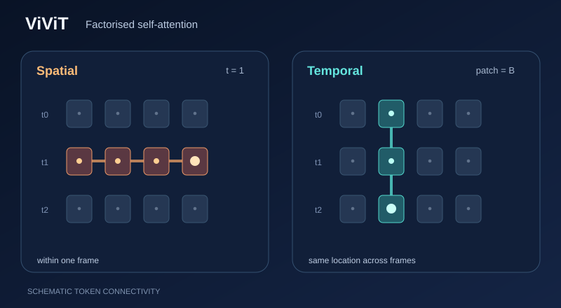

# ViViT：影片視覺 Transformer

ViViT 是由 Transformer 層構成的影片分類模型。它把一段片段轉換為時空詞元，每個詞元是橫跨數個影格的管狀區塊（tubelet），並在這些詞元上套用自注意力。論文提出多種把注意力分解到空間與時間的方式，並在多個影片基準上報告了最佳結果。

## 概觀

[影片章節](index.zh-TW.md)提供了更廣的脈絡。本頁說明模型。與視覺 Transformer 一樣，片段被切成管狀區塊，每一塊嵌入為一個詞元。

## 問題

對所有時空詞元做注意力成本很高，因為詞元數量同時隨影格數與空間位置數增長。論文研究如何把注意力分解到空間與時間上，以控制成本。

## 核心想法

片段被切成互不重疊的管狀區塊，每一塊嵌入為一個詞元。論文提出幾種分解式編碼器：

- **分解式編碼器（Model 2）：**先執行空間 Transformer 編碼器，再對其輸出執行時間編碼器。
- **分解式自注意力（Model 3）：**每個區塊先在空間詞元上做多頭自注意力，再在時間詞元上做多頭自注意力。
- **分解式點積注意力（Model 4）：**一半的注意力頭關注空間，另一半關注時間。

### 視覺解說：空間與時間注意力分解

*原創教學視覺（CC BY-SA 4.0）。* **橘色**追蹤單一影格內的空間詞元混合，**青綠色**追蹤固定空間位置跨影格的時間混合。在 **ViViT Model 3** 中，這兩種注意力會在 Transformer 區塊內依序執行。圖中僅選出一列與一行的連結關係，並未畫出所有注意力頭或學得的權重。詞元位置與移動標記均為**教學示意，不是模型實測注意力分數或推論結果**。MkDocs 會將 GitHub 的靜態預覽增強為支援播放／暫停、鍵盤操作及減少動態效果設定的播放器。[檢視 SVG 動畫](../../../../assets/concept-animations/vivit-factorised-attention-motion.svg)。原始架構請參見 [Arnab 等人（2021）](https://arxiv.org/abs/2103.15691)。

### 互動實驗：直接連結與間接可達性

以下**人工示例**使用三個時間位置，每個位置各有四個空間區塊。選擇查詢影格與區塊，逐步查看 ViViT Model 3 的**空間注意力 → 時間注意力**。橘色表示同影格的鍵詞元，青綠色表示跨影格、相同空間位置的鍵詞元；最後一個階段顯示兩次運算之後能**間接影響**查詢的詞元，不代表一次完整的密集注意力運算。

當 \(T=3\)、\(P=4\)，兩次注意力的有向查詢—鍵配對數分別為 \(TP^2=48\)、\(PT^2=36\)，總計 **84**，完整注意力則為 \((TP)^2=144\)（均包含自己對自己的配對）。這些是**結構配對數**，不是實測 FLOPs、延遲、注意力權重或模型推論結果。可使用「上一步／下一步」、「播放／暫停」、進度與速度控制、重設以及滑桿方向鍵；手機版可將焦點移至圖面後水平捲動。

## 方程式

分解式自注意力模型的每層計算，見論文的式 4 至式 6；本頁不重述。注意力本身採用 Transformer 論文中標準的縮放點積形式。

## 結果

主要結果使用 ViViT-L/16x2，管狀區塊大小為 $16 \times 16 \times 2$。摘要報告，在 Kinetics 400 與 600、Epic Kitchens、Something-Something v2 與 Moments in Time 上達到最佳結果。完整數字見論文的結果表。

## 限制

- 注意力成本仍隨片段長度與解析度增長，因此分解方式的選擇很重要。
- 報告的進步針對摘要中的基準。其他資料集的結果不在本頁範圍內。

## 關聯

ViViT 把[Transformer](../../transformer/index.zh-TW.md)所述的架構套用到影片上，並沿用視覺 Transformer 的做法。若要看同一基準上的卷積方法，見 [I3D](i3d.zh-TW.md)。

## 應用

在摘要所列基準上進行影片分類與動作辨識。

## 開放問題

- 隨著片段變長，哪一種空間與時間的分解最好？
- 在較小的資料集上訓練時，各種分解變體的表現如何？

## 參考文獻

### 奠基性論文

- Arnab、Dehghani、Heigold、Sun、Lučić 與 Schmid，*ViViT: A Video Vision Transformer*（2021）。https://arxiv.org/abs/2103.15691 — 提出 ViViT 模型及其分解式編碼器。
- Vaswani 等人，*Attention Is All You Need*（2017）。https://arxiv.org/abs/1706.03762 — 提出 ViViT 所依據的 Transformer 架構。
- Dosovitskiy 等人，*An Image is Worth 16x16 Words: Transformers for Image Recognition at Scale*（2020）。https://arxiv.org/abs/2010.11929 — 提出視覺 Transformer，ViViT 將其延伸至影片。
- Bertasius、Wang 與 Torresani，*Is Space-Time Attention All You Need for Video Understanding?*（2021）。https://arxiv.org/abs/2102.05095 — 不使用卷積的時空注意力影片理解模型。
- Tong、Song、Wang 與 Wang，*VideoMAE: Masked Autoencoders are Data-Efficient Learners for Self-Supervised Video Pre-Training*（2022）。https://arxiv.org/abs/2203.12602 — 針對影片的遮蔽自編碼器預訓練，從未標註的片段學習表徵。
