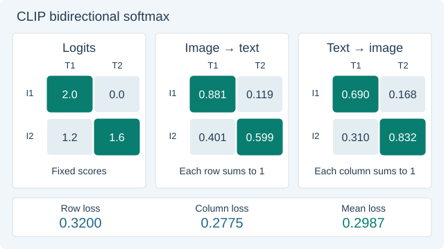
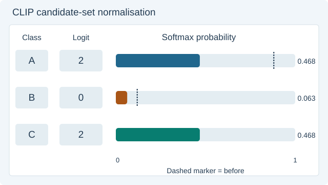

# CLIP

CLIP (Contrastive Language–Image Pre-training) learns an image encoder and a text encoder whose outputs share one embedding space. Trained on 400 million web image–text pairs, it can perform downstream classification without task-specific labelled fine-tuning by comparing images with class descriptions. Here zero-shot describes the adaptation protocol, not a guarantee that web pre-training contained no overlapping images. The method is the modality-alignment member of the family on the parent page, [Embeddings and Representation Learning](index.md).

## Problem

Image classifiers trained on fixed label sets, such as ImageNet, learn only the categories in their training labels, and new categories require new labelled data. Radford et al. (2021) asked whether a model could learn visual concepts from the natural-language text that already accompanies images on the web, and then transfer to new tasks by describing the task in words.

## Core idea

For a batch of `N` image–text pairs, CLIP must identify which of the `N × N` possible pairings actually occurred. The image and text embeddings are normalised, and the contrastive loss favours the paired captions/images over other batch entries. Other entries act as negatives, even though some may also be semantically compatible. The objective is applied in both directions, from image to text and from text to image, which makes the loss symmetric.

Because the loss compares a pair against every other pair in the batch, the negatives come for free: no separate negative set is needed. The similarities are multiplied by a learned inverse temperature. Section 2.5 of the arXiv paper reports an initial temperature of 0.07 and a cap of 100 on the multiplicative logit scale during training.[^training]

## Equation and algorithm

The paper gives its pseudocode for the core step. With row-normalised image and text embedding matrices $I_e,T_e\in\mathbb R^{N\times d}$, the logits are

$$
S=I_eT_e^\top\exp(t)=I_eT_e^\top/\tau,\qquad t=\log(1/\tau).
$$

### Training over paired positions

Thus $t$ is the learned **log inverse-temperature**, or logit scale. Let $S_{ij}$ score image $i$ against text $j$, with paired examples placed at the same index. The two cross-entropies are[^training]

$$
L_{I\to T}=-\frac{1}{N}\sum_{i=1}^{N}\log\frac{\exp(S_{ii})}{\sum_{j=1}^{N}\exp(S_{ij})},
$$

$$
L_{T\to I}=-\frac{1}{N}\sum_{i=1}^{N}\log\frac{\exp(S_{ii})}{\sum_{j=1}^{N}\exp(S_{ji})},
\qquad L=\frac{L_{I\to T}+L_{T\to I}}{2}.
$$

The first denominator fixes an image and ranges over texts in its row. The second fixes a text and ranges over images in its column. The target is the matching **batch position**, so a duplicate or semantically compatible caption at another position still competes with the target under this objective. Symmetric loss means averaging the two directions. It does not require $S=S^\top$ or equal directional losses.

### A two-pair example

Take unit image vectors $(1,0)$ and $(0.6,0.8)$, unit text vectors $(1,0)$ and $(0,1)$, and inverse temperature $\exp(t)=2$. Their logit matrix is

$$
S=\begin{pmatrix}2&0\\1.2&1.6\end{pmatrix}.
$$

Applying the preceding formulas gives the following values, rounded to four decimals.

| Quantity | Image to text, row softmax | Text to image, column softmax |
|---|---|---|
| Probability assigned to the first paired position | 0.8808 | 0.6900 |
| Probability assigned to the second paired position | 0.5987 | 0.8320 |
| Mean negative log probability | 0.3200 | 0.2775 |

The averaged loss is $L\approx0.2987$, using natural logarithms. These are constructed values to demonstrate the calculation, not measurements from a trained CLIP model.

### Two normalisation directions in motion

*Original 12-second teaching animation (CC BY-SA 4.0).* Use the site's Play/Pause button; scroll horizontally on narrow screens. GitHub provides the [static fallback](../../../assets/concept-animations/clip-bidirectional-softmax-still.svg) and [full SVG animation](../../../assets/concept-animations/clip-bidirectional-softmax-motion.svg).

The orange outline first selects the two rows of the logit matrix, then the two columns. Each selected row or column is normalised over its own two entries. Green cells mark the paired batch positions, not a probability threshold. The resulting matrices use the same image-row and text-column layout; each row of the middle matrix sums to one, whereas each column of the right matrix sums to one. For example, the first paired position has probability 0.8808 in the image-to-text direction but 0.6900 in the reverse direction. After all four normalisations, the mean losses from the preceding table appear. Values are rounded for display. The sequential order is instructional, not an assertion that the implementation must compute the directions serially. This is the constructed example above, not a model measurement.

### Zero-shot classification and prompt ensembles

For a chosen candidate class set $C$, encode a prompt for each class and normalise its embedding to obtain $v_c$. Let $u$ be the unit image embedding. The zero-shot classifier uses[^transfer]

$$
p_C(c\mid u)=\frac{\exp\!\left(\exp(t)u^\top v_c\right)}
{\sum_{k\in C}\exp\!\left(\exp(t)u^\top v_k\right)}.
$$

The predicted class maximises this score. For fixed embeddings and a shared positive inverse temperature, cosine similarity, scaled logits and softmax give the same ranking. Changing the scale changes the probabilities without changing that ranking.

Prompt wording changes $v_c$ and can therefore change the ranking. In Section 3.1.4, the default template "A photo of a {label}." improves ImageNet accuracy by about 1.3 percentage points over bare class names. Ensembling 80 context prompts adds about 3.5 further points.[^transfer] The official example normalises each prompt embedding, averages the embeddings for each class, then normalises that average to form one class vector.[^ensemble]

The denominator also depends on the candidate list. As a separate constructed example, logits $(2,0)$ give the first class probability $0.8808$. Adding a third candidate with logit $2$ lowers it to $0.4683$, while leaving both original logits unchanged. Doubling the original two logits to $(4,0)$ instead raises it to $0.9820$. With only one candidate, softmax always returns $1$. Thus a large softmax score alone establishes neither that the correct class was offered nor that confidence is calibrated for the intended task. The model card reports sensitivity to class design and calls for testing with a specific class taxonomy.[^taxonomy]

### Adding a candidate changes the denominator

*Original 12-second teaching animation (CC BY-SA 4.0).* Use the site's Play/Pause button; scroll horizontally on narrow screens. GitHub provides the [static fallback](../../../assets/concept-animations/clip-candidate-set-still.svg) and [full SVG animation](../../../assets/concept-animations/clip-candidate-set-motion.svg).

Start with two classes A and B with logits 2 and 0. The moving green marker announces a new candidate C with logit 2. On arrival, all probabilities update together: A drops from about 0.8808 to 0.4683, B from 0.1192 to 0.0634, and C receives 0.4683. The dashed markers retain the original probabilities of A and B. The original logit difference remains two, so the probability ratio of A to B is unchanged even though their individual probabilities decrease. The bars change discretely when the candidate set changes; the moving marker is not a continuous probability trajectory. A and C now tie. These are rounded analytic values from the constructed example, not CLIP confidence measurements or evidence that a new class is correct.

## Results

The paper reports zero-shot top-1 accuracy on ImageNet. Its **ViT-L/14@336px** model reaches **76.2%**, compared with 11.5% for the earlier Visual N-Grams method ([Table 1 and Section 2.5](https://arxiv.org/abs/2103.00020)). The authors describe this as matching the original supervised ResNet-50; it is not a comparison against the best later ImageNet systems. The authors also report that prompt engineering and ensembling together raise ImageNet accuracy by almost five points. The training set is the paper's own 400-million-pair dataset, called WIT (WebImageText).

## Limitations

- **Behind supervised baselines.** Zero-shot CLIP is competitive with a simple supervised baseline on many datasets but is not state of the art overall. The authors estimate that roughly a thousand-fold increase in compute would be needed to reach the 2021 ImageNet state of the art by extrapolating their observed scaling trend; this is an estimate, not a demonstrated result.
- **Specialised and abstract tasks.** Fine-grained performance varies: Flowers102 and FGVCAircraft trail the paper's linear classifier on ResNet-50 features, while Stanford Cars and Food101 outperform that baseline (Section 3.1.5). Abstract tasks such as counting and new tasks such as nearest-car distance estimation can be near chance; this does not mean all fine-grained classification is near chance.
- **Out-of-distribution data.** It reaches only about 88% on handwritten MNIST digits, which a logistic regression on raw pixels outperforms.
- **Closed set.** It chooses among the concepts it is given and cannot generate new outputs, unlike a captioning model.
- **Social bias.** Training on unfiltered web pairs leads to learned social biases.
- **Evaluation caveats.** Validation sets were queried repeatedly during development, and the evaluation suite was co-adapted with CLIP's development.

[^training]: Radford et al. (2021), arXiv Sections 2.3 and 2.5 and Figure 3. These specify normalised projected embeddings, diagonal batch targets, symmetric cross-entropy and logit scaling.
[^transfer]: Radford et al. (2021), arXiv Sections 3.1.2 and 3.1.4. These describe the zero-shot classifier and prompt ensembling in embedding space.
[^ensemble]: OpenAI, *Prompt Engineering for ImageNet*, the `zeroshot_classifier` function in the official notebook listed below.
[^taxonomy]: OpenAI, *Model Card: CLIP*, “Out-of-Scope Use Cases” and “Bias and Fairness”. The numerical candidate-set and scale examples above are direct calculations from softmax.

## References

### Seminal papers

- Radford, A., Kim, J. W., Hallacy, C., Ramesh, A., Goh, G., Agarwal, S., Sastry, G., Askell, A., Mishkin, P., Clark, J., Krueger, G. & Sutskever, I. (2021). *Learning Transferable Visual Models From Natural Language Supervision*. arXiv. https://arxiv.org/abs/2103.00020 — Defines the contrastive pre-training objective, the WIT dataset and the zero-shot ImageNet results on this page.
- Oord, A. van den, Li, Y. & Vinyals, O. (2018). *Representation Learning with Contrastive Predictive Coding*. arXiv. https://arxiv.org/abs/1807.03748 — Introduces contrastive predictive coding, a probabilistic contrastive loss that uses negative samples to make learning tractable.

### Surveys and textbooks

- Bengio, Y., Courville, A. & Vincent, P. (2012). *Representation Learning: A Review and New Perspectives*. arXiv. https://arxiv.org/abs/1206.5538 — Background on learned representations and their transfer to new tasks.

### Articles and documentation

- Khosla, P. et al. (2020). *Supervised Contrastive Learning*. arXiv. https://arxiv.org/abs/2004.11362 — Uses class labels in a batch contrastive loss, showing how the pull-and-push objective generalises beyond pairs.
- Wang, T. & Isola, P. (2020). *Understanding Contrastive Representation Learning through Alignment and Uniformity on the Hypersphere*. arXiv. https://arxiv.org/abs/2005.10242 — Explains the alignment and uniformity properties that a normalised contrastive embedding such as CLIP's should have.
- OpenAI. *Prompt Engineering for ImageNet*. https://github.com/openai/CLIP/blob/main/notebooks/Prompt_Engineering_for_ImageNet.ipynb — Official worked example showing per-prompt normalisation, averaging and class-vector normalisation.
- OpenAI. *Model Card: CLIP*. https://github.com/openai/CLIP/blob/main/model-card.md — Documents intended use, limitations and sensitivity to the choice of class taxonomy.
